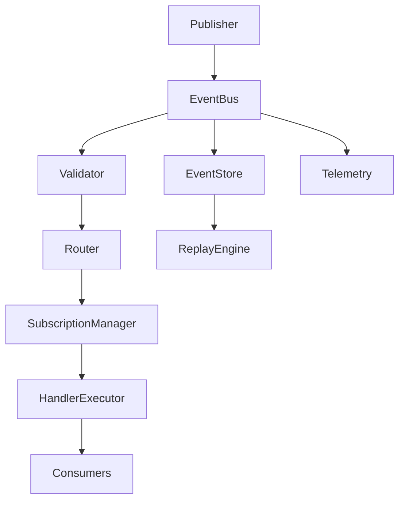

# RFC-0152

**Title:** Event Bus Architecture

**Document ID:** RFC-0152

**Version:** 1.0

**Status:** Accepted

**Category:** System Architecture

**Layer:** Cross Layer / Event Infrastructure

**Target:**

```text
architecture/event_bus/
```

---

# Abstract

This RFC defines the SH-3 Event Bus Architecture (EBA).

The Event Bus Architecture establishes the universal event-driven communication infrastructure used throughout the SH-3 AI Operating System Framework.

The Event Bus provides:

- event publishing
- event routing
- subscription management
- asynchronous processing
- event persistence
- replay capability
- distributed delivery
- execution tracing

The Event Bus is the primary communication backbone of SH-3.

All SH-3 components SHALL communicate through explicit contracts and immutable events whenever asynchronous interaction is required.

Every event operation SHALL be:

- deterministic
- typed
- observable
- traceable
- replayable
- version-aware
- thread-safe

This document is normative.

---

# Motivation

SH-3 follows the principle:

```text
Everything Event Driven
```

A complete AI Operating System requires a universal communication mechanism between:

```text
Foundation

Infrastructure

Runtime

Kernel

Services

Applications

Deployment
```

Without a unified Event Bus:

- components become tightly coupled
- system evolution becomes difficult
- distributed execution becomes inconsistent
- recovery and replay become impossible

The Event Bus provides the nervous system of SH-3.

---

# Goals

The architecture SHALL provide:

- universal event transport
- typed event delivery
- asynchronous execution
- event replay
- distributed event processing
- fault isolation
- observability integration

---

# Non-Goals

The architecture SHALL NOT:

- replace APIs
- replace direct function calls inside a component
- define business workflows
- manage persistent business data

---

# Architecture



---

# Design Principles

## Event First

State changes SHALL produce events.

---

## Immutable Events

Published events SHALL never change.

---

## Loose Coupling

Publishers SHALL not depend on consumers.

---

## Deterministic Delivery

Equivalent events SHALL produce equivalent processing behavior.

---

## Complete Traceability

Every event SHALL be traceable.

---

# Components

| Component | Responsibility |
|---|---|
| EventBusCore | Main event engine |
| EventValidator | Schema validation |
| EventRouter | Routing |
| SubscriptionManager | Subscriber management |
| HandlerExecutor | Handler execution |
| EventStore | Persistence |
| ReplayEngine | Event replay |
| EventMonitor | Observability |

---

# Event Model

Every event SHALL contain:

```text
event_id

event_type

event_version

timestamp

source

destination

trace_id

correlation_id

execution_context

payload

metadata
```

---

# Event Identity

Event identifiers SHALL use:

```text
UUIDv7
```

Requirements:

- globally unique
- sortable
- traceable

---

# Event Lifecycle

Every event SHALL follow:

```text
Created

↓

Validated

↓

Published

↓

Routed

↓

Consumed

↓

Processed

↓

Completed

or

Failed
```

---

# Publishing Model

Publishers SHALL:

1. Create event
2. Validate schema
3. Attach execution context
4. Publish to EventBus

Invalid events SHALL be rejected.

---

# Routing Model

EventRouter SHALL support:

- event type routing
- topic routing
- namespace routing
- priority routing
- capability routing

Routing SHALL remain deterministic.

---

# Subscription Model

Subscribers SHALL define:

```text
subscriber_id

event_filter

handler

priority

retry_policy

metadata
```

---

# Subscription Rules

Subscriptions SHALL support:

- dynamic registration
- removal
- version filtering
- namespace isolation
- capability filtering

---

# Handler Execution

HandlerExecutor SHALL support:

- synchronous handlers
- asynchronous handlers
- parallel execution
- retry handling
- timeout control

---

# Delivery Guarantees

SH-3 SHALL support:

## At Most Once

Use cases:

- telemetry
- notifications

---

## At Least Once

Use cases:

- state synchronization
- recovery events

---

## Exactly Once Logical Processing

Implemented through:

- event identity
- idempotent handlers
- processing history

---

# Retry Model

Failed handlers SHALL support:

```text
Retry

↓

Backoff

↓

Retry Limit

↓

Dead Letter Queue
```

---

# Dead Letter Queue

Failed events SHALL preserve:

- original event
- failure reason
- retry history
- timestamp
- handler information

---

# Event Persistence

EventStore SHALL maintain:

- event history
- processing state
- replay metadata
- consumer offsets

---

# Event Replay

ReplayEngine SHALL support:

- time-based replay
- event-type replay
- component replay
- recovery replay

Replay SHALL preserve original ordering.

---

# Distributed Event Bus

Distributed deployments SHALL support:

- node-local bus
- cluster bus
- cross-cluster federation

Event synchronization SHALL preserve:

- ordering
- identity
- trace context

---

# Ordering Guarantees

Ordering SHALL be guaranteed by:

```text
partition_key
+
sequence_number
```

---

# Security Integration

Event communication SHALL validate:

- publisher identity
- subscriber authorization
- event classification
- namespace access

---

# Observability Integration

Every event SHALL emit:

Metrics:

```text
event_count

processing_latency

failure_rate
```

Logs:

```text
event_id

event_type

trace_id
```

Traces:

```text
publisher

router

consumer
```

---

# Persistence Integration

Event persistence SHALL support:

- append-only storage
- event reconstruction
- audit history
- system replay

---

# Testing Requirements

Event Bus SHALL support:

- event contract tests
- routing tests
- replay tests
- failure tests
- concurrency tests

---

# Thread Model

The Event Bus SHALL support concurrent:

- publishing
- routing
- subscription updates
- handler execution
- persistence

Reference implementation SHALL be:

- deterministic
- thread-safe
- asynchronous
- lock-efficient

---

# Performance Metrics

The architecture exposes:

- events per second
- routing latency
- handler latency
- queue depth
- retry count
- replay throughput

---

# Performance Objectives

The architecture should optimize for:

- low latency
- high throughput
- reliable delivery
- scalable subscribers
- minimal coupling

---

# Future Work

Potential enhancements:

- distributed consensus event ordering
- AI-based event optimization
- adaptive routing
- automatic subscriber scaling
- event compression
- event federation

---

# References

- RFC-0151 Data Contract Architecture
- RFC-0150 Cross Layer Architecture
- RFC-0146 Health Monitoring Architecture
- RFC-0147 Recovery Architecture
- RFC-0118 Observability Architecture

---

# End of RFC-0152