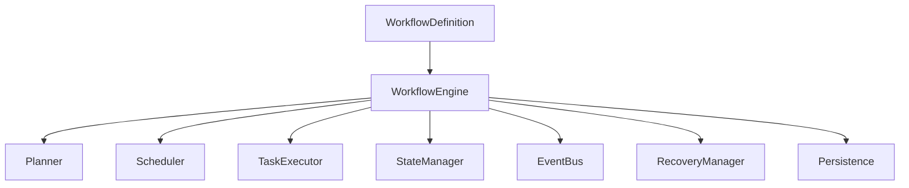

# RFC-0153

**Title:** Workflow Architecture

**Document ID:** RFC-0153

**Version:** 1.0

**Status:** Accepted

**Category:** System Architecture

**Layer:** Cross Layer / Workflow

**Target:**

```text
architecture/workflow/
```

---

# Abstract

This RFC defines the SH-3 Workflow Architecture (WA).

The Workflow Architecture establishes the universal execution framework for representing, scheduling, executing, monitoring, recovering, and optimizing multi-step processes across the SH-3 AI Operating System Framework.

A Workflow represents a deterministic sequence or graph of operations executed across Runtime, Kernel, Services, Applications, and Deployment components.

The Workflow Architecture provides:

- workflow definition
- task orchestration
- dependency management
- state transitions
- execution control
- persistence
- recovery
- replay

Every workflow operation SHALL be:

- deterministic
- event-driven
- strongly typed
- observable
- recoverable
- version-aware
- auditable

This document is normative.

---

# Motivation

SH-3 requires a unified mechanism for complex execution.

Examples:

```text
Goal

↓

Planning

↓

Execution

↓

Validation

↓

Learning

↓

Optimization
```

or:

```text
Deployment

↓

Package Installation

↓

Configuration Update

↓

Health Verification

↓

Activation
```

Without a workflow architecture:

- execution logic becomes fragmented
- recovery becomes difficult
- state management becomes inconsistent
- long-running processes become unreliable

The Workflow Architecture provides a universal execution model.

---

# Goals

The architecture SHALL provide:

- workflow modeling
- task orchestration
- dependency resolution
- state management
- execution tracking
- recovery support
- event integration

---

# Non-Goals

The architecture SHALL NOT:

- replace Runtime execution
- replace Scheduler architecture
- define business-specific workflows
- replace Application logic

---

# Architecture



---

# Design Principles

## Everything Is A Workflow

Complex operations SHALL be represented as workflows.

---

## Event Driven Execution

Workflow state changes SHALL generate events.

---

## Deterministic State

Equivalent workflow inputs SHALL produce equivalent execution states.

---

## Persistent Execution

Long-running workflows SHALL survive restart and failure.

---

## Recoverable Execution

Every workflow SHALL define recovery behavior.

---

# Components

| Component | Responsibility |
|---|---|
| WorkflowEngine | Workflow orchestration |
| WorkflowRegistry | Workflow catalog |
| Planner | Workflow generation |
| Scheduler | Task scheduling |
| TaskExecutor | Task execution |
| StateManager | State tracking |
| DependencyResolver | Dependency analysis |
| RecoveryController | Recovery handling |

---

# Workflow Model

Every workflow SHALL define:

```text
workflow_id

workflow_name

workflow_version

definition

tasks

dependencies

state

metadata
```

---

# Workflow Types

Supported workflow types:

```text
Sequential Workflow

Parallel Workflow

DAG Workflow

Reactive Workflow

Event Workflow

Recovery Workflow

Optimization Workflow
```

---

# Workflow Definition

A workflow SHALL contain:

```text
Tasks

Dependencies

Conditions

Transitions

Policies

Timeouts

Recovery Rules
```

---

# Task Model

Every task SHALL define:

```text
task_id

task_type

executor

inputs

outputs

dependencies

timeout

retry_policy

metadata
```

---

# Task Lifecycle

Every task SHALL follow:

```text
Created

↓

Ready

↓

Scheduled

↓

Running

↓

Completed

or

Failed

or

Cancelled
```

---

# Workflow Lifecycle

Every workflow SHALL follow:

```text
Created

↓

Validated

↓

Scheduled

↓

Running

↓

Suspended

↓

Completed

or

Failed

or

Recovered
```

---

# Dependency Resolution

DependencyResolver SHALL support:

- task dependencies
- service dependencies
- capability dependencies
- resource dependencies

Dependency graphs SHALL remain acyclic unless explicitly supported.

---

# Execution Model

WorkflowEngine SHALL support:

- sequential execution
- parallel execution
- distributed execution
- asynchronous execution
- event-triggered execution

---

# Scheduling

Scheduler SHALL consider:

- priority
- resource availability
- dependencies
- policies
- deadlines

Scheduling decisions SHALL remain deterministic.

---

# State Management

StateManager SHALL maintain:

- workflow state
- task state
- execution context
- checkpoints
- history

State changes SHALL emit events.

---

# Persistence

Workflow persistence SHALL store:

- definitions
- executions
- states
- checkpoints
- results
- failures

Persistent workflow state SHALL support restoration.

---

# Recovery

Workflow recovery SHALL support:

- retry failed tasks
- restore checkpoints
- skip completed tasks
- restart workflow
- rollback execution

---

# Event Integration

Workflow events include:

```text
WorkflowCreated

WorkflowStarted

TaskScheduled

TaskStarted

TaskCompleted

TaskFailed

WorkflowCompleted

WorkflowFailed

WorkflowRecovered
```

Events SHALL follow RFC-0152.

---

# Cognitive Layer Integration

Workflow Architecture SHALL support:

- Planner generated workflows
- Goal driven workflows
- Reasoning workflows
- Learning workflows
- Optimization workflows

---

# Runtime Integration

Runtime SHALL provide:

- execution environment
- resource control
- task isolation
- execution monitoring

---

# Security Integration

Every workflow SHALL validate:

- identity
- permissions
- resource authorization
- policy compliance

---

# Observability Integration

Workflow telemetry SHALL expose:

Metrics:

```text
workflow_duration

task_duration

failure_rate

retry_count
```

Logs:

```text
workflow_id

task_id

execution_state
```

Traces:

```text
workflow_trace
```

---

# Testing Requirements

Workflow Engine SHALL support:

- workflow validation tests
- deterministic replay
- failure simulation
- recovery testing
- concurrency testing

---

# Thread Model

Workflow execution SHALL support concurrent:

- workflow scheduling
- task execution
- state updates
- event processing
- persistence

Reference implementation SHALL be:

- deterministic
- thread-safe
- asynchronous
- event-driven

---

# Performance Metrics

The architecture exposes:

- workflow throughput
- task throughput
- scheduling latency
- execution latency
- recovery latency

---

# Performance Objectives

The architecture should optimize for:

- scalable execution
- reliable long-running workflows
- deterministic scheduling
- efficient recovery
- minimal coordination overhead

---

# Future Work

Potential enhancements:

- AI-generated workflows
- self-optimizing workflows
- adaptive scheduling
- distributed workflow federation
- autonomous workflow repair

---

# References

- RFC-0152 Event Bus Architecture
- RFC-0151 Data Contract Architecture
- RFC-0150 Cross Layer Architecture
- RFC-0147 Recovery Architecture
- RFC-0103 Runtime Execution Architecture

---

# End of RFC-0153