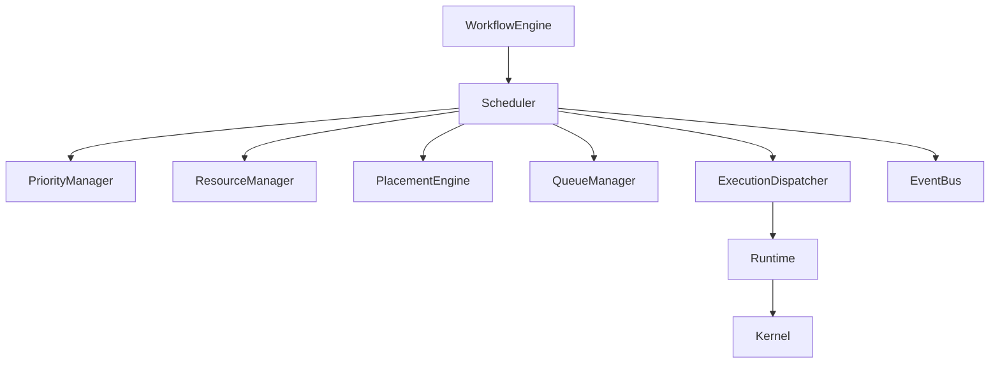

# RFC-0154

**Title:** Scheduler Architecture

**Document ID:** RFC-0154

**Version:** 1.0

**Status:** Accepted

**Category:** System Architecture

**Layer:** Cross Layer / Execution Scheduling

**Target:**

```text
architecture/scheduler/
```

---

# Abstract

This RFC defines the SH-3 Scheduler Architecture (SA).

The Scheduler Architecture establishes the universal scheduling framework responsible for allocating execution opportunities, prioritizing workloads, managing resources, coordinating distributed execution, and optimizing task placement across the SH-3 AI Operating System Framework.

The Scheduler operates between:

```text
Workflow Layer

↓

Runtime Layer

↓

Kernel Execution Layer

↓

Infrastructure Resources
```

The Scheduler provides:

- task scheduling
- workflow scheduling
- resource scheduling
- priority management
- distributed scheduling
- execution balancing
- policy-aware placement

Every scheduling decision SHALL be:

- deterministic
- observable
- policy-compliant
- reproducible
- version-aware
- fault-tolerant

This document is normative.

---

# Motivation

SH-3 executes complex autonomous workloads.

Examples:

```text
Planning

↓

Reasoning

↓

Tool Execution

↓

Learning

↓

Optimization
```

and:

```text
Deployment Workflow

↓

Task Scheduling

↓

Runtime Execution

↓

Health Validation
```

Without a unified Scheduler:

- execution priorities conflict
- resources are inefficiently used
- distributed execution becomes unstable
- workload management becomes fragmented

The Scheduler Architecture provides a universal execution coordination layer.

---

# Goals

The architecture SHALL provide:

- deterministic scheduling
- priority control
- resource awareness
- distributed coordination
- workload balancing
- policy integration
- execution observability

---

# Non-Goals

The architecture SHALL NOT:

- replace Runtime execution
- replace Workflow definition
- replace Kernel resource management
- define application business logic

---

# Architecture



---

# Design Principles

## Deterministic Scheduling

Equivalent inputs SHALL produce equivalent scheduling decisions.

---

## Resource Awareness

Scheduling SHALL consider available resources.

---

## Fair Execution

No workload SHALL permanently block other workloads.

---

## Policy Driven

Scheduling SHALL respect governance and security policies.

---

## Observable Decisions

Every scheduling decision SHALL be traceable.

---

# Components

| Component | Responsibility |
|---|---|
| SchedulerCore | Scheduling engine |
| QueueManager | Work queue management |
| PriorityManager | Priority evaluation |
| ResourceManager | Resource awareness |
| PlacementEngine | Execution placement |
| ExecutionDispatcher | Runtime dispatch |
| SchedulerMonitor | Scheduling telemetry |

---

# Scheduling Model

Every scheduling request SHALL contain:

```text
schedule_id

task_id

workflow_id

priority

requirements

constraints

deadline

context

metadata
```

---

# Scheduling Types

Supported scheduling modes:

```text
Task Scheduling

Workflow Scheduling

Resource Scheduling

Event Scheduling

Recovery Scheduling

Optimization Scheduling
```

---

# Priority Model

Priority SHALL consider:

```text
User Priority

↓

System Priority

↓

Security Priority

↓

Recovery Priority

↓

Optimization Priority
```

---

# Priority Levels

Default levels:

```text
CRITICAL

HIGH

NORMAL

LOW

BACKGROUND
```

Priority resolution SHALL be deterministic.

---

# Queue Management

QueueManager SHALL support:

- priority queues
- delayed queues
- retry queues
- recovery queues
- distributed queues

---

# Resource Model

ResourceManager SHALL track:

```text
CPU

Memory

Storage

Network

Accelerator

Capability
```

---

# Resource Allocation

Resource allocation SHALL consider:

- availability
- workload
- policy
- capability
- locality

---

# Placement Engine

PlacementEngine SHALL determine:

- execution node
- runtime instance
- service instance
- resource allocation

Placement SHALL remain reproducible.

---

# Distributed Scheduling

Distributed environments SHALL support:

- cluster scheduling
- node scheduling
- workload migration
- scheduling synchronization

---

# Scheduling Algorithm

The reference implementation SHALL support:

```text
Priority Based Scheduling

+

Resource Aware Scheduling

+

Policy Based Scheduling
```

---

# Fair Scheduling

Fair scheduling SHALL prevent:

- starvation
- resource monopolization
- priority abuse

---

# Runtime Integration

Scheduler SHALL provide Runtime:

- executable tasks
- execution context
- resource allocation
- timeout information

---

# Kernel Integration

Kernel SHALL provide:

- low-level resource state
- process state
- execution capabilities

---

# Workflow Integration

WorkflowEngine SHALL provide:

- task dependencies
- execution constraints
- workflow priority

---

# Recovery Scheduling

Recovery tasks SHALL receive elevated scheduling priority.

Examples:

```text
Health Failure

↓

Recovery Workflow

↓

Critical Scheduling
```

---

# Event Integration

Scheduler events include:

```text
SchedulingRequested

TaskQueued

TaskScheduled

TaskDispatched

TaskStarted

TaskCompleted

TaskFailed

SchedulingRejected
```

Events SHALL follow RFC-0152.

---

# Persistence

Scheduler SHALL persist:

- scheduling decisions
- queue state
- execution history
- placement history
- performance data

---

# Security Integration

Scheduling SHALL validate:

- execution permission
- resource permission
- namespace policy
- workload isolation

---

# Observability

Scheduler telemetry SHALL expose:

Metrics:

```text
queue_length

scheduling_latency

dispatch_latency

resource_utilization

task_wait_time
```

Logs:

```text
schedule_id

task_id

decision
```

Traces:

```text
workflow

scheduler

runtime
```

---

# Testing Requirements

Scheduler SHALL support:

- deterministic scheduling tests
- load tests
- fairness tests
- failure simulation
- distributed tests

---

# Thread Model

Scheduler SHALL support concurrent:

- scheduling requests
- queue operations
- resource updates
- dispatch operations

Reference implementation SHALL be:

- deterministic
- thread-safe
- asynchronous
- lock-efficient

---

# Performance Metrics

The architecture exposes:

- scheduling throughput
- queue latency
- dispatch latency
- resource efficiency
- scheduling accuracy

---

# Performance Objectives

The architecture should optimize for:

- low scheduling latency
- efficient resource usage
- scalable execution
- predictable behavior
- autonomous operation

---

# Future Work

Potential enhancements:

- AI-based scheduling
- predictive workload placement
- reinforcement learning scheduler
- global optimization scheduling
- self-tuning scheduling policies

---

# References

- RFC-0153 Workflow Architecture
- RFC-0152 Event Bus Architecture
- RFC-0151 Data Contract Architecture
- RFC-0103 Runtime Execution Architecture
- RFC-0117 Kernel Service Registry Architecture

---

# End of RFC-0154