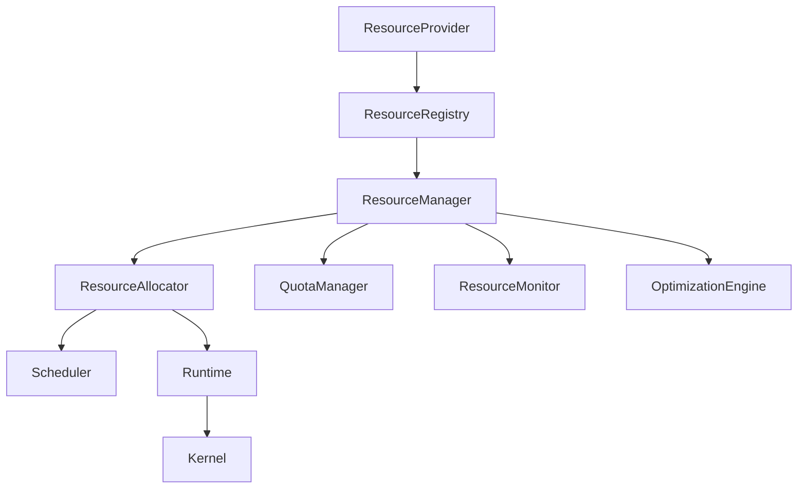

# RFC-0155

**Title:** Resource Management Architecture

**Document ID:** RFC-0155

**Version:** 1.0

**Status:** Accepted

**Category:** System Architecture

**Layer:** Cross Layer / Resource Management

**Target:**

```text
architecture/resource_management/
```

---

# Abstract

This RFC defines the SH-3 Resource Management Architecture (RMA).

The Resource Management Architecture establishes the universal framework responsible for discovering, modeling, allocating, monitoring, optimizing, and releasing computational resources across the SH-3 AI Operating System Framework.

Resources include:

- CPU
- Memory
- Storage
- Network
- Accelerator
- Runtime Capacity
- Service Capability
- External Tools

The Resource Management Architecture provides a unified resource control plane connecting:

```text
Infrastructure

↓

Runtime

↓

Kernel

↓

Scheduler

↓

Workflow

↓

Application
```

Every resource operation SHALL be:

- deterministic
- observable
- policy-controlled
- version-aware
- auditable
- thread-safe

This document is normative.

---

# Motivation

SH-3 operates as an autonomous AI Operating System.

AI workloads require dynamic resource management.

Examples:

```text
Reasoning Task

↓

Model Execution

↓

Tool Invocation

↓

Learning Process

↓

Optimization
```

or:

```text
Workflow

↓

Scheduler

↓

Resource Allocation

↓

Runtime Execution
```

Without a unified resource architecture:

- resource conflicts occur
- workloads become unstable
- optimization becomes difficult
- scaling becomes inefficient

The Resource Management Architecture provides a universal resource abstraction.

---

# Goals

The architecture SHALL provide:

- resource discovery
- resource registration
- resource allocation
- resource isolation
- quota control
- utilization monitoring
- dynamic optimization

---

# Non-Goals

The architecture SHALL NOT:

- replace Kernel resource drivers
- replace Infrastructure providers
- define hardware-specific implementations
- manage application business logic

---

# Architecture



---

# Design Principles

## Resource Abstraction

All resources SHALL be represented through common contracts.

---

## Dynamic Allocation

Resources SHALL be allocated based on current system state.

---

## Isolation

Resource usage SHALL respect boundaries.

---

## Optimization

Unused resources SHOULD be reclaimed.

---

## Deterministic Allocation

Equivalent resource requests SHALL produce equivalent allocations.

---

# Components

| Component | Responsibility |
|---|---|
| ResourceManager | Resource orchestration |
| ResourceRegistry | Resource catalog |
| ResourceAllocator | Allocation engine |
| ResourceMonitor | Utilization tracking |
| QuotaManager | Resource limits |
| CapabilityManager | Capability tracking |
| OptimizationEngine | Resource optimization |

---

# Resource Model

Every resource SHALL define:

```text
resource_id

resource_type

capacity

availability

location

capabilities

version

metadata
```

---

# Resource Types

Supported types:

```text
ComputeResource

MemoryResource

StorageResource

NetworkResource

AcceleratorResource

ServiceResource

ToolResource
```

---

# Resource Registry

ResourceRegistry SHALL maintain:

- available resources
- resource metadata
- capability information
- allocation state
- health status

---

# Resource Discovery

Resource discovery SHALL support:

- automatic registration
- capability discovery
- dynamic updates
- topology awareness

---

# Resource Allocation Model

Allocation requests SHALL contain:

```text
allocation_id

requester

resource_type

requirements

constraints

duration

priority

context
```

---

# Allocation Lifecycle

Every allocation SHALL follow:

```text
Requested

↓

Validated

↓

Reserved

↓

Allocated

↓

Consumed

↓

Released
```

---

# Allocation Strategies

Supported strategies:

```text
Best Fit

Priority Based

Capability Based

Locality Based

Load Balanced

Policy Based
```

---

# Resource Isolation

Resource isolation SHALL support:

- workload isolation
- namespace isolation
- tenant isolation
- security isolation

---

# Quota Management

QuotaManager SHALL control:

- CPU limits
- memory limits
- storage limits
- execution limits
- API limits

---

# Capability Management

CapabilityManager SHALL track:

```text
GPU Support

Model Support

Tool Availability

Execution Capability

Service Capability
```

---

# Resource Monitoring

ResourceMonitor SHALL collect:

Metrics:

```text
usage

capacity

availability

latency

pressure
```

---

# Dynamic Scaling

Resource Management SHALL support:

- scale up
- scale down
- resource migration
- workload balancing

---

# Scheduler Integration

Scheduler SHALL request resources through:

```text
ResourceManager

↓

ResourceAllocator

↓

Runtime
```

Resource decisions SHALL be observable.

---

# Runtime Integration

Runtime SHALL receive:

- allocated resources
- execution limits
- capabilities
- isolation context

---

# Kernel Integration

Kernel SHALL provide:

- hardware state
- process resources
- low-level allocation information

---

# Optimization Engine

OptimizationEngine SHALL analyze:

- resource utilization
- workload patterns
- bottlenecks
- allocation efficiency

Optimization SHALL remain policy-controlled.

---

# Event Integration

Resource events include:

```text
ResourceRegistered

ResourceUpdated

AllocationRequested

ResourceAllocated

ResourceReleased

QuotaExceeded

ResourceOptimized
```

Events SHALL follow RFC-0152.

---

# Persistence

Resource Management SHALL persist:

- resource inventory
- allocation history
- utilization history
- quota history
- optimization history

---

# Security Integration

Resource operations SHALL validate:

- requester identity
- allocation permission
- namespace policy
- isolation policy

---

# Observability

Resource telemetry SHALL expose:

Metrics:

```text
resource_usage

allocation_latency

allocation_failure_rate

capacity_available

optimization_gain
```

Logs:

```text
resource_id

allocation_id

decision
```

Traces:

```text
request

allocation

execution
```

---

# Testing Requirements

Resource Management SHALL support:

- allocation tests
- isolation tests
- scaling tests
- failure tests
- concurrency tests

---

# Thread Model

Resource Management SHALL support concurrent:

- resource registration
- allocation requests
- monitoring
- optimization
- release operations

Reference implementation SHALL be:

- deterministic
- thread-safe
- asynchronous
- lock-efficient

---

# Performance Metrics

The architecture exposes:

- allocation throughput
- resource utilization
- scheduling efficiency
- scaling latency
- optimization efficiency

---

# Performance Objectives

The architecture should optimize for:

- efficient utilization
- predictable allocation
- low overhead
- scalable resource control
- autonomous optimization

---

# Future Work

Potential enhancements:

- AI resource prediction
- autonomous capacity planning
- reinforcement learning allocation
- distributed resource federation
- self-optimizing infrastructure

---

# References

- RFC-0154 Scheduler Architecture
- RFC-0153 Workflow Architecture
- RFC-0152 Event Bus Architecture
- RFC-0142 Node Architecture
- RFC-0103 Runtime Execution Architecture

---

# End of RFC-0155