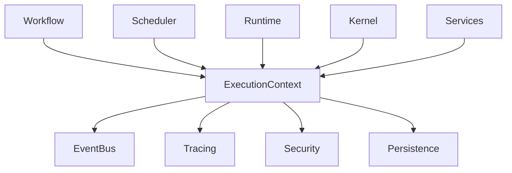

# RFC-0156

**Title:** Runtime Execution Context Architecture

**Document ID:** RFC-0156

**Version:** 1.0

**Status:** Accepted

**Category:** System Architecture

**Layer:** Runtime / Cross Layer

**Target:**

```text
architecture/runtime_context/
```

---

# Abstract

This RFC defines the SH-3 Runtime Execution Context Architecture (RECA).

The Runtime Execution Context Architecture establishes the universal context propagation framework used during execution across SH-3 components.

Execution Context provides a consistent mechanism for carrying:

- identity
- execution state
- tracing information
- security information
- resource information
- workflow information
- cognitive state
- lifecycle state

across:

```text
Workflow

↓

Scheduler

↓

Runtime

↓

Kernel

↓

Service

↓

Application

↓

Deployment
```

Every execution context operation SHALL be:

- immutable
- strongly typed
- deterministic
- traceable
- serializable
- thread-safe
- version-aware

This document is normative.

---

# Motivation

SH-3 executes distributed autonomous processes.

A single operation may pass through:

```text
Goal

↓

Planner

↓

Workflow

↓

Scheduler

↓

Runtime

↓

Kernel

↓

Tool

↓

Learning
```

Without a unified execution context:

- identity is lost
- tracing becomes incomplete
- authorization becomes inconsistent
- recovery becomes difficult
- distributed execution becomes unreliable

Execution Context provides the universal execution envelope.

---

# Goals

The architecture SHALL provide:

- context creation
- context propagation
- context inheritance
- context isolation
- context serialization
- context restoration
- distributed tracing support

---

# Non-Goals

The architecture SHALL NOT:

- execute tasks
- manage resources directly
- replace workflow state
- replace persistent storage

---

# Architecture



---

# Design Principles

## Context Everywhere

Every execution operation SHALL have a context.

---

## Immutable Context

Execution Context SHALL never be modified after creation.

---

## Explicit Propagation

Context propagation SHALL be explicit.

---

## Complete Traceability

Every action SHALL be reconstructable.

---

## Isolation

Independent executions SHALL maintain isolated contexts.

---

# Components

| Component | Responsibility |
|---|---|
| ContextManager | Context lifecycle |
| ContextFactory | Context creation |
| ContextPropagator | Context transfer |
| ContextValidator | Validation |
| ContextSerializer | Serialization |
| ContextRepository | Persistence |

---

# Execution Context Model

Every context SHALL contain:

```text
context_id

trace_id

correlation_id

parent_context_id

execution_id

workflow_id

task_id

security_identity

resource_context

runtime_context

metadata
```

---

# Context Identity

Context identifiers SHALL use:

```text
UUIDv7
```

Requirements:

- globally unique
- sortable
- traceable

---

# Context Types

Supported contexts:

```text
SystemContext

WorkflowContext

TaskContext

AgentContext

SessionContext

RequestContext

RecoveryContext
```

---

# System Context

Represents:

- platform execution
- deployment execution
- autonomous operations

Contains:

```text
system_id

cluster_id

node_id

environment
```

---

# Workflow Context

Represents:

- workflow execution state
- task relationships
- workflow metadata

Contains:

```text
workflow_id

workflow_version

workflow_state
```

---

# Task Context

Represents:

- individual execution unit

Contains:

```text
task_id

task_type

executor

inputs

outputs
```

---

# Agent Context

Represents AI agent execution.

Contains:

```text
agent_id

goal

memory_reference

reasoning_state

capability_context
```

---

# Session Context

Represents user or system sessions.

Contains:

```text
session_id

identity

permissions

preferences
```

---

# Context Lifecycle

Every context SHALL follow:

```text
Created

↓

Validated

↓

Propagated

↓

Active

↓

Completed

or

Cancelled

or

Expired
```

---

# Context Propagation

Context SHALL propagate through:

```text
API

↓

EventBus

↓

Workflow

↓

Scheduler

↓

Runtime

↓

Kernel
```

---

# Context Inheritance

Child contexts SHALL inherit:

- trace information
- security identity
- policy constraints
- metadata

Child contexts SHALL NOT inherit mutable execution state.

---

# Context Isolation

The system SHALL prevent:

- cross-task leakage
- identity mixing
- security boundary violation
- state corruption

---

# Serialization

Context serialization SHALL support:

```text
JSON

MessagePack

Protocol Buffers
```

Serialization SHALL preserve:

- identifiers
- versions
- metadata
- tracing

---

# Distributed Context

Distributed execution SHALL support:

- context transfer
- context recovery
- context synchronization
- context reconstruction

---

# Security Integration

Execution Context SHALL carry:

```text
identity

permissions

roles

capabilities

security_level
```

Every component SHALL validate context authority.

---

# Resource Integration

Resource Context SHALL include:

```text
allocated_resources

resource_limits

capabilities

quota
```

---

# Event Integration

Execution events SHALL include:

```text
context_id

trace_id

correlation_id
```

Examples:

```text
ExecutionStarted

ExecutionCompleted

ExecutionFailed

ContextCreated

ContextExpired
```

---

# Persistence

ContextRepository SHALL maintain:

- active contexts
- completed contexts
- recovery checkpoints
- execution history

---

# Observability

Context telemetry SHALL expose:

Metrics:

```text
context_count

propagation_latency

serialization_latency
```

Logs:

```text
context_id

trace_id

execution_id
```

Traces:

```text
parent_context

child_context
```

---

# Testing Requirements

Execution Context SHALL support:

- propagation tests
- serialization tests
- isolation tests
- recovery tests
- concurrency tests

---

# Thread Model

Context management SHALL support concurrent:

- creation
- propagation
- validation
- serialization
- restoration

Reference implementation SHALL be:

- deterministic
- immutable
- thread-safe
- lock-efficient

---

# Performance Metrics

The architecture exposes:

- context creation latency
- propagation latency
- serialization overhead
- restoration latency

---

# Performance Objectives

The architecture should optimize for:

- minimal propagation overhead
- reliable tracing
- secure execution
- distributed consistency

---

# Future Work

Potential enhancements:

- AI-aware context compression
- predictive context management
- distributed context federation
- automatic context optimization

---

# References

- RFC-0155 Resource Management Architecture
- RFC-0154 Scheduler Architecture
- RFC-0153 Workflow Architecture
- RFC-0152 Event Bus Architecture
- RFC-0150 Cross Layer Architecture

---

# End of RFC-0156