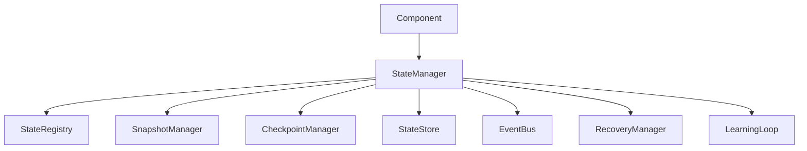

# RFC-0157

**Title:** State Management Architecture

**Document ID:** RFC-0157

**Version:** 1.0

**Status:** Accepted

**Category:** System Architecture

**Layer:** Cross Layer / State Management

**Target:**

```text
architecture/state_management/
```

---

# Abstract

This RFC defines the SH-3 State Management Architecture (SMA).

The State Management Architecture establishes the universal framework responsible for representing, storing, tracking, restoring, synchronizing, and evolving system state across the SH-3 AI Operating System Framework.

State represents the complete operational knowledge required to understand and continue execution.

The State Management Architecture manages:

- Runtime State
- Workflow State
- Task State
- Agent State
- Cognitive State
- Kernel State
- Deployment State
- Persistent State

Every state operation SHALL be:

- deterministic
- version-aware
- observable
- recoverable
- auditable
- thread-safe
- event-driven

This document is normative.

---

# Motivation

SH-3 is an autonomous AI Operating System.

Autonomous systems require continuous state awareness.

Examples:

```text
Goal

↓

Planning State

↓

Execution State

↓

Learning State

↓

Optimization State
```

and:

```text
Failure

↓

Checkpoint

↓

Recovery

↓

State Restoration
```

Without unified state management:

- execution cannot resume safely
- recovery becomes unreliable
- learning history is lost
- distributed consistency decreases

The State Management Architecture provides the system memory foundation.

---

# Goals

The architecture SHALL provide:

- unified state representation
- state persistence
- checkpoint management
- state restoration
- state synchronization
- event-based state evolution

---

# Non-Goals

The architecture SHALL NOT:

- replace Memory Architecture
- replace databases
- define application-specific state
- execute workflows

---

# Architecture



---

# Design Principles

## State Is Data

All operational state SHALL be explicitly represented.

---

## State Is Versioned

Every state change SHALL have a version.

---

## State Is Recoverable

Valid states SHALL be restorable.

---

## State Is Observable

State transitions SHALL be visible.

---

## State Is Event Driven

State changes SHALL produce events.

---

# Components

| Component | Responsibility |
|---|---|
| StateManager | State orchestration |
| StateRegistry | State catalog |
| StateStore | Persistence |
| SnapshotManager | Snapshot creation |
| CheckpointManager | Recovery points |
| StateValidator | State validation |
| StateSynchronizer | Distributed sync |

---

# State Model

Every state object SHALL contain:

```text
state_id

state_type

state_version

owner

timestamp

status

data

metadata
```

---

# State Types

Supported state categories:

```text
SystemState

RuntimeState

WorkflowState

TaskState

AgentState

CognitiveState

KernelState

DeploymentState

LearningState
```

---

# Runtime State

Runtime State represents:

```text
execution environment

active tasks

loaded resources

running processes

execution context
```

---

# Workflow State

Workflow State represents:

```text
workflow progress

task status

dependencies

execution history

results
```

---

# Task State

Task State represents:

```text
task lifecycle

input state

output state

execution result

failure information
```

---

# Agent State

Agent State represents:

```text
agent identity

goal state

reasoning state

memory references

capabilities
```

---

# Cognitive State

Cognitive State represents:

```text
planning status

decision history

belief state

learning context
```

---

# State Lifecycle

Every state SHALL follow:

```text
Created

↓

Initialized

↓

Active

↓

Updated

↓

Checkpointed

↓

Archived
```

---

# State Update Model

State changes SHALL follow:

```text
Current State

↓

State Mutation Request

↓

Validation

↓

New State Version

↓

Event Publication
```

---

# State Versioning

Version format:

```text
Major.Minor.Patch
```

---

# Snapshot Model

SnapshotManager SHALL support:

- full snapshot
- incremental snapshot
- differential snapshot

Snapshots SHALL preserve:

- state version
- timestamp
- dependencies
- metadata

---

# Checkpoint Model

CheckpointManager SHALL create recovery points.

Checkpoint SHALL include:

```text
checkpoint_id

state_reference

timestamp

execution_context

metadata
```

---

# Recovery Integration

RecoveryManager SHALL use:

```text
Failure Detection

↓

Checkpoint Lookup

↓

State Restore

↓

Execution Resume
```

---

# Event Sourcing Integration

State evolution SHALL support:

```text
Event History

↓

State Reconstruction

↓

Current State
```

The system SHALL be capable of rebuilding state from events.

---

# Distributed State

Distributed environments SHALL support:

- state replication
- synchronization
- conflict detection
- consistency validation

---

# Consistency Model

SH-3 SHALL support:

```text
Strong Consistency

Eventual Consistency

Version Based Consistency
```

Selection SHALL depend on state type.

---

# State Synchronization

StateSynchronizer SHALL handle:

- replication
- conflict resolution
- version comparison
- synchronization events

---

# Persistence Integration

StateStore SHALL support:

- persistent storage
- state history
- snapshots
- checkpoints
- migrations

---

# Security Integration

State access SHALL validate:

- identity
- ownership
- permission
- classification

Sensitive state SHALL be protected.

---

# Event Integration

State events include:

```text
StateCreated

StateUpdated

StateCheckpointed

StateRestored

StateSynchronized

StateArchived
```

Events SHALL follow RFC-0152.

---

# Learning Loop Integration

LearningLoop SHALL consume:

- state history
- execution outcomes
- optimization results

to improve future behavior.

---

# Observability

State telemetry SHALL expose:

Metrics:

```text
state_count

update_frequency

snapshot_latency

restore_latency
```

Logs:

```text
state_id

version

transition
```

Traces:

```text
state_change_flow
```

---

# Testing Requirements

State Management SHALL support:

- state transition tests
- snapshot tests
- recovery tests
- synchronization tests
- concurrency tests

---

# Thread Model

State Management SHALL support concurrent:

- reads
- updates
- snapshots
- synchronization
- restoration

Reference implementation SHALL be:

- deterministic
- thread-safe
- immutable where possible
- event-driven

---

# Performance Metrics

The architecture exposes:

- state update latency
- snapshot creation time
- restore time
- synchronization delay
- storage efficiency

---

# Performance Objectives

The architecture should optimize for:

- reliable recovery
- efficient persistence
- scalable synchronization
- minimal state overhead

---

# Future Work

Potential enhancements:

- AI-driven state compression
- predictive checkpointing
- autonomous state optimization
- distributed state intelligence
- semantic state indexing

---

# References

- RFC-0156 Runtime Execution Context Architecture
- RFC-0155 Resource Management Architecture
- RFC-0153 Workflow Architecture
- RFC-0152 Event Bus Architecture
- RFC-0147 Recovery Architecture

---

# End of RFC-0157