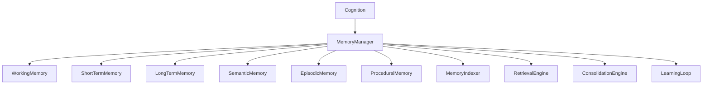

# RFC-0158

**Title:** Memory Architecture

**Document ID:** RFC-0158

**Version:** 1.0

**Status:** Accepted

**Category:** System Architecture

**Layer:** Services / Cognition / Cross Layer

**Target:**

```text
architecture/memory/
```

---

# Abstract

This RFC defines the SH-3 Memory Architecture (MA).

The Memory Architecture establishes the universal cognitive memory framework responsible for storing, organizing, retrieving, consolidating, and optimizing information used by SH-3 autonomous intelligence systems.

Memory provides persistent knowledge continuity across:

```text
Cognition

↓

Planning

↓

Execution

↓

Learning

↓

Optimization
```

The Memory Architecture manages:

- Working Memory
- Short-Term Memory
- Long-Term Memory
- Semantic Memory
- Episodic Memory
- Procedural Memory
- Experience Memory

Every memory operation SHALL be:

- typed
- indexed
- versioned
- observable
- secure
- deterministic
- recoverable

This document is normative.

---

# Motivation

Autonomous AI systems require continuity.

A system without memory cannot:

- maintain context
- learn from experience
- improve decisions
- preserve knowledge
- recover previous understanding

SH-3 requires memory as a core cognitive subsystem.

Memory enables:

```text
Observe

↓

Remember

↓

Reason

↓

Act

↓

Learn

↓

Improve
```

---

# Goals

The architecture SHALL provide:

- unified memory model
- memory storage
- memory retrieval
- semantic indexing
- memory consolidation
- relevance ranking
- lifecycle management

---

# Non-Goals

The architecture SHALL NOT:

- replace general databases
- replace State Management
- define model training systems
- store unnecessary temporary data

---

# Architecture



---

# Design Principles

## Memory Is Structured Knowledge

Memory SHALL not be an unstructured data dump.

---

## Memory Is Context Aware

Retrieval SHALL consider execution context.

---

## Memory Is Evolvable

Memory structures SHALL support migration.

---

## Memory Is Selective

Only valuable information SHALL be preserved.

---

## Memory Supports Learning

Experience SHALL improve future behavior.

---

# Components

| Component | Responsibility |
|---|---|
| MemoryManager | Memory orchestration |
| WorkingMemory | Active reasoning context |
| ShortTermMemory | Temporary retention |
| LongTermMemory | Persistent knowledge |
| SemanticMemory | Concept knowledge |
| EpisodicMemory | Experience history |
| ProceduralMemory | Skill knowledge |
| MemoryIndexer | Search indexing |
| RetrievalEngine | Memory retrieval |
| ConsolidationEngine | Memory optimization |

---

# Memory Model

Every memory item SHALL contain:

```text
memory_id

memory_type

content

embedding

context

importance

timestamp

source

version

metadata
```

---

# Memory Types

## Working Memory

Purpose:

```text
Current reasoning context
```

Characteristics:

- high speed
- temporary
- execution scoped

Examples:

```text
current goal

active plan

current task
```

---

# Short-Term Memory

Purpose:

```text
Recent information retention
```

Characteristics:

- limited lifetime
- session based
- frequently updated

Examples:

```text
recent events

recent observations

recent decisions
```

---

# Long-Term Memory

Purpose:

```text
Persistent knowledge storage
```

Characteristics:

- durable
- indexed
- recoverable

Examples:

```text
facts

experiences

learned patterns
```

---

# Semantic Memory

Stores:

```text
concepts

relationships

definitions

knowledge graphs
```

Used by:

- reasoning
- planning
- retrieval

---

# Episodic Memory

Stores:

```text
events

experiences

executions

outcomes
```

Structure:

```text
Situation

↓

Action

↓

Result

↓

Evaluation
```

---

# Procedural Memory

Stores:

```text
skills

strategies

workflows

successful behaviors
```

---

# Memory Lifecycle

Every memory item SHALL follow:

```text
Created

↓

Indexed

↓

Retrieved

↓

Updated

↓

Consolidated

↓

Archived
```

---

# Memory Storage

Memory Storage SHALL support:

- structured storage
- vector indexing
- metadata indexing
- version tracking

---

# Memory Indexing

MemoryIndexer SHALL support:

- keyword indexing
- semantic indexing
- vector indexing
- relationship indexing

---

# Retrieval Model

RetrievalEngine SHALL evaluate:

```text
Relevance

+

Context

+

Recency

+

Importance

+

Similarity
```

---

# Retrieval Process

```text
Query

↓

Context Analysis

↓

Candidate Search

↓

Ranking

↓

Selection

↓

Memory Injection
```

---

# Memory Consolidation

ConsolidationEngine SHALL:

- merge duplicates
- remove noise
- increase importance of useful memories
- archive obsolete information

---

# Cognitive Integration

Memory SHALL provide:

## Planner

- previous plans
- successful strategies

## Reasoner

- concepts
- relationships

## Decision System

- historical outcomes

---

# Learning Loop Integration

LearningLoop SHALL consume:

```text
Experience

↓

Evaluation

↓

Memory Update

↓

Behavior Improvement
```

---

# State Integration

Memory SHALL integrate with State Management:

```text
State

↓

Experience

↓

Memory

↓

Future Decision
```

---

# Event Integration

Memory events include:

```text
MemoryCreated

MemoryRetrieved

MemoryUpdated

MemoryConsolidated

MemoryArchived
```

Events SHALL follow RFC-0152.

---

# Security Integration

Memory access SHALL validate:

- identity
- ownership
- classification
- permissions

Memory isolation SHALL be enforced.

---

# Persistence

Memory persistence SHALL maintain:

- memory objects
- indexes
- relationships
- history
- versions

---

# Observability

Memory telemetry SHALL expose:

Metrics:

```text
memory_size

retrieval_latency

hit_rate

consolidation_rate
```

Logs:

```text
memory_id

operation

source
```

Traces:

```text
query

retrieval

usage
```

---

# Testing Requirements

Memory Architecture SHALL support:

- storage tests
- retrieval tests
- ranking tests
- consolidation tests
- recovery tests

---

# Thread Model

Memory operations SHALL support concurrent:

- writes
- reads
- indexing
- retrieval
- consolidation

Reference implementation SHALL be:

- deterministic
- thread-safe
- asynchronous
- scalable

---

# Performance Metrics

The architecture exposes:

- retrieval latency
- indexing speed
- memory growth rate
- consolidation efficiency

---

# Performance Objectives

The architecture should optimize for:

- accurate retrieval
- efficient storage
- continuous learning
- low latency reasoning

---

# Future Work

Potential enhancements:

- neural memory architecture
- autonomous memory pruning
- self-organizing knowledge graph
- predictive memory retrieval
- cross-agent shared memory

---

# References

- RFC-0157 State Management Architecture
- RFC-0156 Runtime Execution Context Architecture
- RFC-0153 Workflow Architecture
- RFC-0152 Event Bus Architecture
- SH-3 Cognition Architecture

---

# End of RFC-0158