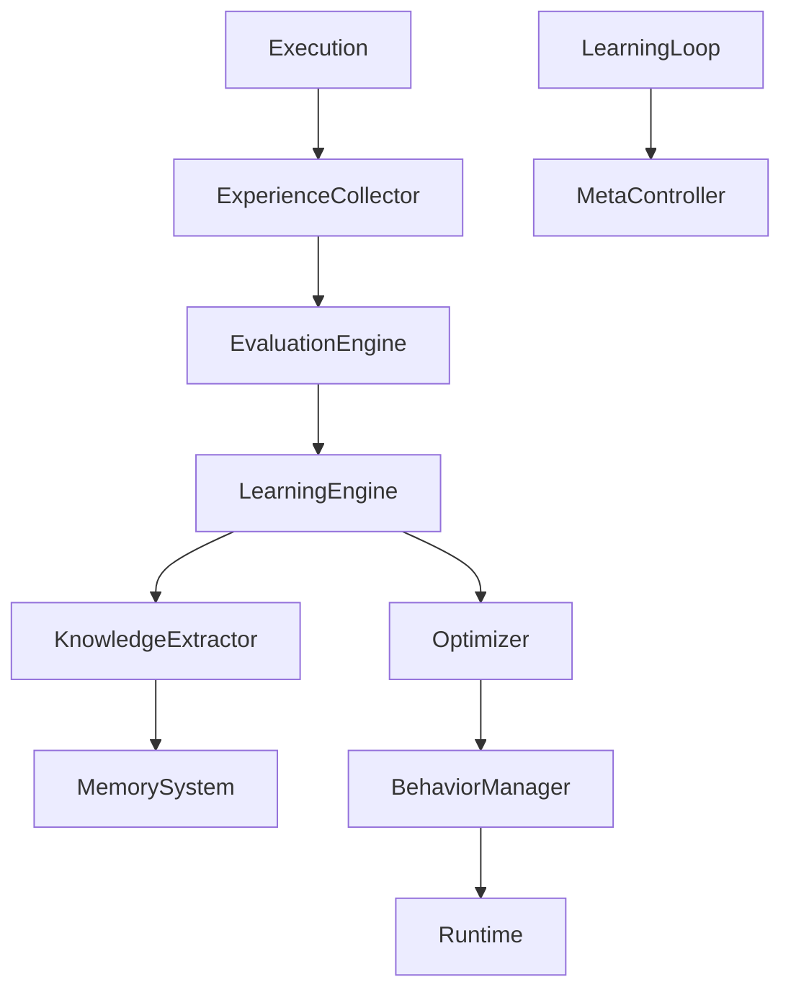

# RFC-0159

**Title:** Learning Loop Architecture

**Document ID:** RFC-0159

**Version:** 1.0

**Status:** Accepted

**Category:** System Architecture

**Layer:** Cognition / Learning / Self Improvement

**Target:**

```text
architecture/learning_loop/
```

---

# Abstract

This RFC defines the SH-3 Learning Loop Architecture (LLA).

The Learning Loop Architecture establishes the continuous improvement framework responsible for collecting experiences, evaluating outcomes, extracting knowledge, updating behaviors, optimizing strategies, and improving future autonomous operations.

The Learning Loop connects:

```text
Execution

↓

Observation

↓

Evaluation

↓

Learning

↓

Memory Update

↓

Behavior Improvement
```

The Learning Loop enables SH-3 to continuously improve through operational experience.

Every learning operation SHALL be:

- deterministic
- measurable
- explainable
- versioned
- reversible
- observable
- policy-controlled

This document is normative.

---

# Motivation

Autonomous systems require the ability to improve.

A static system:

```text
Input

↓

Processing

↓

Output
```

does not improve over time.

SH-3 requires:

```text
Experience

↓

Analysis

↓

Knowledge Extraction

↓

Optimization

↓

Improved Behavior
```

The Learning Loop provides the continuous adaptation mechanism.

---

# Goals

The architecture SHALL provide:

- experience collection
- performance evaluation
- learning extraction
- behavior optimization
- memory integration
- feedback processing
- improvement tracking

---

# Non-Goals

The architecture SHALL NOT:

- replace model training infrastructure
- directly modify production behavior without validation
- bypass governance controls
- remove human oversight requirements

---

# Architecture



---

# Design Principles

## Continuous Improvement

The system SHALL continuously evaluate performance.

---

## Evidence Based Learning

Changes SHALL be based on measurable evidence.

---

## Controlled Adaptation

Learning changes SHALL pass validation.

---

## Reversible Improvement

All learned changes SHALL support rollback.

---

## Separation of Learning and Execution

Learning SHALL not destabilize active execution.

---

# Components

| Component | Responsibility |
|---|---|
| LearningLoopManager | Learning orchestration |
| ExperienceCollector | Experience gathering |
| EvaluationEngine | Performance analysis |
| LearningEngine | Knowledge extraction |
| KnowledgeExtractor | Pattern extraction |
| Optimizer | Strategy optimization |
| BehaviorManager | Behavior version control |
| FeedbackProcessor | Feedback handling |

---

# Learning Model

Every learning cycle SHALL contain:

```text
learning_id

experience

evaluation

hypothesis

change

validation

result

version
```

---

# Learning Cycle

The standard cycle:

```text
Observe

↓

Collect Experience

↓

Evaluate Result

↓

Extract Knowledge

↓

Generate Improvement

↓

Validate

↓

Apply

↓

Measure
```

---

# Experience Model

Experience SHALL contain:

```text
experience_id

context

action

result

reward

evaluation

metadata
```

---

# Experience Collection

ExperienceCollector SHALL collect:

- execution results
- user feedback
- system metrics
- failures
- successful strategies

---

# Evaluation Model

EvaluationEngine SHALL analyze:

```text
Success

↓

Efficiency

↓

Quality

↓

Reliability

↓

Cost
```

---

# Evaluation Metrics

Examples:

```text
accuracy

latency

resource_usage

success_rate

failure_rate

user_satisfaction
```

---

# Learning Engine

LearningEngine SHALL:

- identify patterns
- extract knowledge
- generate improvements
- produce learning proposals

---

# Knowledge Extraction

KnowledgeExtractor SHALL convert:

```text
Experience

↓

Pattern

↓

Knowledge

↓

Memory
```

---

# Optimization Model

Optimizer SHALL improve:

- workflows
- scheduling strategies
- resource allocation
- reasoning strategies
- tool selection

---

# Behavior Management

BehaviorManager SHALL maintain:

```text
behavior_id

version

configuration

performance

status
```

---

# Behavior Lifecycle

```text
Created

↓

Evaluated

↓

Validated

↓

Active

↓

Deprecated

↓

Archived
```

---

# Validation Process

All improvements SHALL pass:

```text
Proposal

↓

Simulation

↓

Evaluation

↓

Approval

↓

Deployment
```

---

# Memory Integration

Learning Loop SHALL update:

```text
Semantic Memory

Episodic Memory

Procedural Memory
```

through RFC-0158.

---

# State Integration

Learning state SHALL be maintained through:

```text
State Management

↓

Learning State

↓

Recovery
```

---

# Event Integration

Learning events include:

```text
LearningStarted

ExperienceCollected

EvaluationCompleted

KnowledgeExtracted

ImprovementGenerated

BehaviorUpdated

LearningCompleted
```

Events SHALL follow RFC-0152.

---

# MetaController Integration

MetaController SHALL supervise:

- learning priorities
- improvement safety
- optimization goals
- adaptation limits

---

# Governance Integration

Learning SHALL validate:

- policy compliance
- security constraints
- operational impact
- safety boundaries

---

# Persistence

Learning persistence SHALL maintain:

- experiences
- evaluations
- learning history
- behavior versions
- improvement results

---

# Observability

Learning telemetry SHALL expose:

Metrics:

```text
learning_cycles

improvement_rate

success_rate

rollback_rate
```

Logs:

```text
learning_id

change

result
```

Traces:

```text
experience

learning

behavior_update
```

---

# Testing Requirements

Learning Loop SHALL support:

- deterministic replay
- evaluation tests
- simulation tests
- rollback tests
- regression tests

---

# Thread Model

Learning Loop SHALL support concurrent:

- experience collection
- evaluation
- knowledge extraction
- optimization
- memory updates

Reference implementation SHALL be:

- deterministic
- thread-safe
- asynchronous
- event-driven

---

# Performance Metrics

The architecture exposes:

- learning latency
- improvement frequency
- evaluation throughput
- rollback frequency
- optimization gain

---

# Performance Objectives

The architecture should optimize for:

- stable improvement
- measurable gains
- controlled adaptation
- continuous optimization

---

# Future Work

Potential enhancements:

- autonomous research loop
- reinforcement learning integration
- self-generated experiments
- AI-driven architecture optimization
- collective learning systems

---

# References

- RFC-0158 Memory Architecture
- RFC-0157 State Management Architecture
- RFC-0156 Runtime Execution Context Architecture
- RFC-0152 Event Bus Architecture
- SH-3 MetaController Architecture

---

# End of RFC-0159