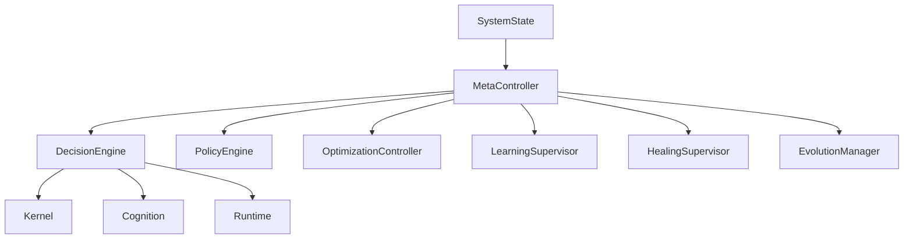

# RFC-0160

**Title:** Meta Controller Architecture

**Document ID:** RFC-0160

**Version:** 1.0

**Status:** Accepted

**Category:** System Architecture

**Layer:** Kernel / Cognition / Autonomy

**Target:**

```text
architecture/meta_controller/
```

---

# Abstract

This RFC defines the SH-3 Meta Controller Architecture (MCA).

The Meta Controller Architecture establishes the highest-level supervisory control framework responsible for observing, evaluating, coordinating, and optimizing the complete SH-3 AI Operating System Framework.

The Meta Controller operates as the global intelligence coordination layer.

It supervises:

```text
Cognition

↓

Learning

↓

Kernel

↓

Runtime

↓

Deployment

↓

Self Healing
```

The Meta Controller provides:

- global system awareness
- strategic decision making
- policy coordination
- learning supervision
- optimization control
- autonomous adaptation
- system evolution management

Every Meta Controller operation SHALL be:

- observable
- deterministic
- explainable
- policy-controlled
- reversible
- versioned

This document is normative.

---

# Motivation

SH-3 contains multiple autonomous subsystems:

```text
Planner

Memory

Learning

Optimizer

SelfHealing

Runtime

Kernel

Deployment
```

Each subsystem can operate independently.

However, an advanced autonomous operating system requires a higher-level controller capable of answering:

```text
What should the system improve?

What should the system prioritize?

Which action produces the highest value?

Is the system operating safely?

```

The Meta Controller provides global coordination.

---

# Goals

The architecture SHALL provide:

- system-wide observation
- strategic planning
- subsystem coordination
- policy enforcement
- optimization supervision
- autonomous evolution control

---

# Non-Goals

The architecture SHALL NOT:

- directly replace subsystem logic
- bypass security policies
- execute low-level operations
- modify components without validation

---

# Architecture



---

# Design Principles

## Global Awareness

Meta Controller SHALL maintain system-wide understanding.

---

## Separation of Concerns

Subsystems execute.
Meta Controller coordinates.

---

## Controlled Autonomy

Autonomous decisions SHALL follow policies.

---

## Explainable Decisions

Important decisions SHALL preserve reasoning records.

---

## Continuous Improvement

Meta Controller SHALL optimize system behavior.

---

# Components

| Component | Responsibility |
|---|---|
| MetaControllerCore | Main coordinator |
| ObservationEngine | System awareness |
| DecisionEngine | Strategic decisions |
| PolicyEngine | Rule evaluation |
| OptimizationController | Optimization control |
| LearningSupervisor | Learning management |
| HealingSupervisor | Recovery coordination |
| EvolutionManager | System evolution |

---

# Meta Controller Model

Every decision SHALL contain:

```text
decision_id

timestamp

context

observation

options

selected_action

reason

confidence

result
```

---

# Observation Engine

ObservationEngine SHALL collect:

- system state
- runtime metrics
- learning results
- failures
- resource usage
- performance trends

---

# Decision Engine

DecisionEngine SHALL evaluate:

```text
Current State

↓

Possible Actions

↓

Expected Outcome

↓

Risk

↓

Policy

↓

Decision
```

---

# Decision Types

Supported decisions:

```text
Optimization Decision

Recovery Decision

Learning Decision

Resource Decision

Deployment Decision

Policy Decision
```

---

# Policy Engine

PolicyEngine SHALL enforce:

- security policy
- resource policy
- operational policy
- learning policy
- deployment policy

---

# Optimization Controller

OptimizationController SHALL manage:

- performance optimization
- resource optimization
- workflow optimization
- behavior optimization

---

# Learning Supervisor

LearningSupervisor SHALL control:

- learning priority
- experiment approval
- improvement validation
- rollback decisions

Integration:

```text
RFC-0159 Learning Loop
```

---

# Healing Supervisor

HealingSupervisor SHALL coordinate:

```text
Detection

↓

Diagnosis

↓

Recovery

↓

Validation
```

Integration:

```text
SelfHealing Architecture
```

---

# Evolution Manager

EvolutionManager SHALL manage:

- architecture evolution
- capability expansion
- version transitions
- component replacement

---

# Decision Lifecycle

Every decision SHALL follow:

```text
Observed

↓

Analyzed

↓

Evaluated

↓

Approved

↓

Executed

↓

Measured
```

---

# Autonomy Model

Autonomous operation levels:

```text
Level 0

Manual Control


Level 1

Assisted Operation


Level 2

Policy Guided Automation


Level 3

Autonomous Optimization


Level 4

Self Improving System
```

---

# Event Integration

Meta Controller events:

```text
ObservationCollected

DecisionCreated

DecisionApproved

OptimizationStarted

LearningDirected

HealingDirected

EvolutionTriggered
```

Events SHALL follow RFC-0152.

---

# State Integration

Meta Controller maintains:

```text
SystemState

DecisionState

PolicyState

OptimizationState

EvolutionState
```

through RFC-0157.

---

# Memory Integration

Meta Controller uses:

- historical decisions
- previous optimizations
- learned strategies

through RFC-0158.

---

# Learning Integration

Meta Controller supervises:

```text
Experience

↓

Learning

↓

Evaluation

↓

Behavior Improvement
```

through RFC-0159.

---

# Security Integration

All decisions SHALL validate:

- authority
- policy
- risk level
- operational impact

---

# Persistence

Meta Controller SHALL store:

- decisions
- reasoning records
- policies
- optimization history
- evolution history

---

# Observability

Metrics:

```text
decision_latency

decision_accuracy

optimization_gain

policy_violation_count

autonomy_level
```

Logs:

```text
decision_id

reason

action
```

Traces:

```text
observation

decision

execution
```

---

# Testing Requirements

Meta Controller SHALL support:

- decision simulation
- policy testing
- optimization testing
- failure testing
- deterministic replay

---

# Thread Model

Meta Controller SHALL support concurrent:

- observation processing
- decision evaluation
- policy checking
- optimization control
- subsystem coordination

Reference implementation SHALL be:

- deterministic
- thread-safe
- event-driven
- asynchronous

---

# Performance Metrics

The architecture exposes:

- decision throughput
- optimization effectiveness
- system improvement rate
- autonomy efficiency

---

# Performance Objectives

The architecture should optimize for:

- stable autonomous operation
- safe adaptation
- measurable improvement
- global coordination efficiency

---

# Future Work

Potential enhancements:

- self-designed architecture evolution
- autonomous research planning
- multi-agent Meta Controller
- predictive system management
- AGI-level self governance

---

# References

- RFC-0159 Learning Loop Architecture
- RFC-0158 Memory Architecture
- RFC-0157 State Management Architecture
- RFC-0155 Resource Management Architecture
- RFC-0152 Event Bus Architecture

---

# End of RFC-0160