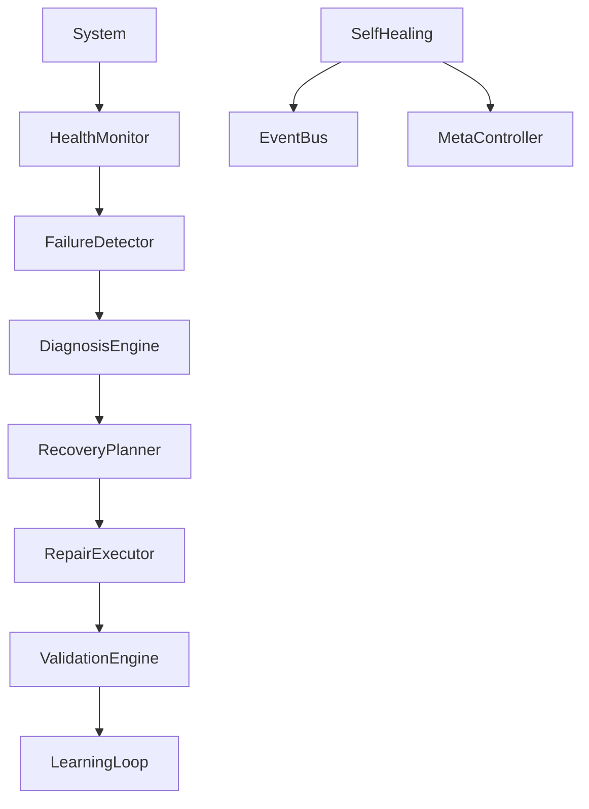

# RFC-0161

**Title:** Self Healing Architecture

**Document ID:** RFC-0161

**Version:** 1.0

**Status:** Accepted

**Category:** System Architecture

**Layer:** Autonomy / Reliability / Kernel

**Target:**

```text
architecture/self_healing/
```

---

# Abstract

This RFC defines the SH-3 Self Healing Architecture (SHA).

The Self Healing Architecture establishes the autonomous reliability framework responsible for detecting failures, analyzing causes, planning recovery actions, executing repairs, validating restoration, and improving future resilience across the SH-3 AI Operating System Framework.

Self Healing provides autonomous recovery capabilities for:

- Runtime failures
- Service failures
- Workflow failures
- Resource failures
- Dependency failures
- Configuration failures
- Performance degradation

The Self Healing Architecture enables:

```text
Detect

↓

Analyze

↓

Decide

↓

Recover

↓

Validate

↓

Learn
```

Every healing operation SHALL be:

- deterministic
- observable
- reversible
- policy-controlled
- auditable
- version-aware
- thread-safe

This document is normative.

---

# Motivation

Autonomous systems must operate continuously.

In production environments:

```text
Failure
```

is inevitable.

A traditional system:

```text
Failure

↓

Human Intervention

↓

Recovery
```

is insufficient for autonomous AI infrastructure.

SH-3 requires:

```text
Failure

↓

Detection

↓

Diagnosis

↓

Recovery

↓

Optimization
```

The Self Healing Architecture provides continuous reliability.

---

# Goals

The architecture SHALL provide:

- failure detection
- root cause analysis
- recovery planning
- automated repair
- rollback capability
- recovery validation
- learning feedback

---

# Non-Goals

The architecture SHALL NOT:

- bypass security controls
- perform unsafe modifications
- replace human governance
- hide failures from observability systems

---

# Architecture



---

# Design Principles

## Failure Is Data

Every failure SHALL become observable information.

---

## Recovery Is Controlled

Recovery actions SHALL follow policies.

---

## Repair Is Reversible

All changes SHALL support rollback.

---

## Learning From Failure

Failures SHALL improve future behavior.

---

## Minimal Intervention

Recovery SHALL apply the smallest effective correction.

---

# Components

| Component | Responsibility |
|---|---|
| SelfHealingCore | Healing orchestration |
| HealthMonitor | Health observation |
| FailureDetector | Failure identification |
| DiagnosisEngine | Root cause analysis |
| RecoveryPlanner | Recovery strategy generation |
| RepairExecutor | Repair execution |
| RollbackManager | State restoration |
| ValidationEngine | Recovery verification |

---

# Failure Model

Every failure SHALL contain:

```text
failure_id

failure_type

component

timestamp

severity

context

trace_id

cause

metadata
```

---

# Failure Types

Supported categories:

```text
RuntimeFailure

WorkflowFailure

ResourceFailure

ServiceFailure

DependencyFailure

ConfigurationFailure

SecurityFailure

PerformanceFailure
```

---

# Health Model

Every component SHALL expose:

```text
status

availability

latency

error_rate

resource_usage

version
```

---

# Health States

```text
Healthy

↓

Warning

↓

Degraded

↓

Failed

↓

Recovering

↓

Healthy
```

---

# Failure Detection

FailureDetector SHALL detect:

- exceptions
- timeouts
- unavailable services
- abnormal metrics
- invalid states
- dependency failures

---

# Detection Methods

Supported methods:

```text
Rule Based Detection

Metric Threshold Detection

Pattern Detection

State Validation

Predictive Detection
```

---

# Diagnosis Engine

DiagnosisEngine SHALL determine:

```text
Symptom

↓

Evidence

↓

Cause

↓

Impact

↓

Recovery Option
```

---

# Diagnosis Sources

Sources include:

- logs
- traces
- metrics
- state history
- event history
- memory

---

# Recovery Planner

RecoveryPlanner SHALL generate:

```text
RecoveryPlan

├── Action
├── Target
├── Priority
├── Risk
├── Rollback
└── Validation
```

---

# Recovery Actions

Supported actions:

```text
Restart

Rollback

Reload Configuration

Replace Component

Reallocate Resource

Restore State

Rebuild Dependency
```

---

# Repair Execution

RepairExecutor SHALL:

1. Validate recovery policy
2. Create checkpoint
3. Execute repair
4. Monitor result
5. Report outcome

---

# Rollback Model

RollbackManager SHALL restore:

- previous state
- previous configuration
- previous version
- previous resource allocation

Rollback SHALL preserve:

```text
trace_id

failure_history

recovery_history
```

---

# Recovery Lifecycle

```text
Failure Detected

↓

Diagnosis Started

↓

Recovery Planned

↓

Approval

↓

Repair Executed

↓

Validation

↓

Recovery Completed
```

---

# Validation Engine

Validation SHALL verify:

- component health
- workflow continuity
- state consistency
- performance recovery
- security compliance

---

# Event Integration

Self Healing events:

```text
FailureDetected

DiagnosisStarted

RecoveryPlanned

RecoveryStarted

RepairCompleted

RollbackExecuted

RecoveryCompleted
```

Events SHALL follow RFC-0152.

---

# State Integration

Self Healing SHALL maintain:

```text
FailureState

RecoveryState

CheckpointState

RepairState
```

through RFC-0157.

---

# Memory Integration

Failures SHALL become experience:

```text
Failure

↓

Episode

↓

Memory

↓

Future Prevention
```

through RFC-0158.

---

# Learning Integration

LearningLoop SHALL consume:

- failures
- recovery results
- repair effectiveness

to improve:

- detection
- diagnosis
- recovery strategies

---

# Meta Controller Integration

Meta Controller SHALL supervise:

- recovery priority
- risk assessment
- autonomous healing level
- system evolution impact

---

# Security Integration

Recovery SHALL validate:

- authorization
- repair permission
- target ownership
- safety policy

---

# Persistence

Self Healing SHALL persist:

- failures
- diagnoses
- recovery plans
- repair history
- rollback points

---

# Observability

Metrics:

```text
failure_rate

detection_latency

recovery_time

repair_success_rate

rollback_rate
```

Logs:

```text
failure_id

recovery_action

result
```

Traces:

```text
failure

diagnosis

recovery
```

---

# Testing Requirements

Self Healing SHALL support:

- failure injection tests
- recovery tests
- rollback tests
- resilience tests
- chaos testing

---

# Thread Model

Self Healing SHALL support concurrent:

- health monitoring
- failure analysis
- recovery planning
- repair execution
- validation

Reference implementation SHALL be:

- deterministic
- thread-safe
- asynchronous
- event-driven

---

# Performance Metrics

The architecture exposes:

- mean time to detect
- mean time to recover
- recovery success rate
- prevention improvement rate

---

# Performance Objectives

The architecture should optimize for:

- fast recovery
- safe automation
- minimal downtime
- continuous resilience improvement

---

# Future Work

Potential enhancements:

- predictive failure prevention
- autonomous repair generation
- self-generated recovery workflows
- AI-driven root cause analysis
- adaptive resilience optimization

---

# References

- RFC-0160 Meta Controller Architecture
- RFC-0159 Learning Loop Architecture
- RFC-0157 State Management Architecture
- RFC-0152 Event Bus Architecture
- RFC-0147 Recovery Architecture

---

# End of RFC-0161