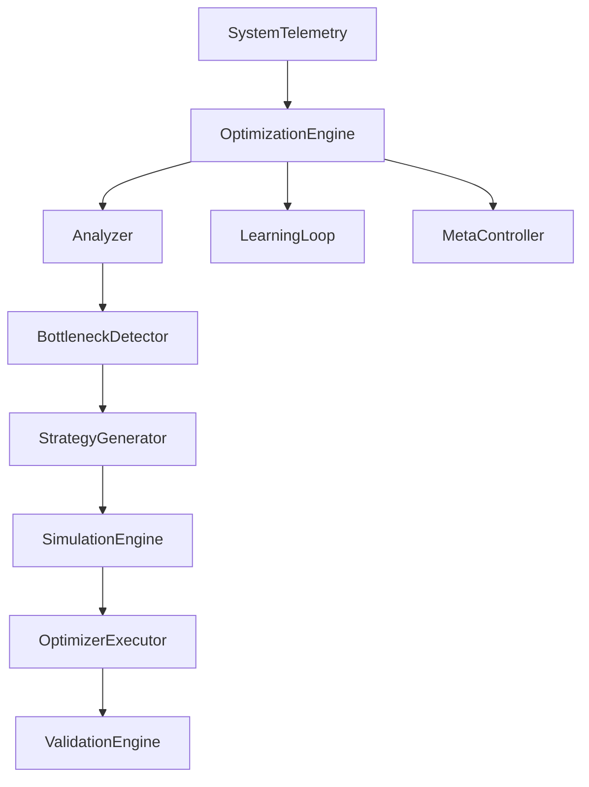

# RFC-0162

**Title:** Optimization Architecture

**Document ID:** RFC-0162

**Version:** 1.0

**Status:** Accepted

**Category:** System Architecture

**Layer:** Autonomy / Intelligence / System Optimization

**Target:**

```text
architecture/optimization/
```

---

# Abstract

This RFC defines the SH-3 Optimization Architecture (OA).

The Optimization Architecture establishes the autonomous improvement framework responsible for analyzing system behavior, identifying inefficiencies, generating optimization strategies, validating improvements, and applying controlled enhancements across the SH-3 AI Operating System Framework.

The Optimization Architecture manages:

- performance optimization
- resource optimization
- workflow optimization
- scheduling optimization
- cognitive optimization
- learning optimization
- architecture optimization

The Optimization Architecture connects:

```text
Observation

↓

Analysis

↓

Optimization

↓

Validation

↓

Deployment

↓

Measurement
```

Every optimization operation SHALL be:

- measurable
- deterministic
- reversible
- policy-controlled
- observable
- versioned
- safe

This document is normative.

---

# Motivation

Autonomous systems must continuously improve.

A fixed system:

```text
Execute

↓

Result
```

does not adapt.

SH-3 requires:

```text
Execute

↓

Measure

↓

Analyze

↓

Optimize

↓

Improve
```

Optimization provides the mechanism for continuous system enhancement.

---

# Goals

The architecture SHALL provide:

- performance analysis
- bottleneck identification
- optimization strategy generation
- controlled improvement deployment
- optimization measurement
- rollback capability

---

# Non-Goals

The architecture SHALL NOT:

- modify components without validation
- bypass security policies
- replace Learning Loop
- replace Runtime execution

---

# Architecture



---

# Design Principles

## Measure Before Optimize

Optimization SHALL be based on evidence.

---

## Controlled Improvement

Every optimization SHALL have validation.

---

## Reversible Change

Optimization SHALL support rollback.

---

## Global Awareness

Optimization SHALL consider system-wide effects.

---

## Continuous Improvement

Optimization SHALL feed future decisions.

---

# Components

| Component | Responsibility |
|---|---|
| OptimizationCore | Optimization orchestration |
| Analyzer | Performance analysis |
| BottleneckDetector | Problem identification |
| StrategyGenerator | Optimization creation |
| SimulationEngine | Change evaluation |
| OptimizerExecutor | Improvement execution |
| ValidationEngine | Result verification |
| OptimizationHistory | Knowledge storage |

---

# Optimization Model

Every optimization request SHALL contain:

```text
optimization_id

target

current_state

metrics

objective

strategy

expected_result

validation_rule
```

---

# Optimization Types

Supported categories:

```text
Performance Optimization

Resource Optimization

Workflow Optimization

Scheduling Optimization

Memory Optimization

Learning Optimization

Architecture Optimization
```

---

# Performance Optimization

Targets:

```text
latency

throughput

response_time

execution_cost
```

---

# Resource Optimization

Targets:

```text
CPU usage

Memory usage

Storage usage

Network usage

Accelerator usage
```

Integration:

```text
RFC-0155 Resource Management Architecture
```

---

# Workflow Optimization

Optimization targets:

```text
task ordering

parallelization

dependency reduction

execution path
```

Integration:

```text
RFC-0153 Workflow Architecture
```

---

# Scheduling Optimization

Targets:

```text
priority strategy

queue efficiency

placement strategy

resource allocation
```

Integration:

```text
RFC-0154 Scheduler Architecture
```

---

# Cognitive Optimization

Targets:

```text
reasoning efficiency

planning quality

memory retrieval

decision accuracy
```

---

# Bottleneck Detection

BottleneckDetector SHALL analyze:

- execution latency
- resource pressure
- failure frequency
- queue delay
- memory usage
- learning efficiency

---

# Analysis Model

Analysis SHALL evaluate:

```text
Current Performance

↓

Expected Performance

↓

Difference

↓

Optimization Opportunity
```

---

# Strategy Generator

StrategyGenerator SHALL create:

```text
OptimizationPlan

├── Target
├── Change
├── Risk
├── Expected Gain
├── Validation
└── Rollback
```

---

# Simulation Engine

Before applying optimization:

```text
Proposal

↓

Simulation

↓

Prediction

↓

Approval
```

SHALL be executed when risk requires validation.

---

# Optimization Execution

OptimizerExecutor SHALL:

1. Create checkpoint
2. Apply optimization
3. Monitor result
4. Validate improvement
5. Commit or rollback

---

# Optimization Lifecycle

```text
Detected

↓

Analyzed

↓

Planned

↓

Simulated

↓

Approved

↓

Applied

↓

Validated

↓

Recorded
```

---

# Validation Model

Optimization success SHALL evaluate:

```text
Performance Gain

+

Stability

+

Resource Efficiency

+

Quality Impact
```

---

# Rollback

Failed optimization SHALL restore:

- previous configuration
- previous strategy
- previous state
- previous behavior

---

# Learning Integration

Optimization results SHALL become experience:

```text
Optimization

↓

Evaluation

↓

Memory

↓

Learning
```

Integration:

```text
RFC-0159 Learning Loop Architecture
```

---

# Memory Integration

Optimization history SHALL be stored:

```text
Successful Strategy

Failed Strategy

Performance Pattern

System Knowledge
```

Integration:

```text
RFC-0158 Memory Architecture
```

---

# Meta Controller Integration

Meta Controller SHALL supervise:

- optimization priority
- risk assessment
- global impact
- evolution strategy

Integration:

```text
RFC-0160 Meta Controller Architecture
```

---

# Event Integration

Optimization events:

```text
OptimizationDetected

OptimizationPlanned

OptimizationSimulated

OptimizationApplied

OptimizationValidated

OptimizationRolledBack
```

Events SHALL follow RFC-0152.

---

# State Integration

Optimization state SHALL contain:

```text
OptimizationState

TargetState

PreviousState

ResultState
```

Integration:

```text
RFC-0157 State Management Architecture
```

---

# Security Integration

Optimization SHALL validate:

- authorization
- change permission
- affected components
- risk level

---

# Persistence

Optimization history SHALL store:

- optimization plans
- applied changes
- measurements
- results
- rollback records

---

# Observability

Metrics:

```text
optimization_count

performance_gain

rollback_rate

improvement_rate

execution_cost_change
```

Logs:

```text
optimization_id

strategy

result
```

Traces:

```text
analysis

optimization

validation
```

---

# Testing Requirements

Optimization SHALL support:

- simulation tests
- regression tests
- rollback tests
- performance tests
- safety tests

---

# Thread Model

Optimization SHALL support concurrent:

- metric analysis
- strategy generation
- simulations
- validation
- history recording

Reference implementation SHALL be:

- deterministic
- thread-safe
- asynchronous
- event-driven

---

# Performance Metrics

The architecture exposes:

- optimization latency
- improvement ratio
- resource savings
- stability impact

---

# Performance Objectives

The architecture should optimize for:

- continuous improvement
- safe adaptation
- measurable gains
- minimal operational disruption

---

# Future Work

Potential enhancements:

- autonomous architecture redesign
- AI generated optimization strategies
- predictive optimization
- reinforcement learning optimizer
- global system self-tuning

---

# References

- RFC-0161 Self Healing Architecture
- RFC-0160 Meta Controller Architecture
- RFC-0159 Learning Loop Architecture
- RFC-0155 Resource Management Architecture
- RFC-0154 Scheduler Architecture

---

# End of RFC-0162