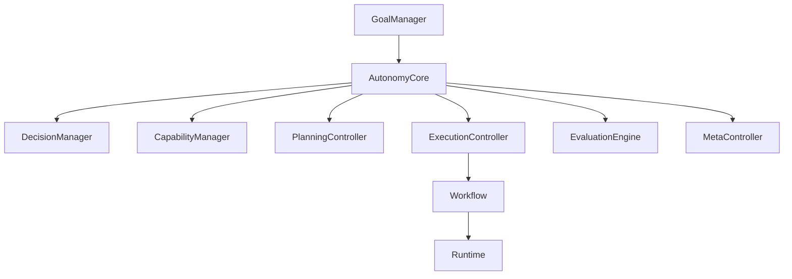

# RFC-0163

**Title:** Autonomy Architecture

**Document ID:** RFC-0163

**Version:** 1.0

**Status:** Accepted

**Category:** System Architecture

**Layer:** Autonomy / Agent Control / Cognition

**Target:**

```text
architecture/autonomy/
```

---

# Abstract

This RFC defines the SH-3 Autonomy Architecture (AA).

The Autonomy Architecture establishes the framework responsible for enabling autonomous operation, goal management, decision execution, capability utilization, self-directed task management, and controlled system independence within the SH-3 AI Operating System Framework.

The Autonomy Architecture provides:

- autonomous goal processing
- decision management
- capability selection
- autonomous planning
- execution control
- self-monitoring
- autonomy level management

The Autonomy Architecture connects:

```text
Goal

↓

Understanding

↓

Planning

↓

Decision

↓

Execution

↓

Evaluation

↓

Improvement
```

Every autonomous operation SHALL be:

- goal-oriented
- observable
- explainable
- policy-controlled
- reversible
- measurable
- secure

This document is normative.

---

# Motivation

Traditional software systems execute predefined instructions.

Autonomous systems require:

```text
Observe

↓

Understand

↓

Decide

↓

Act

↓

Learn
```

SH-3 requires the ability to:

- identify objectives
- create execution strategies
- select capabilities
- evaluate outcomes
- improve future behavior

The Autonomy Architecture provides the operational intelligence layer.

---

# Goals

The architecture SHALL provide:

- autonomous execution control
- goal lifecycle management
- decision coordination
- capability orchestration
- autonomy governance
- self-directed improvement

---

# Non-Goals

The architecture SHALL NOT:

- bypass security policies
- remove system governance
- directly replace human authority
- execute unsafe operations

---

# Architecture



---

# Design Principles

## Goal Driven

All autonomous actions SHALL originate from goals.

---

## Controlled Autonomy

Autonomous decisions SHALL operate within defined boundaries.

---

## Capability Based

The system SHALL select actions based on available capabilities.

---

## Feedback Driven

Every action SHALL produce evaluation data.

---

## Progressive Autonomy

Autonomy levels SHALL increase through validation.

---

# Components

| Component | Responsibility |
|---|---|
| AutonomyCore | Autonomous coordination |
| GoalManager | Goal lifecycle |
| DecisionManager | Decision control |
| CapabilityManager | Capability selection |
| PlanningController | Strategy generation |
| ExecutionController | Action execution |
| EvaluationEngine | Result analysis |
| AutonomyPolicy | Governance |

---

# Goal Model

Every goal SHALL contain:

```text
goal_id

objective

priority

constraints

deadline

context

status

metadata
```

---

# Goal Lifecycle

Every goal SHALL follow:

```text
Created

↓

Analyzed

↓

Planned

↓

Executing

↓

Evaluated

↓

Completed

or

Cancelled
```

---

# Goal Types

Supported goals:

```text
User Goal

System Goal

Optimization Goal

Recovery Goal

Learning Goal

Maintenance Goal
```

---

# Decision Model

Every autonomous decision SHALL contain:

```text
decision_id

goal_id

context

options

selected_action

reason

confidence

result
```

---

# Decision Process

```text
Goal

↓

Context Analysis

↓

Capability Check

↓

Option Generation

↓

Policy Validation

↓

Decision

↓

Execution
```

---

# Capability Management

CapabilityManager SHALL maintain:

```text
capability_id

name

version

availability

performance

permission
```

---

# Capability Selection

Selection SHALL consider:

- goal requirements
- system state
- resource availability
- policy restrictions
- historical performance

---

# Planning Integration

Autonomy SHALL use:

```text
Goal

↓

Planner

↓

Workflow

↓

Execution
```

Integration:

```text
RFC-0153 Workflow Architecture
```

---

# Execution Integration

Autonomous execution SHALL use:

```text
Workflow

↓

Scheduler

↓

Resource Manager

↓

Runtime
```

---

# Evaluation Model

EvaluationEngine SHALL measure:

```text
Goal Achievement

+

Efficiency

+

Safety

+

Quality
```

---

# Autonomy Levels

SH-3 SHALL support:

```text
Level 0

Manual Operation


Level 1

Assisted Operation


Level 2

Policy Guided Automation


Level 3

Autonomous Execution


Level 4

Self Improving Autonomy
```

---

# Autonomy Policy

AutonomyPolicy SHALL define:

- allowed actions
- restricted actions
- approval requirements
- risk limits
- resource limits

---

# Human/System Boundary

The system SHALL support:

```text
Human Request

↓

Autonomous Processing

↓

Human Review

↓

Execution
```

when required.

---

# Event Integration

Autonomy events include:

```text
GoalCreated

GoalAnalyzed

DecisionCreated

ActionSelected

ExecutionStarted

GoalCompleted

AutonomyChanged
```

Events SHALL follow RFC-0152.

---

# State Integration

Autonomy State SHALL maintain:

```text
GoalState

DecisionState

CapabilityState

AutonomyLevel
```

through RFC-0157.

---

# Memory Integration

Autonomous decisions SHALL use:

- previous experiences
- successful strategies
- learned behaviors

through RFC-0158.

---

# Learning Integration

Autonomy SHALL improve through:

```text
Action

↓

Result

↓

Evaluation

↓

Learning

↓

Improved Decision
```

through RFC-0159.

---

# Self Healing Integration

Autonomous recovery SHALL support:

```text
Failure

↓

Diagnosis

↓

Recovery Decision

↓

Repair
```

through RFC-0161.

---

# Optimization Integration

Autonomy SHALL optimize:

- goal execution
- capability selection
- planning efficiency

through RFC-0162.

---

# Security Integration

Every autonomous action SHALL validate:

- identity
- authority
- policy
- risk

---

# Persistence

Autonomy SHALL persist:

- goals
- decisions
- actions
- evaluations
- autonomy history

---

# Observability

Metrics:

```text
goal_success_rate

decision_accuracy

autonomy_level

execution_efficiency

policy_violation_count
```

Logs:

```text
goal_id

decision_id

action
```

Traces:

```text
goal

decision

execution
```

---

# Testing Requirements

Autonomy SHALL support:

- goal tests
- decision tests
- policy tests
- simulation tests
- safety tests
- replay tests

---

# Thread Model

Autonomy SHALL support concurrent:

- goal processing
- decision evaluation
- capability selection
- execution monitoring
- feedback processing

Reference implementation SHALL be:

- deterministic
- thread-safe
- asynchronous
- event-driven

---

# Performance Metrics

The architecture exposes:

- decision latency
- goal completion rate
- autonomous success rate
- improvement rate

---

# Performance Objectives

The architecture should optimize for:

- reliable autonomy
- safe independence
- efficient execution
- continuous improvement

---

# Future Work

Potential enhancements:

- multi-agent autonomy
- autonomous research planning
- self-generated objectives
- advanced AGI autonomy models
- collective intelligence coordination

---

# References

- RFC-0162 Optimization Architecture
- RFC-0161 Self Healing Architecture
- RFC-0160 Meta Controller Architecture
- RFC-0159 Learning Loop Architecture
- RFC-0153 Workflow Architecture

---

# End of RFC-0163