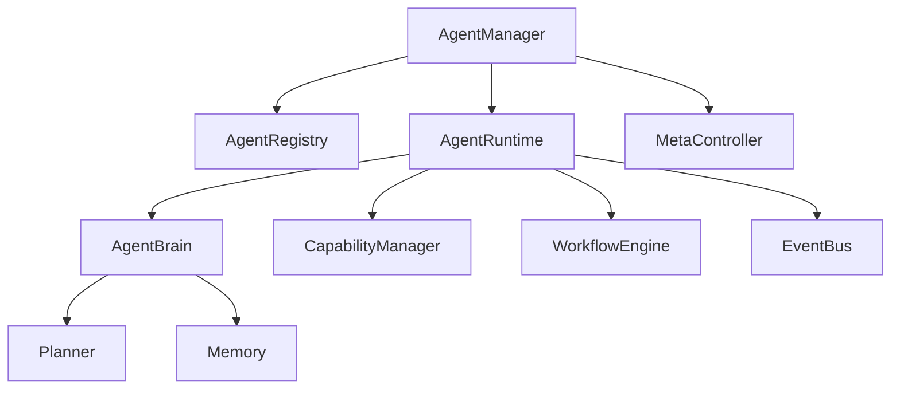

# RFC-0164

**Title:** Agent Architecture

**Document ID:** RFC-0164

**Version:** 1.0

**Status:** Accepted

**Category:** System Architecture

**Layer:** Cognition / Autonomy / Agent Runtime

**Target:**

```text
architecture/agent/
```

---

# Abstract

This RFC defines the SH-3 Agent Architecture (AA).

The Agent Architecture establishes the universal framework for creating, managing, executing, communicating with, and evolving autonomous agents inside the SH-3 AI Operating System Framework.

An Agent represents an autonomous execution entity capable of:

- perceiving context
- maintaining internal state
- selecting capabilities
- executing tasks
- learning from experience
- collaborating with other agents

The Agent Architecture provides:

- agent identity
- lifecycle management
- capability management
- memory integration
- communication
- coordination
- autonomy control

Every agent operation SHALL be:

- typed
- isolated
- observable
- deterministic
- policy-controlled
- recoverable
- version-aware

This document is normative.

---

# Motivation

SH-3 requires autonomous entities capable of independent operation.

A single monolithic intelligence model is insufficient for complex environments.

SH-3 adopts:

```text
Multiple Specialized Agents

+

Shared Infrastructure

+

Coordinated Intelligence
```

An agent may perform:

```text
Planning

Reasoning

Execution

Monitoring

Recovery

Optimization
```

while cooperating with other agents.

---

# Goals

The architecture SHALL provide:

- agent abstraction
- agent lifecycle
- agent execution
- agent communication
- capability coordination
- multi-agent collaboration
- autonomous improvement

---

# Non-Goals

The architecture SHALL NOT:

- replace Workflow Architecture
- replace Runtime Architecture
- bypass security policies
- create uncontrolled autonomous execution

---

# Architecture



---

# Design Principles

## Agent As Autonomous Unit

Each agent SHALL represent an independent execution entity.

---

## Capability Based Operation

Agents SHALL act through registered capabilities.

---

## Limited Responsibility

Each agent SHALL have a defined purpose.

---

## Cooperative Intelligence

Agents SHALL collaborate through explicit communication.

---

## Controlled Evolution

Agent improvement SHALL be validated.

---

# Components

| Component | Responsibility |
|---|---|
| AgentManager | Agent orchestration |
| AgentRegistry | Agent catalog |
| AgentRuntime | Agent execution environment |
| AgentBrain | Decision processing |
| CapabilityManager | Capability control |
| AgentCommunication | Agent messaging |
| AgentMonitor | Agent observation |
| AgentEvolution | Agent improvement |

---

# Agent Model

Every agent SHALL contain:

```text
agent_id

agent_type

agent_version

identity

purpose

capabilities

memory_reference

state_reference

policy

metadata
```

---

# Agent Types

Supported agent categories:

```text
PlannerAgent

ReasoningAgent

ExecutionAgent

MonitoringAgent

HealingAgent

OptimizationAgent

LearningAgent
```

---

# Agent Identity

Agent identity SHALL provide:

```text
unique_id

role

authority

ownership

version
```

Identity SHALL remain stable across lifecycle operations.

---

# Agent Lifecycle

Every agent SHALL follow:

```text
Created

↓

Registered

↓

Initialized

↓

Active

↓

Suspended

↓

Updated

↓

Deprecated

↓

Archived
```

---

# Agent Runtime

AgentRuntime SHALL provide:

- execution context
- resource access
- capability access
- memory access
- communication access

Integration:

```text
RFC-0156 Runtime Execution Context
```

---

# Agent Brain

AgentBrain SHALL manage:

```text
Observation

↓

Reasoning

↓

Decision

↓

Action
```

---

# Decision Model

Every agent decision SHALL contain:

```text
decision_id

agent_id

context

options

selected_action

confidence

result
```

---

# Capability Model

Agent capabilities SHALL define:

```text
capability_id

name

version

input_schema

output_schema

permission

performance
```

---

# Capability Selection

Selection SHALL consider:

- goal requirements
- current state
- available resources
- policy constraints
- historical success

---

# Agent Memory Integration

Agents SHALL access:

```text
Working Memory

Episodic Memory

Semantic Memory

Procedural Memory
```

Integration:

```text
RFC-0158 Memory Architecture
```

---

# Agent Communication

Agents SHALL communicate through:

```text
EventBus

+

Message Contract
```

Integration:

```text
RFC-0152 Event Bus Architecture
```

---

# Agent Message Model

Every message SHALL contain:

```text
message_id

sender

receiver

message_type

context

payload

timestamp
```

---

# Multi Agent Coordination

Coordination SHALL support:

```text
Task Delegation

Information Sharing

Result Aggregation

Conflict Resolution
```

---

# Agent Collaboration Model

Example:

```text
Planner Agent

↓

Execution Agent

↓

Monitoring Agent

↓

Optimization Agent
```

---

# Workflow Integration

Agents SHALL create and execute workflows through:

```text
RFC-0153 Workflow Architecture
```

---

# Autonomy Integration

Agents SHALL operate under:

```text
RFC-0163 Autonomy Architecture
```

---

# Learning Integration

Agents SHALL improve through:

```text
Experience

↓

Evaluation

↓

Learning

↓

Behavior Update
```

Integration:

```text
RFC-0159 Learning Loop
```

---

# Self Healing Integration

Agents SHALL support:

- failure reporting
- recovery participation
- resilience improvement

Integration:

```text
RFC-0161 Self Healing Architecture
```

---

# Optimization Integration

Agent behavior SHALL be optimized through:

```text
RFC-0162 Optimization Architecture
```

---

# Security Model

Agents SHALL validate:

- identity
- capability permission
- execution authority
- communication permission

---

# Persistence

Agent state SHALL persist:

- identity
- configuration
- memory references
- behavior versions
- execution history

---

# Observability

Metrics:

```text
agent_activity

task_success_rate

decision_latency

communication_latency

learning_gain
```

Logs:

```text
agent_id

action

result
```

Traces:

```text
agent_flow

decision_flow

collaboration_flow
```

---

# Testing Requirements

Agent Architecture SHALL support:

- lifecycle tests
- communication tests
- capability tests
- collaboration tests
- recovery tests
- deterministic replay tests

---

# Thread Model

Agent Runtime SHALL support concurrent:

- perception
- reasoning
- communication
- execution
- learning

Reference implementation SHALL be:

- deterministic
- thread-safe
- asynchronous
- event-driven

---

# Performance Metrics

The architecture exposes:

- agent response latency
- task completion rate
- collaboration efficiency
- resource efficiency

---

# Performance Objectives

The architecture should optimize for:

- scalable agents
- reliable cooperation
- safe autonomy
- continuous improvement

---

# Future Work

Potential enhancements:

- dynamic agent generation
- agent society models
- specialized agent evolution
- collective intelligence
- autonomous agent architecture design

---

# References

- RFC-0163 Autonomy Architecture
- RFC-0162 Optimization Architecture
- RFC-0161 Self Healing Architecture
- RFC-0159 Learning Loop Architecture
- RFC-0158 Memory Architecture
- RFC-0152 Event Bus Architecture

---

# End of RFC-0164