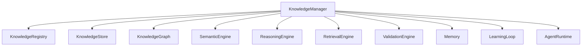

# RFC-0165

**Title:** Knowledge Architecture

**Document ID:** RFC-0165

**Version:** 1.0

**Status:** Accepted

**Category:** System Architecture

**Layer:** Cognition / Intelligence / Knowledge

**Target:**

```text
architecture/knowledge/
```

---

# Abstract

This RFC defines the SH-3 Knowledge Architecture (KA).

The Knowledge Architecture establishes the universal framework responsible for representing, storing, connecting, retrieving, reasoning over, validating, and evolving knowledge inside the SH-3 AI Operating System Framework.

Knowledge provides the intelligence foundation connecting:

```text
Memory

↓

Reasoning

↓

Planning

↓

Decision

↓

Learning
```

The Knowledge Architecture manages:

- factual knowledge
- semantic knowledge
- relational knowledge
- procedural knowledge
- contextual knowledge
- experiential knowledge
- system knowledge

Every knowledge operation SHALL be:

- typed
- versioned
- traceable
- validated
- observable
- secure
- evolvable

This document is normative.

---

# Motivation

Autonomous intelligence requires more than stored data.

Data:

```text
Information
```

is transformed into:

```text
Knowledge

↓

Understanding

↓

Decision Capability
```

SH-3 requires a structured knowledge system capable of supporting:

- reasoning
- planning
- prediction
- learning
- optimization

---

# Goals

The architecture SHALL provide:

- knowledge representation
- knowledge storage
- knowledge retrieval
- semantic relationships
- knowledge validation
- knowledge evolution

---

# Non-Goals

The architecture SHALL NOT:

- replace Memory Architecture
- replace databases
- directly execute decisions
- bypass policy controls

---

# Architecture



---

# Design Principles

## Knowledge Is Structured

Knowledge SHALL maintain explicit relationships.

---

## Knowledge Is Contextual

Meaning SHALL depend on context.

---

## Knowledge Is Evolvable

Knowledge SHALL support updates and versioning.

---

## Knowledge Is Explainable

Knowledge usage SHALL be traceable.

---

## Knowledge Is Shared Intelligence

Agents SHALL reuse validated knowledge.

---

# Components

| Component | Responsibility |
|---|---|
| KnowledgeManager | Knowledge orchestration |
| KnowledgeRegistry | Knowledge catalog |
| KnowledgeStore | Persistent storage |
| KnowledgeGraph | Relationship management |
| SemanticEngine | Meaning processing |
| RetrievalEngine | Knowledge search |
| ReasoningEngine | Knowledge inference |
| ValidationEngine | Knowledge verification |

---

# Knowledge Model

Every knowledge object SHALL contain:

```text
knowledge_id

knowledge_type

content

relationships

source

confidence

version

timestamp

context

metadata
```

---

# Knowledge Types

Supported categories:

```text
Fact Knowledge

Concept Knowledge

Relationship Knowledge

Procedural Knowledge

Experience Knowledge

System Knowledge

Domain Knowledge
```

---

# Fact Knowledge

Represents:

```text
Verified information
```

Examples:

```text
system configuration

technical specification

validated observation
```

---

# Concept Knowledge

Represents:

```text
Meaning and abstraction
```

Examples:

```text
concepts

categories

definitions
```

---

# Relationship Knowledge

Represents:

```text
connections between entities
```

Example:

```text
Agent

uses

Capability
```

---

# Procedural Knowledge

Represents:

```text
How to perform actions
```

Examples:

```text
workflow patterns

repair procedures

optimization strategies
```

---

# Experience Knowledge

Represents:

```text
Past outcomes and lessons
```

Integration:

```text
RFC-0158 Memory Architecture
```

---

# System Knowledge

Represents:

```text
SH-3 architecture

components

dependencies

runtime behavior
```

---

# Knowledge Graph

KnowledgeGraph SHALL represent:

```text
Entity

↓

Relation

↓

Entity
```

Example:

```text
Planner

creates

Workflow
```

---

# Graph Model

Nodes:

```text
Agent

Capability

Component

Concept

Event

Task

Resource
```

Edges:

```text
uses

creates

depends_on

improves

causes

related_to
```

---

# Knowledge Lifecycle

Every knowledge item SHALL follow:

```text
Created

↓

Validated

↓

Indexed

↓

Retrieved

↓

Updated

↓

Consolidated

↓

Archived
```

---

# Knowledge Acquisition

Knowledge sources:

```text
Memory

Experience

Events

Learning

External Data

System Observation
```

---

# Knowledge Validation

ValidationEngine SHALL evaluate:

```text
Source Reliability

Consistency

Confidence

Freshness

Policy Compliance
```

---

# Knowledge Retrieval

Retrieval SHALL consider:

```text
Semantic Similarity

Context

Importance

Confidence

Recency
```

---

# Reasoning Integration

ReasoningEngine SHALL use:

```text
Knowledge

+

Context

+

Rules

↓

Inference
```

---

# Planning Integration

Planner SHALL use knowledge for:

- strategy generation
- task selection
- prediction
- optimization

---

# Agent Integration

Agents SHALL access shared knowledge through:

```text
KnowledgeManager
```

---

# Memory Integration

Knowledge SHALL synchronize with:

```text
Semantic Memory

Procedural Memory

Episodic Memory
```

through:

```text
RFC-0158 Memory Architecture
```

---

# Learning Integration

LearningLoop SHALL update knowledge through:

```text
Experience

↓

Evaluation

↓

Knowledge Update
```

through:

```text
RFC-0159 Learning Loop
```

---

# Event Integration

Knowledge events:

```text
KnowledgeCreated

KnowledgeValidated

KnowledgeRetrieved

KnowledgeUpdated

KnowledgeMerged

KnowledgeArchived
```

Events SHALL follow RFC-0152.

---

# State Integration

Knowledge operations SHALL maintain:

```text
KnowledgeState

VersionState

ValidationState
```

through RFC-0157.

---

# Security Integration

Knowledge access SHALL validate:

- identity
- permission
- classification
- ownership

---

# Persistence

Knowledge storage SHALL maintain:

- objects
- relationships
- versions
- validation history
- usage history

---

# Observability

Metrics:

```text
knowledge_count

retrieval_latency

validation_rate

confidence_score

usage_frequency
```

Logs:

```text
knowledge_id

operation

source
```

Traces:

```text
retrieval

reasoning

decision
```

---

# Testing Requirements

Knowledge Architecture SHALL support:

- schema tests
- retrieval tests
- graph tests
- validation tests
- consistency tests

---

# Thread Model

Knowledge operations SHALL support concurrent:

- reads
- writes
- indexing
- retrieval
- validation

Reference implementation SHALL be:

- deterministic
- thread-safe
- asynchronous
- event-driven

---

# Performance Metrics

The architecture exposes:

- retrieval speed
- reasoning accuracy
- knowledge growth
- validation efficiency

---

# Performance Objectives

The architecture should optimize for:

- accurate knowledge
- efficient retrieval
- explainable reasoning
- continuous knowledge improvement

---

# Future Work

Potential enhancements:

- autonomous knowledge discovery
- self-building knowledge graph
- causal reasoning engine
- world model integration
- collective agent knowledge

---

# References

- RFC-0164 Agent Architecture
- RFC-0163 Autonomy Architecture
- RFC-0159 Learning Loop Architecture
- RFC-0158 Memory Architecture
- RFC-0157 State Management Architecture
- RFC-0152 Event Bus Architecture

---

# End of RFC-0165