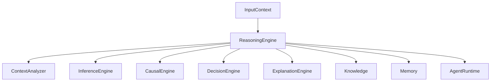

# RFC-0166

**Title:** Reasoning Architecture

**Document ID:** RFC-0166

**Version:** 1.0

**Status:** Accepted

**Category:** System Architecture

**Layer:** Cognition / Intelligence / Decision

**Target:**

```text
architecture/reasoning/
```

---

# Abstract

This RFC defines the SH-3 Reasoning Architecture (RA).

The Reasoning Architecture establishes the intelligence processing framework responsible for interpreting information, generating conclusions, evaluating alternatives, performing inference, and supporting autonomous decision making inside the SH-3 AI Operating System Framework.

The Reasoning Architecture provides:

- logical reasoning
- contextual reasoning
- causal reasoning
- probabilistic reasoning
- strategic reasoning
- decision reasoning

The Reasoning Architecture connects:

```text
Knowledge

↓

Reasoning

↓

Decision

↓

Action

↓

Evaluation

↓

Learning
```

Every reasoning operation SHALL be:

- explainable
- traceable
- deterministic where possible
- confidence aware
- policy controlled
- versioned

This document is normative.

---

# Motivation

Autonomous intelligence requires the ability to transform knowledge into decisions.

Knowledge alone:

```text
Fact
```

does not provide:

```text
Understanding

↓

Prediction

↓

Decision
```

SH-3 requires a reasoning layer capable of:

- analyzing situations
- comparing possibilities
- predicting outcomes
- selecting actions

---

# Goals

The architecture SHALL provide:

- reasoning abstraction
- inference processing
- decision support
- explanation generation
- confidence evaluation
- reasoning history management

---

# Non-Goals

The architecture SHALL NOT:

- replace Knowledge Architecture
- replace Planning Architecture
- directly execute operations
- bypass policy validation

---

# Architecture



---

# Design Principles

## Explainable Reasoning

Every important conclusion SHALL have supporting evidence.

---

## Context Aware

Reasoning SHALL consider execution context.

---

## Multi Strategy

Multiple reasoning approaches SHALL be supported.

---

## Confidence Based

Reasoning results SHALL include confidence.

---

## Continuous Improvement

Reasoning quality SHALL improve through learning.

---

# Components

| Component | Responsibility |
|---|---|
| ReasoningEngine | Reasoning orchestration |
| ContextAnalyzer | Context interpretation |
| InferenceEngine | Logical inference |
| CausalEngine | Cause analysis |
| DecisionEngine | Decision support |
| ExplanationEngine | Reason explanation |
| ReasoningMemory | Reasoning history |

---

# Reasoning Model

Every reasoning request SHALL contain:

```text
reasoning_id

context

knowledge

objective

constraints

strategy

metadata
```

---

# Reasoning Result

Every result SHALL contain:

```text
reasoning_id

conclusion

evidence

confidence

alternatives

explanation

timestamp
```

---

# Reasoning Types

Supported reasoning models:

```text
Deductive Reasoning

Inductive Reasoning

Abductive Reasoning

Causal Reasoning

Probabilistic Reasoning

Strategic Reasoning
```

---

# Deductive Reasoning

Purpose:

```text
General Rule

+

Specific Condition

↓

Conclusion
```

Used for:

- policy validation
- deterministic decisions
- system rules

---

# Inductive Reasoning

Purpose:

```text
Examples

↓

Pattern

↓

General Knowledge
```

Used for:

- learning
- optimization
- prediction

---

# Abductive Reasoning

Purpose:

```text
Observation

↓

Possible Explanation

↓

Best Cause
```

Used for:

- diagnosis
- self healing

---

# Causal Reasoning

Purpose:

```text
Cause

↓

Effect

↓

Prediction
```

Used for:

- failure analysis
- optimization
- planning

---

# Probabilistic Reasoning

Purpose:

```text
Evidence

↓

Probability

↓

Decision Confidence
```

Used for:

- uncertain environments
- risk evaluation

---

# Strategic Reasoning

Purpose:

```text
Goal

↓

Options

↓

Long Term Outcome
```

Used for:

- autonomy
- planning
- optimization

---

# Reasoning Lifecycle

Every reasoning operation SHALL follow:

```text
Request

↓

Context Analysis

↓

Knowledge Retrieval

↓

Inference

↓

Evaluation

↓

Explanation

↓

Result
```

---

# Context Analyzer

ContextAnalyzer SHALL analyze:

- current state
- goals
- constraints
- history
- available resources

---

# Inference Engine

InferenceEngine SHALL support:

- rule inference
- graph inference
- pattern inference
- similarity inference

---

# Knowledge Integration

Reasoning SHALL consume:

```text
Knowledge Graph

Semantic Memory

Procedural Memory

Experience Memory
```

Integration:

```text
RFC-0165 Knowledge Architecture
RFC-0158 Memory Architecture
```

---

# Agent Integration

Agents SHALL use ReasoningEngine for:

- understanding
- decision support
- strategy evaluation

Integration:

```text
RFC-0164 Agent Architecture
```

---

# Planning Integration

Planner SHALL use reasoning results:

```text
Reasoning

↓

Plan Generation

↓

Workflow
```

---

# Decision Integration

DecisionEngine SHALL evaluate:

```text
Options

+

Risk

+

Expected Result

↓

Action
```

---

# Learning Integration

Reasoning results SHALL become learning data:

```text
Reasoning

↓

Outcome

↓

Evaluation

↓

Improvement
```

Integration:

```text
RFC-0159 Learning Loop Architecture
```

---

# Self Healing Integration

Reasoning SHALL support:

```text
Failure

↓

Cause Analysis

↓

Recovery Decision
```

Integration:

```text
RFC-0161 Self Healing Architecture
```

---

# Event Integration

Reasoning events:

```text
ReasoningStarted

KnowledgeCollected

InferenceCompleted

DecisionGenerated

ExplanationCreated
```

Events SHALL follow RFC-0152.

---

# State Integration

Reasoning state SHALL maintain:

```text
ReasoningContext

InferenceState

DecisionState
```

Integration:

```text
RFC-0157 State Management Architecture
```

---

# Security Integration

Reasoning SHALL validate:

- knowledge permission
- context authority
- decision constraints

---

# Persistence

Reasoning history SHALL store:

- reasoning requests
- conclusions
- evidence
- confidence
- outcomes

---

# Observability

Metrics:

```text
reasoning_latency

accuracy

confidence_score

decision_quality

explanation_rate
```

Logs:

```text
reasoning_id

strategy

result
```

Traces:

```text
knowledge

inference

decision
```

---

# Testing Requirements

Reasoning Architecture SHALL support:

- inference tests
- explanation tests
- consistency tests
- replay tests
- benchmark tests

---

# Thread Model

Reasoning SHALL support concurrent:

- context analysis
- inference
- knowledge retrieval
- evaluation

Reference implementation SHALL be:

- deterministic
- thread-safe
- asynchronous
- event-driven

---

# Performance Metrics

The architecture exposes:

- reasoning latency
- inference accuracy
- decision improvement
- explanation completeness

---

# Performance Objectives

The architecture should optimize for:

- reliable conclusions
- explainable decisions
- efficient inference
- continuous improvement

---

# Future Work

Potential enhancements:

- advanced causal reasoning
- world model integration
- self-generated hypotheses
- autonomous scientific reasoning
- AGI reasoning framework

---

# References

- RFC-0165 Knowledge Architecture
- RFC-0164 Agent Architecture
- RFC-0163 Autonomy Architecture
- RFC-0159 Learning Loop Architecture
- RFC-0158 Memory Architecture

---

# End of RFC-0166