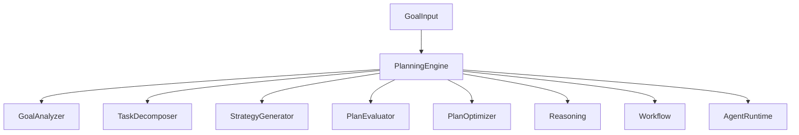

# RFC-0167

**Title:** Planning Architecture

**Document ID:** RFC-0167

**Version:** 1.0

**Status:** Accepted

**Category:** System Architecture

**Layer:** Cognition / Intelligence / Workflow

**Target:**

```text
architecture/planning/
```

---

# Abstract

This RFC defines the SH-3 Planning Architecture (PA).

The Planning Architecture establishes the autonomous planning framework responsible for transforming goals into executable strategies, decomposing objectives into tasks, generating execution plans, evaluating alternatives, and coordinating workflows inside the SH-3 AI Operating System Framework.

The Planning Architecture provides:

- goal understanding
- goal decomposition
- strategy generation
- task planning
- dependency analysis
- execution preparation
- plan optimization

The Planning Architecture connects:

```text
Goal

↓

Reasoning

↓

Planning

↓

Workflow

↓

Execution

↓

Evaluation

↓

Learning
```

Every planning operation SHALL be:

- goal-oriented
- explainable
- deterministic where possible
- versioned
- observable
- policy-controlled

This document is normative.

---

# Motivation

Autonomous systems require the ability to convert intentions into actions.

A goal:

```text
"Improve system performance"
```

must become:

```text
Objective

↓

Strategy

↓

Tasks

↓

Execution Flow

↓

Measured Result
```

SH-3 requires a planning layer capable of creating adaptive execution strategies.

---

# Goals

The architecture SHALL provide:

- goal analysis
- plan generation
- task decomposition
- dependency management
- strategy evaluation
- workflow creation

---

# Non-Goals

The architecture SHALL NOT:

- directly execute tasks
- replace Workflow Architecture
- replace Scheduler Architecture
- bypass policies

---

# Architecture



---

# Design Principles

## Goal First

Every plan SHALL originate from a defined objective.

---

## Decomposition

Complex objectives SHALL be divided into manageable tasks.

---

## Adaptability

Plans SHALL support modification.

---

## Evaluation Before Execution

Critical plans SHALL be validated before execution.

---

## Continuous Improvement

Planning quality SHALL improve through feedback.

---

# Components

| Component | Responsibility |
|---|---|
| PlanningEngine | Planning orchestration |
| GoalAnalyzer | Goal interpretation |
| TaskDecomposer | Task generation |
| StrategyGenerator | Strategy creation |
| PlanEvaluator | Plan analysis |
| PlanOptimizer | Plan improvement |
| PlanRepository | Plan storage |

---

# Planning Model

Every plan SHALL contain:

```text
plan_id

goal_id

strategy

tasks

dependencies

constraints

resources

validation

version
```

---

# Goal Model

Planning SHALL consume:

```text
Goal

Objective

Constraints

Priority

Context

Expected Outcome
```

---

# Goal Analysis

GoalAnalyzer SHALL identify:

- objective
- required capabilities
- constraints
- expected results
- success criteria

---

# Task Decomposition

TaskDecomposer SHALL transform:

```text
Goal

↓

Sub Goals

↓

Tasks

↓

Actions
```

Example:

```text
Improve Performance

↓

Analyze Metrics

↓

Detect Bottleneck

↓

Optimize Component

↓

Validate Result
```

---

# Task Model

Every task SHALL contain:

```text
task_id

description

dependency

capability

resource_requirement

priority

validation_rule
```

---

# Strategy Generation

StrategyGenerator SHALL produce:

```text
Strategy

↓

Execution Options

↓

Expected Results

↓

Risk Evaluation
```

---

# Strategy Types

Supported strategies:

```text
Sequential Strategy

Parallel Strategy

Adaptive Strategy

Recovery Strategy

Optimization Strategy
```

---

# Dependency Analysis

Planning SHALL analyze:

```text
Task Relationship

↓

Execution Order

↓

Resource Conflict

↓

Optimization Opportunity
```

---

# Plan Evaluation

PlanEvaluator SHALL measure:

```text
Goal Achievement

+

Cost

+

Risk

+

Efficiency
```

---

# Plan Optimization

PlanOptimizer SHALL improve:

- task ordering
- parallel execution
- resource usage
- execution efficiency

Integration:

```text
RFC-0162 Optimization Architecture
```

---

# Reasoning Integration

Planning SHALL use:

```text
Knowledge

+

Reasoning

+

Context

↓

Plan
```

Integration:

```text
RFC-0166 Reasoning Architecture
RFC-0165 Knowledge Architecture
```

---

# Workflow Integration

Validated plans SHALL become workflows:

```text
Plan

↓

Workflow

↓

Scheduler

↓

Runtime
```

Integration:

```text
RFC-0153 Workflow Architecture
```

---

# Agent Integration

Agents SHALL use PlanningEngine for:

- task strategy
- execution preparation
- collaboration planning

Integration:

```text
RFC-0164 Agent Architecture
```

---

# Memory Integration

Planning SHALL use:

- previous plans
- successful strategies
- failure history

Integration:

```text
RFC-0158 Memory Architecture
```

---

# Learning Integration

Planning results SHALL produce:

```text
Plan

↓

Execution Result

↓

Evaluation

↓

Learning Update
```

Integration:

```text
RFC-0159 Learning Loop Architecture
```

---

# Event Integration

Planning events:

```text
GoalReceived

PlanningStarted

TaskGenerated

PlanCreated

PlanValidated

PlanOptimized
```

Events SHALL follow RFC-0152.

---

# State Integration

Planning SHALL maintain:

```text
PlanningState

GoalState

PlanState

TaskState
```

Integration:

```text
RFC-0157 State Management Architecture
```

---

# Security Integration

Planning SHALL validate:

- goal authorization
- capability permission
- resource limits
- policy restrictions

---

# Persistence

Planning SHALL store:

- goals
- plans
- strategies
- task graphs
- evaluation results

---

# Observability

Metrics:

```text
planning_latency

plan_success_rate

task_accuracy

optimization_gain

goal_completion_rate
```

Logs:

```text
plan_id

goal_id

strategy
```

Traces:

```text
goal

plan

workflow
```

---

# Testing Requirements

Planning Architecture SHALL support:

- decomposition tests
- strategy tests
- dependency tests
- simulation tests
- replay tests

---

# Thread Model

Planning SHALL support concurrent:

- goal analysis
- task generation
- strategy evaluation
- plan optimization

Reference implementation SHALL be:

- deterministic
- thread-safe
- asynchronous
- event-driven

---

# Performance Metrics

The architecture exposes:

- planning latency
- plan quality
- execution efficiency
- adaptation speed

---

# Performance Objectives

The architecture should optimize for:

- accurate planning
- efficient execution
- adaptive strategies
- continuous improvement

---

# Future Work

Potential enhancements:

- autonomous long-term planning
- hierarchical planning
- multi-agent planning
- predictive planning
- self-generated objectives

---

# References

- RFC-0166 Reasoning Architecture
- RFC-0165 Knowledge Architecture
- RFC-0164 Agent Architecture
- RFC-0163 Autonomy Architecture
- RFC-0153 Workflow Architecture

---

# End of RFC-0167