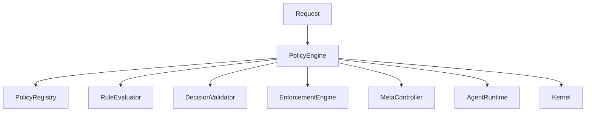

# RFC-0168

**Title:** Policy Architecture

**Document ID:** RFC-0168

**Version:** 1.0

**Status:** Accepted

**Category:** System Architecture

**Layer:** Governance / Security / Cognition

**Target:**

```text
architecture/policy/
```

---

# Abstract

This RFC defines the SH-3 Policy Architecture (PA).

The Policy Architecture establishes the governance framework responsible for controlling, validating, restricting, and guiding autonomous system behavior across the SH-3 AI Operating System Framework.

Policy provides the decision boundary between:

```text
Capability

+

Autonomy

+

Execution

↓

Allowed Behavior
```

The Policy Architecture manages:

- security policies
- execution policies
- autonomy policies
- resource policies
- learning policies
- agent policies
- recovery policies
- optimization policies

Every policy operation SHALL be:

- explicit
- versioned
- auditable
- deterministic
- enforceable
- observable

This document is normative.

---

# Motivation

Autonomous systems require control boundaries.

Without policy control:

```text
Capability

↓

Action

↓

Unknown Impact
```

SH-3 requires:

```text
Intent

↓

Policy Evaluation

↓

Allowed Action

↓

Execution
```

Policy provides safe autonomy.

---

# Goals

The architecture SHALL provide:

- policy definition
- policy evaluation
- policy enforcement
- policy versioning
- policy auditing
- policy evolution

---

# Non-Goals

The architecture SHALL NOT:

- replace security infrastructure
- replace authentication systems
- directly execute operations
- prevent controlled autonomous improvement

---

# Architecture



---

# Design Principles

## Policy Before Action

Every important operation SHALL pass policy evaluation.

---

## Explicit Control

Policies SHALL be visible and traceable.

---

## Least Privilege

Actions SHALL receive only required permissions.

---

## Dynamic Governance

Policies SHALL support runtime updates.

---

## Safe Autonomy

Autonomous behavior SHALL operate within boundaries.

---

# Components

| Component | Responsibility |
|---|---|
| PolicyEngine | Policy orchestration |
| PolicyRegistry | Policy storage |
| RuleEvaluator | Rule processing |
| DecisionValidator | Decision approval |
| EnforcementEngine | Policy execution |
| PolicyMonitor | Compliance monitoring |
| PolicyManager | Lifecycle management |

---

# Policy Model

Every policy SHALL contain:

```text
policy_id

policy_type

version

scope

rules

priority

owner

status

metadata
```

---

# Policy Types

Supported policies:

```text
Security Policy

Execution Policy

Resource Policy

Agent Policy

Autonomy Policy

Learning Policy

Recovery Policy

Optimization Policy
```

---

# Security Policy

Controls:

```text
identity

permission

access

authentication

authorization
```

---

# Execution Policy

Controls:

```text
allowed operations

execution limits

environment restrictions

runtime constraints
```

---

# Resource Policy

Controls:

```text
CPU limits

Memory limits

Storage limits

Network limits

Priority allocation
```

Integration:

```text
RFC-0155 Resource Management Architecture
```

---

# Agent Policy

Controls:

```text
agent permissions

capabilities

communication rules

authority level
```

Integration:

```text
RFC-0164 Agent Architecture
```

---

# Autonomy Policy

Controls:

```text
autonomy level

approval requirements

decision boundaries

risk limits
```

Integration:

```text
RFC-0163 Autonomy Architecture
```

---

# Learning Policy

Controls:

```text
learning scope

experiment permission

behavior modification

rollback requirement
```

Integration:

```text
RFC-0159 Learning Loop Architecture
```

---

# Recovery Policy

Controls:

```text
repair actions

rollback authority

failure response

recovery priority
```

Integration:

```text
RFC-0161 Self Healing Architecture
```

---

# Optimization Policy

Controls:

```text
allowed optimization

change scope

validation requirement

deployment condition
```

Integration:

```text
RFC-0162 Optimization Architecture
```

---

# Policy Evaluation

PolicyEngine SHALL evaluate:

```text
Request

↓

Context

↓

Applicable Policies

↓

Rules

↓

Decision
```

---

# Policy Decision Model

Every policy decision SHALL contain:

```text
decision_id

request

policy

result

reason

timestamp

version
```

---

# Decision Results

Supported results:

```text
ALLOW

DENY

REQUIRE_APPROVAL

LIMIT

AUDIT
```

---

# Rule Model

Every rule SHALL contain:

```text
condition

action

priority

effect

metadata
```

---

# Policy Lifecycle

Every policy SHALL follow:

```text
Created

↓

Validated

↓

Activated

↓

Evaluated

↓

Updated

↓

Deprecated
```

---

# Policy Conflict Resolution

When policies conflict:

Priority:

```text
System Policy

↓

Security Policy

↓

Safety Policy

↓

Operational Policy

↓

Optimization Policy
```

shall determine precedence.

---

# Meta Controller Integration

Meta Controller SHALL supervise:

- policy evolution
- autonomy boundaries
- governance changes

Integration:

```text
RFC-0160 Meta Controller Architecture
```

---

# Agent Integration

Agents SHALL validate:

```text
Capability

↓

Policy

↓

Action
```

before execution.

---

# Reasoning Integration

Reasoning SHALL include:

```text
Policy Constraints

↓

Decision Space

↓

Valid Options
```

Integration:

```text
RFC-0166 Reasoning Architecture
```

---

# Planning Integration

Planning SHALL consider:

```text
Goal

+

Policy Constraints

↓

Executable Plan
```

Integration:

```text
RFC-0167 Planning Architecture
```

---

# Event Integration

Policy events:

```text
PolicyCreated

PolicyUpdated

PolicyEvaluated

PolicyViolation

PolicyApproved
```

Events SHALL follow RFC-0152.

---

# State Integration

Policy State SHALL maintain:

```text
ActivePolicies

PolicyVersion

ViolationHistory
```

Integration:

```text
RFC-0157 State Management Architecture
```

---

# Security Integration

Policy Architecture SHALL integrate with:

- identity management
- access control
- audit system
- compliance system

---

# Persistence

Policy persistence SHALL maintain:

- definitions
- versions
- evaluation history
- violations
- approvals

---

# Observability

Metrics:

```text
policy_evaluations

allow_rate

deny_rate

violation_count

approval_latency
```

Logs:

```text
policy_id

decision

reason
```

Traces:

```text
request

evaluation

execution
```

---

# Testing Requirements

Policy Architecture SHALL support:

- rule tests
- conflict tests
- permission tests
- compliance tests
- regression tests

---

# Thread Model

Policy operations SHALL support concurrent:

- evaluations
- updates
- validation
- monitoring

Reference implementation SHALL be:

- deterministic
- thread-safe
- low latency
- event-driven

---

# Performance Metrics

The architecture exposes:

- evaluation latency
- rule processing rate
- policy coverage
- violation detection rate

---

# Performance Objectives

The architecture should optimize for:

- safe autonomy
- fast validation
- transparent governance
- reliable enforcement

---

# Future Work

Potential enhancements:

- AI-generated policies
- adaptive governance
- predictive risk policies
- autonomous compliance management
- formal verification integration

---

# References

- RFC-0167 Planning Architecture
- RFC-0166 Reasoning Architecture
- RFC-0164 Agent Architecture
- RFC-0163 Autonomy Architecture
- RFC-0160 Meta Controller Architecture

---

# End of RFC-0168