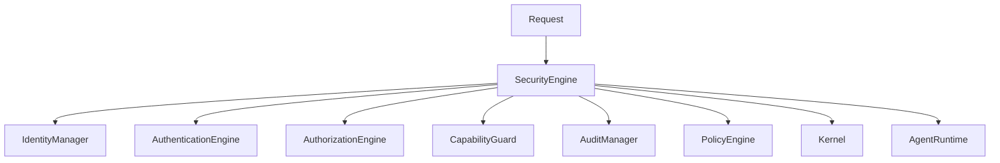

# RFC-0169

**Title:** Security Architecture

**Document ID:** RFC-0169

**Version:** 1.0

**Status:** Accepted

**Category:** System Architecture

**Layer:** Security / Infrastructure / Governance

**Target:**

```text
architecture/security/
```

---

# Abstract

This RFC defines the SH-3 Security Architecture (SA).

The Security Architecture establishes the protection framework responsible for securing identities, capabilities, communications, data, execution environments, and autonomous operations across the SH-3 AI Operating System Framework.

Security provides the protection boundary between:

```text
Identity

↓

Authorization

↓

Capability

↓

Execution

↓

Audit
```

The Security Architecture manages:

- identity management
- authentication
- authorization
- capability security
- communication security
- data protection
- execution isolation
- audit management
- threat detection

Every security operation SHALL be:

- explicit
- verifiable
- auditable
- deterministic
- policy-controlled
- fail-safe

This document is normative.

---

# Motivation

Autonomous AI systems require stronger security boundaries than traditional software.

SH-3 contains:

```text
Agents

+

Autonomy

+

Learning

+

Self Modification

+

Distributed Execution
```

Therefore security SHALL protect:

```text
Who can act?

↓

What can act?

↓

What can be changed?

↓

How is it verified?
```

---

# Goals

The architecture SHALL provide:

- secure identity
- access control
- capability isolation
- secure communication
- auditability
- threat detection
- security lifecycle management

---

# Non-Goals

The architecture SHALL NOT:

- replace operating system security
- replace network security infrastructure
- bypass policy enforcement
- prevent approved autonomous operations

---

# Architecture



---

# Design Principles

## Zero Trust

Every request SHALL be verified.

---

## Least Privilege

Access SHALL be limited to required permissions.

---

## Defense In Depth

Multiple security layers SHALL protect the system.

---

## Complete Auditability

Security decisions SHALL be traceable.

---

## Secure Autonomy

Autonomous actions SHALL remain controlled.

---

# Components

| Component | Responsibility |
|---|---|
| SecurityCore | Security orchestration |
| IdentityManager | Identity lifecycle |
| AuthenticationEngine | Identity verification |
| AuthorizationEngine | Permission evaluation |
| CapabilityGuard | Capability protection |
| EncryptionManager | Data protection |
| AuditManager | Security records |
| ThreatDetector | Threat analysis |

---

# Security Model

Every security request SHALL contain:

```text
request_id

identity

resource

action

context

timestamp

metadata
```

---

# Identity Management

IdentityManager SHALL manage:

```text
Identity

↓

Credential

↓

Authority

↓

Lifecycle
```

---

# Identity Model

Every identity SHALL contain:

```text
identity_id

type

owner

permissions

status

version
```

---

# Identity Types

Supported identities:

```text
Human Identity

Agent Identity

Service Identity

Component Identity

System Identity
```

---

# Authentication

AuthenticationEngine SHALL verify:

- identity validity
- credential validity
- session validity
- trust level

---

# Authentication Flow

```text
Request

↓

Identity Check

↓

Credential Verification

↓

Trust Evaluation

↓

Authenticated
```

---

# Authorization

AuthorizationEngine SHALL determine:

```text
Identity

+

Resource

+

Action

+

Policy

↓

Permission Result
```

---

# Authorization Results

Supported results:

```text
ALLOW

DENY

LIMIT

REQUIRE_APPROVAL
```

---

# Capability Security

Every capability SHALL define:

```text
capability_id

owner

permission

scope

risk_level

version
```

---

# CapabilityGuard

CapabilityGuard SHALL prevent:

- unauthorized tool usage
- unsafe execution
- privilege escalation
- invalid resource access

---

# Agent Security

Agents SHALL have:

```text
Agent Identity

+

Agent Capability

+

Agent Policy

+

Agent Permission
```

Integration:

```text
RFC-0164 Agent Architecture
RFC-0168 Policy Architecture
```

---

# Communication Security

Internal communication SHALL support:

- message authentication
- integrity validation
- sender verification
- replay protection

Integration:

```text
RFC-0152 Event Bus Architecture
```

---

# Data Protection

Protected data includes:

```text
Memory Data

Knowledge Data

State Data

Configuration Data

Execution Data
```

---

# Encryption Management

EncryptionManager SHALL support:

- data encryption
- key management
- secure storage
- secure transport

---

# Execution Isolation

Security Architecture SHALL isolate:

```text
Agent

↓

Capability

↓

Runtime

↓

Resource
```

---

# Threat Detection

ThreatDetector SHALL monitor:

- abnormal behavior
- unauthorized access
- policy violations
- suspicious execution
- resource abuse

---

# Security Lifecycle

Security objects SHALL follow:

```text
Created

↓

Validated

↓

Active

↓

Monitored

↓

Updated

↓

Revoked
```

---

# Policy Integration

Security decisions SHALL use:

```text
Security Policy

+

Execution Policy

+

Agent Policy

+

Autonomy Policy
```

Integration:

```text
RFC-0168 Policy Architecture
```

---

# Autonomy Integration

Security SHALL control:

```text
Autonomy Level

↓

Allowed Capability

↓

Execution Boundary
```

Integration:

```text
RFC-0163 Autonomy Architecture
```

---

# Self Healing Integration

Security incidents SHALL produce:

```text
Threat

↓

Detection

↓

Recovery

↓

Learning
```

Integration:

```text
RFC-0161 Self Healing Architecture
```

---

# Learning Integration

Security events SHALL become learning data:

```text
Incident

↓

Analysis

↓

Improvement
```

Integration:

```text
RFC-0159 Learning Loop Architecture
```

---

# Event Integration

Security events:

```text
AuthenticationSucceeded

AuthenticationFailed

AuthorizationDenied

SecurityViolation

ThreatDetected

CapabilityBlocked
```

Events SHALL follow RFC-0152.

---

# State Integration

Security State SHALL maintain:

```text
IdentityState

PermissionState

ThreatState

AuditState
```

Integration:

```text
RFC-0157 State Management Architecture
```

---

# Persistence

Security persistence SHALL maintain:

- identities
- permissions
- credentials
- audit records
- security events
- threat history

---

# Observability

Metrics:

```text
authentication_rate

authorization_latency

security_events

blocked_actions

threat_count
```

Logs:

```text
identity

action

decision
```

Traces:

```text
request

verification

execution
```

---

# Testing Requirements

Security Architecture SHALL support:

- authentication tests
- authorization tests
- penetration tests
- isolation tests
- audit tests
- policy tests

---

# Thread Model

Security operations SHALL support concurrent:

- authentication
- authorization
- auditing
- monitoring

Reference implementation SHALL be:

- deterministic
- thread-safe
- low latency
- event-driven

---

# Performance Metrics

The architecture exposes:

- authentication latency
- authorization latency
- threat detection speed
- audit completeness

---

# Performance Objectives

The architecture should optimize for:

- strong security
- minimal overhead
- transparent operation
- reliable protection

---

# Future Work

Potential enhancements:

- AI security analyst
- autonomous threat response
- formal security verification
- adaptive security policies
- zero trust distributed architecture

---

# References

- RFC-0168 Policy Architecture
- RFC-0164 Agent Architecture
- RFC-0163 Autonomy Architecture
- RFC-0161 Self Healing Architecture
- RFC-0152 Event Bus Architecture

---

# End of RFC-0169