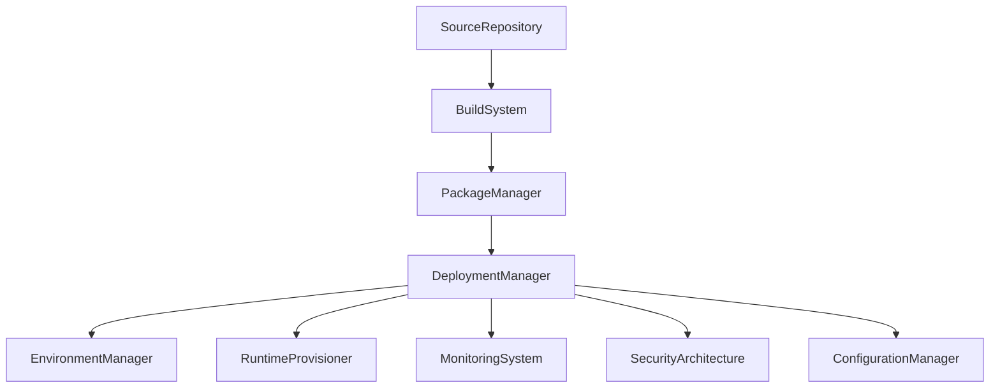

# RFC-0170

**Title:** Deployment Architecture

**Document ID:** RFC-0170

**Version:** 1.0

**Status:** Accepted

**Category:** System Architecture

**Layer:** Deployment / Operations / Infrastructure

**Target:**

```text
architecture/deployment/
```

---

# Abstract

This RFC defines the SH-3 Deployment Architecture (DA).

The Deployment Architecture establishes the production deployment framework responsible for packaging, provisioning, configuring, releasing, updating, monitoring, and operating SH-3 as a production-grade AI Operating System Framework.

The Deployment Architecture provides:

- deployment models
- package management
- environment management
- configuration management
- version management
- runtime provisioning
- upgrade strategy
- rollback mechanism
- operational lifecycle

The Deployment Architecture connects:

```text
Source

↓

Build

↓

Package

↓

Deploy

↓

Runtime

↓

Monitor

↓

Update
```

Every deployment operation SHALL be:

- reproducible
- versioned
- traceable
- secure
- automated
- reversible

This document is normative.

---

# Motivation

Production AI systems require more than application code.

SH-3 contains:

```text
Kernel

+

Runtime

+

Cognition

+

Agents

+

Learning

+

Autonomy

+

Self Healing
```

Therefore deployment must support:

```text
Reliable Installation

↓

Safe Execution

↓

Continuous Operation

↓

Controlled Evolution
```

---

# Goals

The architecture SHALL provide:

- production deployment
- environment isolation
- component packaging
- configuration control
- upgrade management
- rollback support
- operational automation

---

# Non-Goals

The architecture SHALL NOT:

- replace Runtime Architecture
- replace Infrastructure Architecture
- directly manage application logic
- bypass Security Architecture

---

# Deployment Architecture



---

# Design Principles

## Reproducible Deployment

The same input SHALL produce the same deployment result.

---

## Immutable Versioning

Released versions SHALL remain identifiable.

---

## Automation First

Deployment SHALL minimize manual operations.

---

## Safe Evolution

Updates SHALL support validation and rollback.

---

## Environment Independence

The system SHALL operate across environments.

---

# Components

| Component | Responsibility |
|---|---|
| DeploymentManager | Deployment orchestration |
| BuildSystem | Build process |
| PackageManager | Package handling |
| EnvironmentManager | Environment control |
| ConfigurationManager | Configuration lifecycle |
| RuntimeProvisioner | Runtime preparation |
| ReleaseManager | Version releases |
| RollbackManager | Recovery |

---

# Deployment Model

Supported models:

```text
Single Node Deployment

Distributed Deployment

Cloud Deployment

Edge Deployment

Hybrid Deployment
```

---

# Package Model

Every SH-3 package SHALL contain:

```text
package_id

version

components

dependencies

configuration

checksum

metadata
```

---

# Component Packaging

SH-3 components SHALL be independently deployable:

```text
Foundation

Infrastructure

Runtime

Cognition

Kernel

Autonomy

Deployment
```

---

# Version Management

Every release SHALL contain:

```text
release_id

version

build_number

timestamp

components

compatibility
```

---

# Version Policy

SH-3 SHALL support:

```text
Major Version

Minor Version

Patch Version
```

Example:

```text
2.0.0

2.1.0

2.1.1
```

---

# Environment Management

Supported environments:

```text
Development

Testing

Staging

Production
```

---

# Environment Model

Every environment SHALL define:

```text
environment_id

configuration

resources

security_policy

runtime_version
```

---

# Configuration Management

Configuration SHALL support:

- external configuration
- version control
- validation
- secure secrets handling

---

# Configuration Lifecycle

```text
Created

↓

Validated

↓

Applied

↓

Monitored

↓

Updated

↓

Archived
```

---

# Runtime Provisioning

RuntimeProvisioner SHALL prepare:

```text
Python Environment

Dependencies

Storage

Network

Security Context

Runtime Services
```

---

# Deployment Pipeline

Standard pipeline:

```text
Commit

↓

Build

↓

Test

↓

Package

↓

Security Scan

↓

Deploy

↓

Validate

↓

Activate
```

---

# Validation

Deployment validation SHALL verify:

```text
Component Health

Dependency Compatibility

Security Status

Runtime Availability

Performance
```

---

# Upgrade Strategy

SH-3 SHALL support:

```text
Rolling Upgrade

Blue Green Deployment

Canary Deployment
```

---

# Rollback

RollbackManager SHALL support:

```text
Failure Detection

↓

Previous Version Restore

↓

State Recovery

↓

Validation
```

---

# Runtime Integration

Deployment SHALL provision:

```text
Runtime

↓

Kernel

↓

Services

↓

Agents
```

Integration:

```text
RFC-0156 Runtime Architecture
```

---

# Security Integration

Deployment SHALL validate:

- package integrity
- signatures
- permissions
- environment security

Integration:

```text
RFC-0169 Security Architecture
```

---

# Policy Integration

Deployment operations SHALL follow:

```text
Deployment Policy

+

Security Policy

+

Resource Policy
```

Integration:

```text
RFC-0168 Policy Architecture
```

---

# Self Healing Integration

Deployment recovery SHALL support:

```text
Deployment Failure

↓

Detection

↓

Rollback

↓

Recovery
```

Integration:

```text
RFC-0161 Self Healing Architecture
```

---

# Monitoring Integration

Deployment SHALL expose:

- health status
- version status
- deployment status
- resource status

---

# Event Integration

Deployment events:

```text
BuildStarted

PackageCreated

DeploymentStarted

DeploymentCompleted

DeploymentFailed

RollbackStarted

RollbackCompleted
```

Events SHALL follow RFC-0152.

---

# State Integration

Deployment State SHALL maintain:

```text
DeploymentStatus

VersionState

EnvironmentState

ReleaseState
```

Integration:

```text
RFC-0157 State Management Architecture
```

---

# Persistence

Deployment persistence SHALL store:

- releases
- packages
- configurations
- deployment history
- rollback points

---

# Observability

Metrics:

```text
deployment_success_rate

deployment_time

rollback_count

version_distribution

health_status
```

Logs:

```text
release_id

environment

operation
```

Traces:

```text
build

deployment

validation
```

---

# Testing Requirements

Deployment Architecture SHALL support:

- build tests
- package tests
- installation tests
- upgrade tests
- rollback tests
- environment tests

---

# Thread Model

Deployment operations SHALL support concurrent:

- package processing
- environment checks
- monitoring
- validation

Reference implementation SHALL be:

- deterministic
- thread-safe
- automated
- event-driven

---

# Performance Metrics

The architecture exposes:

- deployment duration
- recovery duration
- update success rate
- operational availability

---

# Performance Objectives

The architecture should optimize for:

- reliable releases
- minimal downtime
- fast recovery
- operational stability

---

# Future Work

Potential enhancements:

- autonomous deployment optimization
- self-managed infrastructure
- AI operations management
- distributed SH-3 federation
- autonomous version migration

---

# References

- RFC-0169 Security Architecture
- RFC-0168 Policy Architecture
- RFC-0161 Self Healing Architecture
- RFC-0157 State Management Architecture
- RFC-0156 Runtime Architecture

---

# End of RFC-0170