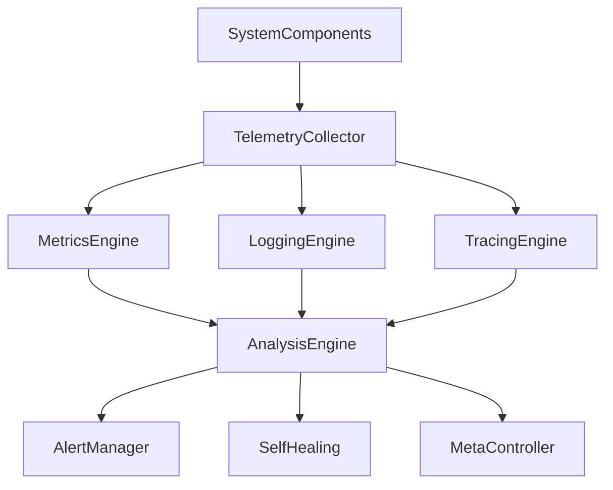

# RFC-0171

**Title:** Observability Architecture

**Document ID:** RFC-0171

**Version:** 1.0

**Status:** Accepted

**Category:** System Architecture

**Layer:** Infrastructure / Operations / Reliability

**Target:**

```text
architecture/observability/
```

---

# Abstract

This RFC defines the SH-3 Observability Architecture (OA).

The Observability Architecture establishes the system visibility framework responsible for collecting, processing, analyzing, correlating, and presenting operational information from every SH-3 subsystem.

Observability enables:

```text
System State

↓

Measurement

↓

Understanding

↓

Decision

↓

Improvement
```

The architecture manages:

- Metrics
- Logging
- Distributed Tracing
- Health Monitoring
- Performance Analysis
- Alert Management
- Diagnostic Information
- Operational Intelligence

Every observability operation SHALL be:

- accurate
- low overhead
- traceable
- versioned
- secure
- deterministic

This document is normative.

---

# Motivation

Complex autonomous systems require complete visibility.

SH-3 contains:

```text
Runtime

Kernel

Agents

Cognition

Learning

Self Healing

Optimization

Deployment
```

Without observability:

```text
Failure

↓

Unknown Cause
```

With observability:

```text
Event

↓

Measurement

↓

Diagnosis

↓

Recovery

↓

Improvement
```

---

# Goals

The architecture SHALL provide:

- complete system visibility
- operational diagnostics
- performance measurement
- failure analysis
- autonomous monitoring
- optimization feedback

---

# Non-Goals

The architecture SHALL NOT:

- replace Logging implementations
- replace Monitoring infrastructure
- directly control execution
- bypass security auditing

---

# Architecture



---

# Design Principles

## Everything Observable

Every important operation SHALL produce telemetry.

---

## Correlation First

Metrics, logs, and traces SHALL be correlated.

---

## Low Impact

Observability SHALL minimize execution overhead.

---

## Historical Analysis

System behavior SHALL remain analyzable over time.

---

## Actionable Information

Observability SHALL support decisions.

---

# Components

| Component | Responsibility |
|---|---|
| ObservabilityCore | Main coordinator |
| TelemetryCollector | Data collection |
| MetricsEngine | Metric processing |
| LoggingEngine | Log management |
| TracingEngine | Trace management |
| AnalysisEngine | Analysis |
| AlertManager | Notification control |
| DashboardManager | Visualization |

---

# Telemetry Model

Every telemetry record SHALL contain:

```text
telemetry_id

timestamp

source

type

value

context

trace_id

metadata
```

---

# Observability Signals

SH-3 SHALL support:

```text
Metrics

Logs

Traces

Events

Profiles
```

---

# Metrics Architecture

Metrics SHALL measure:

```text
Availability

Performance

Resource Usage

Quality

Reliability
```

---

# Core Metrics

System metrics:

```text
cpu_usage

memory_usage

storage_usage

network_usage
```

Runtime metrics:

```text
execution_time

task_count

queue_size

error_rate
```

Cognition metrics:

```text
reasoning_latency

planning_accuracy

learning_gain
```

Autonomy metrics:

```text
goal_success_rate

decision_quality

policy_events
```

---

# Logging Architecture

LoggingEngine SHALL provide:

- structured logs
- severity levels
- correlation IDs
- searchable history

---

# Log Model

Every log entry SHALL contain:

```text
log_id

timestamp

level

source

message

trace_id

metadata
```

---

# Log Levels

Supported levels:

```text
DEBUG

INFO

WARNING

ERROR

CRITICAL
```

---

# Distributed Tracing

TracingEngine SHALL track:

```text
Request

↓

Agent

↓

Workflow

↓

Runtime

↓

Result
```

---

# Trace Model

Every trace SHALL contain:

```text
trace_id

span_id

parent_id

operation

duration

status
```

---

# Health Monitoring

HealthMonitor SHALL observe:

```text
Component Status

Dependency Status

Resource Status

Behavior Status
```

---

# Health States

```text
Healthy

↓

Warning

↓

Degraded

↓

Failed

↓

Recovering
```

---

# Performance Analysis

AnalysisEngine SHALL detect:

- bottlenecks
- abnormal behavior
- degradation
- optimization opportunities

Integration:

```text
RFC-0162 Optimization Architecture
```

---

# Alert Management

AlertManager SHALL handle:

```text
Detection

↓

Classification

↓

Priority

↓

Notification

↓

Resolution Tracking
```

---

# Alert Model

Every alert SHALL contain:

```text
alert_id

severity

source

condition

timestamp

status
```

---

# Self Healing Integration

Observability SHALL provide:

```text
Detection Data

↓

Diagnosis Input

↓

Recovery Validation
```

Integration:

```text
RFC-0161 Self Healing Architecture
```

---

# Optimization Integration

Telemetry SHALL provide:

```text
Performance Data

↓

Analysis

↓

Optimization Strategy
```

Integration:

```text
RFC-0162 Optimization Architecture
```

---

# Learning Integration

Observability data SHALL become learning input:

```text
Observation

↓

Experience

↓

Learning

↓

Improvement
```

Integration:

```text
RFC-0159 Learning Loop Architecture
```

---

# Meta Controller Integration

Meta Controller SHALL consume:

- system health
- performance trends
- operational state
- optimization signals

Integration:

```text
RFC-0160 Meta Controller Architecture
```

---

# Security Integration

Observability SHALL protect:

- sensitive logs
- telemetry access
- audit information

Integration:

```text
RFC-0169 Security Architecture
```

---

# Event Integration

Observability events:

```text
TelemetryCollected

MetricThresholdExceeded

LogCreated

TraceCompleted

AlertTriggered

HealthChanged
```

Events SHALL follow RFC-0152.

---

# State Integration

Observability State SHALL maintain:

```text
HealthState

MetricState

AlertState

TraceState
```

Integration:

```text
RFC-0157 State Management Architecture
```

---

# Persistence

Observability SHALL store:

- metrics history
- logs
- traces
- alerts
- diagnostics

---

# Testing Requirements

Observability SHALL support:

- telemetry tests
- metric validation
- log tests
- trace correlation tests
- alert tests

---

# Thread Model

Observability SHALL support concurrent:

- telemetry collection
- metric processing
- log writing
- trace generation
- analysis

Reference implementation SHALL be:

- deterministic
- thread-safe
- asynchronous
- event-driven

---

# Performance Metrics

The architecture exposes:

```text
collection_latency

processing_latency

storage_efficiency

alert_accuracy
```

---

# Performance Objectives

The architecture should optimize for:

- complete visibility
- low overhead
- fast diagnosis
- operational intelligence

---

# Future Work

Potential enhancements:

- predictive observability
- AI anomaly detection
- autonomous incident analysis
- self-generated dashboards
- causal telemetry analysis

---

# References

- RFC-0170 Deployment Architecture
- RFC-0169 Security Architecture
- RFC-0162 Optimization Architecture
- RFC-0161 Self Healing Architecture
- RFC-0152 Event Bus Architecture

---

# End of RFC-0171