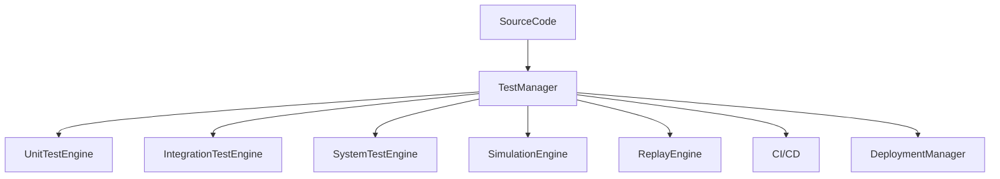

# RFC-0172

**Title:** Testing Architecture

**Document ID:** RFC-0172

**Version:** 1.0

**Status:** Accepted

**Category:** System Architecture

**Layer:** Quality / Reliability / Development

**Target:**

```text
architecture/testing/
```

---

# Abstract

This RFC defines the SH-3 Testing Architecture (TA).

The Testing Architecture establishes the verification framework responsible for validating correctness, reliability, compatibility, safety, performance, and evolutionary stability across the SH-3 AI Operating System Framework.

The Testing Architecture provides:

- unit testing
- integration testing
- system testing
- regression testing
- deterministic replay testing
- simulation testing
- fault injection testing
- quality validation

The Testing Architecture connects:

```text
Development

↓

Validation

↓

Deployment

↓

Monitoring

↓

Improvement
```

Every test operation SHALL be:

- deterministic
- reproducible
- automated
- traceable
- isolated
- measurable

This document is normative.

---

# Motivation

SH-3 is a layered autonomous system.

The architecture contains:

```text
Foundation

Infrastructure

Runtime

Kernel

Cognition

Agent

Autonomy

Self Healing

Learning
```

Complex autonomous systems require continuous validation.

Without testing:

```text
Change

↓

Unknown Impact

↓

System Risk
```

With testing:

```text
Change

↓

Verification

↓

Safe Evolution
```

---

# Goals

The architecture SHALL provide:

- correctness verification
- compatibility verification
- behavioral validation
- regression prevention
- reliability assurance
- autonomous system verification

---

# Non-Goals

The architecture SHALL NOT:

- replace runtime monitoring
- replace observability
- replace security validation
- execute production workloads

---

# Architecture



---

# Design Principles

## Everything Testable

Every component SHALL expose test boundaries.

---

## Deterministic Validation

The same input SHALL produce comparable results.

---

## Isolation First

Tests SHALL avoid unintended side effects.

---

## Continuous Verification

Every change SHALL be validated.

---

## Failure Is Information

Test failures SHALL become improvement signals.

---

# Components

| Component | Responsibility |
|---|---|
| TestManager | Test orchestration |
| UnitTestEngine | Component validation |
| IntegrationTestEngine | Layer validation |
| SystemTestEngine | Full system validation |
| SimulationEngine | Scenario testing |
| ReplayEngine | Deterministic reproduction |
| FaultInjector | Failure testing |
| QualityGate | Release decision |

---

# Test Model

Every test SHALL contain:

```text
test_id

target

input

environment

expected_result

actual_result

status

metadata
```

---

# Test Types

SH-3 SHALL support:

```text
Unit Test

Integration Test

System Test

Regression Test

Performance Test

Security Test

Simulation Test

Chaos Test
```

---

# Unit Testing

Unit tests SHALL validate:

- functions
- classes
- modules
- isolated behaviors

Targets:

```text
Foundation

Infrastructure

Runtime Components
```

---

# Integration Testing

Integration tests SHALL validate:

```text
Component

↓

Layer

↓

Subsystem
```

Examples:

```text
Runtime + Kernel

Memory + Learning

Agent + Policy
```

---

# System Testing

System testing SHALL validate:

```text
Complete SH-3 Runtime

↓

Complete Execution Flow
```

---

# Regression Testing

Regression testing SHALL verify:

```text
Existing Behavior

↓

New Version

↓

Compatibility
```

---

# Deterministic Replay Testing

ReplayEngine SHALL support:

```text
Event History

+

State Snapshot

+

Input Data

↓

Same Execution Result
```

Integration:

```text
RFC-0152 Event Bus Architecture

RFC-0157 State Management Architecture
```

---

# Simulation Testing

SimulationEngine SHALL provide:

- virtual environments
- synthetic events
- scenario execution
- behavior evaluation

Used for:

```text
Autonomy Testing

Planning Testing

Agent Testing
```

---

# Fault Injection Testing

FaultInjector SHALL simulate:

```text
Component Failure

Network Failure

Resource Failure

Invalid Input

State Corruption
```

---

# Chaos Testing

Chaos testing SHALL verify:

```text
Failure

↓

Detection

↓

Recovery

↓

System Stability
```

Integration:

```text
RFC-0161 Self Healing Architecture
```

---

# Performance Testing

Performance tests SHALL measure:

```text
Latency

Throughput

Resource Usage

Scalability

Stability
```

---

# Security Testing

Security tests SHALL validate:

```text
Authentication

Authorization

Isolation

Policy Enforcement
```

Integration:

```text
RFC-0169 Security Architecture
RFC-0168 Policy Architecture
```

---

# CI/CD Integration

Testing SHALL integrate with:

```text
Commit

↓

Build

↓

Test

↓

Security Scan

↓

Package

↓

Deploy
```

Integration:

```text
RFC-0170 Deployment Architecture
```

---

# Quality Gate

QualityGate SHALL evaluate:

```text
Test Result

+

Coverage

+

Security Status

+

Performance

↓

Release Decision
```

---

# Coverage Requirements

SH-3 SHALL measure:

```text
Code Coverage

Behavior Coverage

Scenario Coverage

Failure Coverage
```

---

# Agent Testing

Agents SHALL be tested for:

- capability usage
- policy compliance
- communication behavior
- goal completion

Integration:

```text
RFC-0164 Agent Architecture
```

---

# Cognition Testing

Cognition components SHALL validate:

```text
Knowledge Retrieval

Reasoning Result

Planning Quality

Learning Effect
```

Integration:

```text
RFC-0165 Knowledge Architecture

RFC-0166 Reasoning Architecture

RFC-0167 Planning Architecture
```

---

# Learning Testing

LearningLoop SHALL validate:

```text
Input

↓

Learning Update

↓

Behavior Change

↓

Evaluation
```

Integration:

```text
RFC-0159 Learning Loop Architecture
```

---

# Self Healing Testing

SelfHealing SHALL validate:

```text
Failure

↓

Diagnosis

↓

Repair

↓

Recovery
```

Integration:

```text
RFC-0161 Self Healing Architecture
```

---

# Event Integration

Testing events:

```text
TestStarted

TestCompleted

TestFailed

RegressionDetected

QualityGatePassed

QualityGateFailed
```

Events SHALL follow RFC-0152.

---

# State Integration

Testing State SHALL maintain:

```text
TestExecutionState

CoverageState

QualityState
```

Integration:

```text
RFC-0157 State Management Architecture
```

---

# Persistence

Testing data SHALL store:

- test results
- reports
- coverage
- failures
- replay data

---

# Observability Integration

Testing SHALL expose:

```text
Test Metrics

Failure Reports

Performance Data
```

Integration:

```text
RFC-0171 Observability Architecture
```

---

# Thread Model

Testing SHALL support concurrent:

- test execution
- simulation
- replay
- analysis

Reference implementation SHALL be:

- deterministic
- thread-safe
- isolated
- event-driven

---

# Performance Metrics

The architecture exposes:

```text
test_duration

coverage_rate

failure_rate

recovery_validation_rate

regression_rate
```

---

# Performance Objectives

The architecture should optimize for:

- fast feedback
- reliable validation
- continuous delivery
- safe evolution

---

# Future Work

Potential enhancements:

- AI generated test cases
- autonomous verification
- formal verification
- self-testing components
- intelligent regression analysis

---

# References

- RFC-0171 Observability Architecture
- RFC-0170 Deployment Architecture
- RFC-0169 Security Architecture
- RFC-0161 Self Healing Architecture
- RFC-0157 State Management Architecture
- RFC-0152 Event Bus Architecture

---

# End of RFC-0172