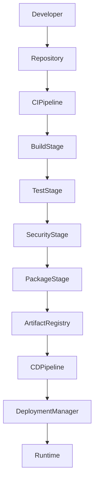

# RFC-0173

**Title:** CI/CD Architecture

**Document ID:** RFC-0173

**Version:** 1.0

**Status:** Accepted

**Category:** System Architecture

**Layer:** Development Operations / Deployment / Automation

**Target:**

```text
architecture/cicd/
```

---

# Abstract

This RFC defines the SH-3 Continuous Integration and Continuous Delivery Architecture (CI/CD).

The CI/CD Architecture establishes the automated software lifecycle framework responsible for building, validating, packaging, releasing, and deploying SH-3 components safely and continuously.

The CI/CD Architecture provides:

- automated build pipeline
- automated testing
- artifact management
- release automation
- deployment automation
- quality enforcement
- version management
- rollback integration

The CI/CD lifecycle:

```text
Commit

↓

Build

↓

Validate

↓

Package

↓

Release

↓

Deploy

↓

Monitor

↓

Improve
```

Every CI/CD operation SHALL be:

- automated
- reproducible
- traceable
- version controlled
- secure
- reversible

This document is normative.

---

# Motivation

SH-3 is a continuously evolving AI Operating System Framework.

The system contains:

```text
Foundation

Runtime

Kernel

Cognition

Agents

Autonomy

Learning

Self Healing
```

Manual delivery introduces:

```text
Human Error

↓

Deployment Risk

↓

System Instability
```

SH-3 requires:

```text
Code Change

↓

Automated Verification

↓

Safe Release
```

---

# Goals

The architecture SHALL provide:

- continuous integration
- automated validation
- automated delivery
- release consistency
- deployment safety
- artifact traceability

---

# Non-Goals

The architecture SHALL NOT:

- replace Deployment Architecture
- replace Testing Architecture
- modify business logic
- bypass Security Architecture

---

# Architecture



---

# Design Principles

## Automation First

Manual steps SHALL be minimized.

---

## Fail Fast

Invalid changes SHALL stop early.

---

## Immutable Artifacts

Build outputs SHALL be versioned.

---

## Continuous Validation

Every change SHALL be verified.

---

## Safe Delivery

Production changes SHALL be controlled.

---

# Components

| Component | Responsibility |
|---|---|
| PipelineManager | Pipeline orchestration |
| BuildEngine | Build execution |
| TestExecutor | Automated testing |
| SecurityScanner | Security validation |
| ArtifactRegistry | Artifact storage |
| ReleaseManager | Release control |
| DeploymentTrigger | Deployment activation |
| RollbackController | Recovery |

---

# Pipeline Model

Every pipeline SHALL contain:

```text
pipeline_id

trigger

stages

environment

artifact

result

metadata
```

---

# CI Pipeline

Continuous Integration SHALL execute:

```text
Source Fetch

↓

Dependency Resolution

↓

Build

↓

Static Analysis

↓

Unit Test

↓

Integration Test

↓

Security Scan

↓

Artifact Creation
```

---

# Build Stage

BuildEngine SHALL:

- compile components
- resolve dependencies
- generate artifacts
- verify build integrity

---

# Static Validation

CI SHALL validate:

```text
Type Safety

Code Quality

Formatting

Dependency Rules

Architecture Rules
```

Required compatibility:

```text
Python 3.12+

Ruff Compatible

Mypy Compatible
```

---

# Testing Integration

CI SHALL execute:

```text
Unit Tests

Integration Tests

System Tests

Regression Tests
```

Integration:

```text
RFC-0172 Testing Architecture
```

---

# Security Integration

Security validation SHALL include:

```text
Dependency Scan

Permission Check

Artifact Verification

Configuration Validation
```

Integration:

```text
RFC-0169 Security Architecture
```

---

# Artifact Management

ArtifactRegistry SHALL maintain:

```text
artifact_id

version

checksum

source_commit

build_metadata
```

---

# Artifact Lifecycle

```text
Created

↓

Validated

↓

Stored

↓

Released

↓

Deployed

↓

Archived
```

---

# CD Pipeline

Continuous Delivery SHALL execute:

```text
Artifact Selection

↓

Environment Preparation

↓

Deployment Validation

↓

Deployment

↓

Health Check

↓

Activation
```

---

# Release Management

Every release SHALL contain:

```text
release_id

version

artifact

environment

approval

status
```

---

# Deployment Trigger

DeploymentTrigger SHALL support:

```text
Automatic Deployment

Manual Approval

Scheduled Deployment

Event Based Deployment
```

---

# Rollback Integration

Failed deployment SHALL execute:

```text
Failure Detection

↓

Rollback Decision

↓

Previous Artifact Restore

↓

Validation
```

Integration:

```text
RFC-0170 Deployment Architecture
RFC-0161 Self Healing Architecture
```

---

# Git Workflow

SH-3 SHALL support:

```text
Feature Branch

↓

Pull Request

↓

Validation Pipeline

↓

Merge

↓

Release Pipeline
```

---

# Branch Protection

Protected branches SHALL require:

- successful build
- successful tests
- security validation
- review approval

---

# Version Integration

CI/CD SHALL manage:

```text
Source Version

Build Version

Artifact Version

Release Version
```

---

# Environment Promotion

Promotion flow:

```text
Development

↓

Testing

↓

Staging

↓

Production
```

---

# Quality Gate Integration

Pipeline SHALL evaluate:

```text
Build Result

+

Test Result

+

Security Result

+

Performance Result

↓

Release Decision
```

Integration:

```text
RFC-0172 Testing Architecture
```

---

# Observability Integration

CI/CD SHALL publish:

- build metrics
- deployment metrics
- release status
- failure information

Integration:

```text
RFC-0171 Observability Architecture
```

---

# Event Integration

CI/CD events:

```text
BuildStarted

BuildCompleted

TestCompleted

ArtifactCreated

ReleaseCreated

DeploymentTriggered

DeploymentCompleted
```

Events SHALL follow:

```text
RFC-0152 Event Bus Architecture
```

---

# State Integration

CI/CD State SHALL maintain:

```text
PipelineState

BuildState

ReleaseState

DeploymentState
```

Integration:

```text
RFC-0157 State Management Architecture
```

---

# Persistence

CI/CD SHALL store:

- pipeline history
- artifacts
- releases
- execution logs
- validation results

---

# Thread Model

CI/CD SHALL support concurrent:

- builds
- tests
- artifact processing
- validation

Reference implementation SHALL be:

- deterministic
- thread-safe
- asynchronous
- event-driven

---

# Performance Metrics

The architecture exposes:

```text
build_duration

pipeline_success_rate

deployment_frequency

rollback_rate

release_latency
```

---

# Performance Objectives

The architecture should optimize for:

- fast delivery
- reliable releases
- automated verification
- operational stability

---

# Future Work

Potential enhancements:

- AI optimized pipelines
- autonomous release management
- predictive deployment analysis
- self-healing deployment pipelines
- distributed CI/CD federation

---

# References

- RFC-0172 Testing Architecture
- RFC-0171 Observability Architecture
- RFC-0170 Deployment Architecture
- RFC-0169 Security Architecture
- RFC-0152 Event Bus Architecture

---

# End of RFC-0173