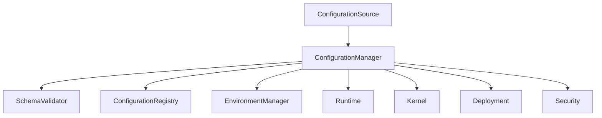

# RFC-0174

**Title:** Configuration Architecture

**Document ID:** RFC-0174

**Version:** 1.0

**Status:** Accepted

**Category:** System Architecture

**Layer:** Foundation / Infrastructure / Deployment

**Target:**

```text
architecture/configuration/
```

---

# Abstract

This RFC defines the SH-3 Configuration Architecture (CA).

The Configuration Architecture establishes the configuration management framework responsible for defining, loading, validating, versioning, securing, and distributing configuration data across the SH-3 AI Operating System Framework.

Configuration provides the operational control layer between:

```text
System Definition

↓

Runtime Behavior

↓

Execution Environment
```

The Configuration Architecture manages:

- system configuration
- environment configuration
- runtime configuration
- component configuration
- feature configuration
- security configuration
- deployment configuration
- dynamic configuration

Every configuration operation SHALL be:

- typed
- validated
- versioned
- traceable
- secure
- deterministic

This document is normative.

---

# Motivation

Large autonomous systems require centralized and controlled configuration management.

SH-3 contains:

```text
Foundation

Infrastructure

Runtime

Kernel

Cognition

Agent

Autonomy

Learning

Self Healing
```

Each layer requires configurable behavior.

Without configuration control:

```text
Change

↓

Unknown State

↓

Unpredictable Behavior
```

With configuration management:

```text
Configuration

↓

Validation

↓

Controlled Runtime
```

---

# Goals

The architecture SHALL provide:

- centralized configuration management
- typed configuration models
- validation
- environment separation
- secure configuration handling
- runtime configuration updates

---

# Non-Goals

The architecture SHALL NOT:

- store application data
- replace Persistence Architecture
- bypass Security Architecture
- allow unsafe runtime modification

---

# Architecture



---

# Design Principles

## Configuration Is Code

Configuration SHALL be version controlled.

---

## Strong Typing

Configuration SHALL use explicit schemas.

---

## Validation Before Usage

Invalid configuration SHALL never reach runtime.

---

## Environment Separation

Each environment SHALL have independent configuration.

---

## Secure By Default

Sensitive values SHALL be protected.

---

# Components

| Component | Responsibility |
|---|---|
| ConfigurationManager | Configuration orchestration |
| ConfigurationRegistry | Storage and lookup |
| SchemaValidator | Validation |
| EnvironmentManager | Environment handling |
| SecretManager | Secret protection |
| FeatureManager | Feature control |
| ConfigurationWatcher | Change detection |

---

# Configuration Model

Every configuration object SHALL contain:

```text
config_id

name

version

schema

scope

value

metadata
```

---

# Configuration Types

SH-3 SHALL support:

```text
System Configuration

Runtime Configuration

Component Configuration

Environment Configuration

Security Configuration

Deployment Configuration

Feature Configuration
```

---

# System Configuration

Controls:

```text
system_identity

version

architecture

enabled_layers
```

---

# Runtime Configuration

Controls:

```text
execution_mode

worker_count

timeout

resource_limit
```

---

# Component Configuration

Each component SHALL define:

```text
component_id

parameters

dependencies

options
```

---

# Environment Configuration

Supported environments:

```text
Development

Testing

Staging

Production
```

Each environment SHALL have:

```text
environment_id

runtime_settings

resource_settings

security_settings
```

---

# Schema Validation

SchemaValidator SHALL verify:

```text
Type

Required Fields

Value Range

Dependency Rules

Compatibility
```

---

# Typed Configuration

Configuration models SHALL support:

```python
Typed Models

Schema Validation

Static Analysis
```

Required:

```text
Python 3.12+

Mypy Compatible
```

---

# Dynamic Configuration

ConfigurationManager SHALL support controlled runtime updates:

```text
Change Request

↓

Validation

↓

Approval

↓

Apply

↓

Verify
```

---

# Configuration Reload

Runtime reload SHALL support:

```text
Detect Change

↓

Validate

↓

Update Component

↓

Confirm State
```

---

# Secret Management

SecretManager SHALL protect:

```text
API Keys

Credentials

Tokens

Encryption Keys
```

Requirements:

- encryption
- access control
- audit logging

Integration:

```text
RFC-0169 Security Architecture
```

---

# Feature Flags

FeatureManager SHALL provide:

```text
Feature

↓

Enable / Disable

↓

Environment Control

↓

Safe Rollout
```

Use cases:

```text
Experimental Features

A/B Testing

Gradual Release
```

---

# Version Management

Every configuration change SHALL create:

```text
Configuration Version

+

Change History

+

Rollback Point
```

---

# Rollback

Configuration rollback SHALL support:

```text
Invalid Change Detection

↓

Previous Version Restore

↓

Runtime Validation
```

---

# Runtime Integration

Runtime SHALL consume:

```text
Validated Configuration

↓

Execution Context
```

Integration:

```text
RFC-0156 Runtime Architecture
```

---

# Kernel Integration

Kernel SHALL use configuration for:

```text
Component Registration

Execution Policy

Service Initialization
```

Integration:

```text
RFC-0154 Kernel Architecture
```

---

# Deployment Integration

Deployment SHALL manage:

```text
Environment Configuration

Release Configuration

Runtime Parameters
```

Integration:

```text
RFC-0170 Deployment Architecture
```

---

# CI/CD Integration

CI/CD SHALL validate:

```text
Configuration Schema

Compatibility

Security Rules
```

Integration:

```text
RFC-0173 CI/CD Architecture
```

---

# Policy Integration

Configuration changes SHALL follow:

```text
Configuration Policy

+

Security Policy

+

Approval Rules
```

Integration:

```text
RFC-0168 Policy Architecture
```

---

# Event Integration

Configuration events:

```text
ConfigurationLoaded

ConfigurationValidated

ConfigurationChanged

ConfigurationReloaded

ConfigurationRollback
```

Events SHALL follow:

```text
RFC-0152 Event Bus Architecture
```

---

# State Integration

Configuration State SHALL maintain:

```text
ActiveConfiguration

VersionState

EnvironmentState

ChangeHistory
```

Integration:

```text
RFC-0157 State Management Architecture
```

---

# Persistence

Configuration persistence SHALL store:

- configuration definitions
- versions
- schemas
- history
- rollback points

---

# Observability Integration

Configuration operations SHALL expose:

```text
Change Metrics

Validation Results

Reload Status

Failure Information
```

Integration:

```text
RFC-0171 Observability Architecture
```

---

# Testing Requirements

Configuration SHALL support:

- schema tests
- validation tests
- compatibility tests
- rollback tests
- security tests

Integration:

```text
RFC-0172 Testing Architecture
```

---

# Thread Model

Configuration operations SHALL support concurrent:

- reads
- validation
- updates
- reload operations

Reference implementation SHALL be:

- deterministic
- thread-safe
- atomic
- event-driven

---

# Performance Metrics

The architecture exposes:

```text
load_latency

validation_latency

reload_latency

configuration_error_rate
```

---

# Performance Objectives

The architecture should optimize for:

- fast loading
- safe updates
- predictable behavior
- operational consistency

---

# Future Work

Potential enhancements:

- AI generated configuration
- automatic tuning
- adaptive configuration optimization
- self-validating configuration
- distributed configuration federation

---

# References

- RFC-0173 CI/CD Architecture
- RFC-0170 Deployment Architecture
- RFC-0169 Security Architecture
- RFC-0168 Policy Architecture
- RFC-0156 Runtime Architecture

---

# End of RFC-0174