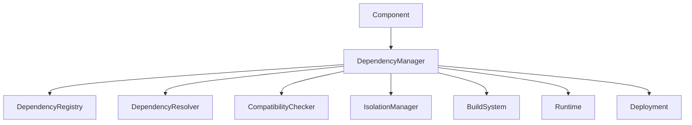

# RFC-0175

**Title:** Dependency Management Architecture

**Document ID:** RFC-0175

**Version:** 1.0

**Status:** Accepted

**Category:** System Architecture

**Layer:** Foundation / Infrastructure / Build System

**Target:**

```text
architecture/dependency/
```

---

# Abstract

This RFC defines the SH-3 Dependency Management Architecture (DMA).

The Dependency Management Architecture establishes the framework responsible for discovering, resolving, validating, isolating, tracking, and maintaining dependencies across the SH-3 AI Operating System Framework.

Dependency management provides controlled relationships between:

```text
Component

↓

Dependency

↓

Version

↓

Compatibility

↓

Execution
```

The architecture manages:

- internal module dependencies
- external package dependencies
- version resolution
- compatibility validation
- dependency graph management
- dependency isolation
- dependency security

Every dependency operation SHALL be:

- deterministic
- version controlled
- validated
- traceable
- reproducible
- secure

This document is normative.

---

# Motivation

SH-3 is a layered modular AI Operating System Framework.

The system contains:

```text
Foundation

Infrastructure

Runtime

Kernel

Cognition

Agent

Autonomy

Deployment
```

Each layer depends on lower layers.

Incorrect dependency handling causes:

```text
Version Conflict

↓

Runtime Failure

↓

System Instability
```

SH-3 requires:

```text
Dependency Definition

↓

Resolution

↓

Validation

↓

Execution
```

---

# Goals

The architecture SHALL provide:

- dependency discovery
- dependency resolution
- version management
- compatibility checking
- isolation
- reproducible builds

---

# Non-Goals

The architecture SHALL NOT:

- replace package repositories
- manage application data
- bypass architecture dependency rules
- allow circular dependencies

---

# Architecture



---

# Design Principles

## Explicit Dependencies

Every dependency SHALL be declared.

---

## One Direction Dependency

Dependencies SHALL follow architecture direction.

```text
Application

↓

Deployment

↓

Kernel

↓

Services

↓

Runtime

↓

Infrastructure

↓

Foundation
```

---

## Reproducible Environment

Same dependency definition SHALL produce same environment.

---

## Isolation First

Components SHALL avoid unintended dependency coupling.

---

## Compatibility Before Execution

Dependencies SHALL be validated before activation.

---

# Components

| Component | Responsibility |
|---|---|
| DependencyManager | Dependency orchestration |
| DependencyRegistry | Dependency catalog |
| DependencyResolver | Version resolution |
| CompatibilityChecker | Compatibility validation |
| IsolationManager | Environment isolation |
| PackageAnalyzer | Package inspection |
| DependencyMonitor | Runtime tracking |

---

# Dependency Model

Every dependency SHALL contain:

```text
dependency_id

name

version

source

type

scope

compatibility

metadata
```

---

# Dependency Types

SH-3 SHALL support:

```text
Internal Module

External Package

Runtime Dependency

Build Dependency

Optional Dependency
```

---

# Internal Module Dependency

Examples:

```text
Runtime

depends_on

Foundation
```

---

# Dependency Graph

DependencyManager SHALL maintain:

```text
Node

=

Component

Edge

=

Dependency
```

Example:

```text
Kernel

↓

Runtime

↓

Infrastructure

↓

Foundation
```

---

# Graph Validation

Dependency graph SHALL detect:

```text
Circular Dependency

Missing Dependency

Invalid Direction

Version Conflict
```

---

# Version Management

Dependency versions SHALL support:

```text
Major

Minor

Patch
```

Example:

```text
1.0.0

1.1.0

1.1.1
```

---

# Version Resolution

DependencyResolver SHALL evaluate:

```text
Required Version

+

Available Version

+

Compatibility Rules

↓

Resolved Version
```

---

# Compatibility Checking

CompatibilityChecker SHALL verify:

```text
API Compatibility

Schema Compatibility

Runtime Compatibility

Configuration Compatibility
```

---

# Module Isolation

IsolationManager SHALL provide:

- dependency boundaries
- namespace separation
- runtime isolation
- conflict prevention

---

# Package Analysis

PackageAnalyzer SHALL inspect:

```text
Package Metadata

Dependencies

Security Status

License

Compatibility
```

---

# Security Integration

Dependency management SHALL validate:

- trusted source
- package integrity
- known vulnerabilities
- permission requirements

Integration:

```text
RFC-0169 Security Architecture
```

---

# Configuration Integration

Dependency versions SHALL be controlled through:

```text
Configuration

↓

Dependency Specification
```

Integration:

```text
RFC-0174 Configuration Architecture
```

---

# Build Integration

BuildSystem SHALL consume:

```text
Dependency Graph

↓

Resolved Environment

↓

Build Artifact
```

Integration:

```text
RFC-0173 CI/CD Architecture
```

---

# Deployment Integration

Deployment SHALL verify:

```text
Artifact

+

Dependency Environment

↓

Production Compatibility
```

Integration:

```text
RFC-0170 Deployment Architecture
```

---

# Runtime Integration

Runtime SHALL verify:

```text
Loaded Component

+

Required Dependency

↓

Activation
```

Integration:

```text
RFC-0156 Runtime Architecture
```

---

# Kernel Integration

Kernel SHALL use dependency information for:

- component loading
- initialization ordering
- service registration

Integration:

```text
RFC-0154 Kernel Architecture
```

---

# Event Integration

Dependency events:

```text
DependencyRegistered

DependencyResolved

DependencyConflictDetected

DependencyValidated

DependencyUpdated
```

Events SHALL follow:

```text
RFC-0152 Event Bus Architecture
```

---

# State Integration

Dependency State SHALL maintain:

```text
DependencyGraphState

VersionState

CompatibilityState

ResolutionState
```

Integration:

```text
RFC-0157 State Management Architecture
```

---

# Persistence

Dependency persistence SHALL store:

- dependency definitions
- version history
- resolution results
- compatibility reports

---

# Observability Integration

Dependency operations SHALL expose:

```text
Resolution Time

Conflict Count

Dependency Changes

Compatibility Status
```

Integration:

```text
RFC-0171 Observability Architecture
```

---

# Testing Requirements

Dependency Architecture SHALL support:

- graph validation tests
- resolution tests
- compatibility tests
- isolation tests
- build reproducibility tests

Integration:

```text
RFC-0172 Testing Architecture
```

---

# Thread Model

Dependency operations SHALL support concurrent:

- dependency lookup
- resolution
- validation
- monitoring

Reference implementation SHALL be:

- deterministic
- thread-safe
- cache-aware
- event-driven

---

# Performance Metrics

The architecture exposes:

```text
resolution_latency

dependency_count

conflict_rate

validation_time
```

---

# Performance Objectives

The architecture should optimize for:

- fast resolution
- reliable builds
- stable runtime
- predictable deployment

---

# Future Work

Potential enhancements:

- AI dependency optimization
- automatic upgrade planning
- dependency risk prediction
- self-healing dependency resolution
- distributed dependency federation

---

# References

- RFC-0174 Configuration Architecture
- RFC-0173 CI/CD Architecture
- RFC-0170 Deployment Architecture
- RFC-0156 Runtime Architecture
- RFC-0154 Kernel Architecture

---

# End of RFC-0175