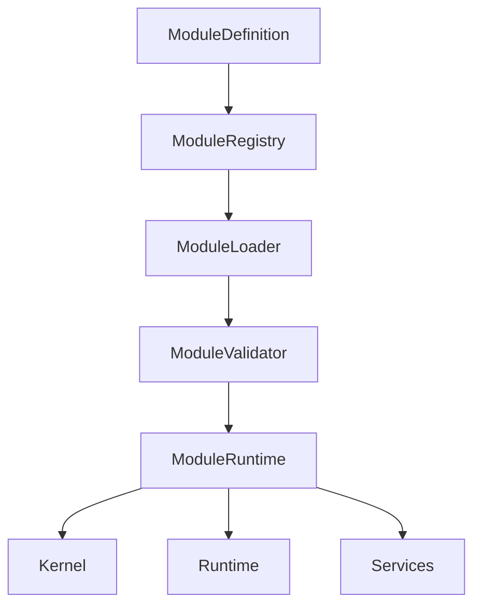

# RFC-0176

**Title:** Module Architecture

**Document ID:** RFC-0176

**Version:** 1.0

**Status:** Accepted

**Category:** System Architecture

**Layer:** Foundation / Runtime / Kernel

**Target:**

```text
architecture/module/
```

---

# Abstract

This RFC defines the SH-3 Module Architecture (MA).

The Module Architecture establishes the modular execution framework responsible for defining, registering, loading, isolating, replacing, and managing all SH-3 system components.

The Module Architecture provides:

- module definition
- module lifecycle
- module registry
- dynamic loading
- dependency binding
- plugin capability
- hot replacement
- isolation boundaries

The Module Architecture creates the replaceable component model:

```text
Module

↓

Registry

↓

Loader

↓

Runtime

↓

Execution
```

Every module operation SHALL be:

- typed
- isolated
- replaceable
- versioned
- observable
- deterministic

This document is normative.

---

# Motivation

SH-3 follows the principle:

```text
Everything Is Replaceable
```

A production AI Operating System requires components that can evolve independently.

Without modularity:

```text
Change Component

↓

Impact Entire System
```

With modularity:

```text
Replace Module

↓

Validate

↓

Activate
```

---

# Goals

The architecture SHALL provide:

- independent components
- dynamic extension
- safe replacement
- lifecycle management
- dependency control
- runtime flexibility

---

# Non-Goals

The architecture SHALL NOT:

- bypass dependency validation
- allow uncontrolled dynamic execution
- replace Kernel coordination
- violate security policies

---

# Architecture



---

# Design Principles

## Everything Is Modular

All major capabilities SHALL be modules.

---

## Explicit Lifecycle

Every module SHALL have defined states.

---

## Replaceable Components

Modules SHALL be independently replaceable.

---

## Dependency Controlled

Modules SHALL declare dependencies.

---

## Runtime Safe

Activation SHALL require validation.

---

# Components

| Component | Responsibility |
|---|---|
| ModuleManager | Module orchestration |
| ModuleRegistry | Module catalog |
| ModuleLoader | Loading |
| ModuleValidator | Verification |
| ModuleLifecycleManager | State control |
| ModuleResolver | Dependency binding |
| ModuleMonitor | Runtime observation |

---

# Module Model

Every module SHALL contain:

```text
module_id

name

version

type

dependencies

interfaces

permissions

metadata
```

---

# Module Types

SH-3 SHALL support:

```text
Core Module

Service Module

Agent Module

Plugin Module

Extension Module

Infrastructure Module
```

---

# Module Lifecycle

Every module SHALL follow:

```text
Created

↓

Registered

↓

Validated

↓

Loaded

↓

Active

↓

Paused

↓

Replaced

↓

Unloaded
```

---

# Module Registration

ModuleRegistry SHALL maintain:

```text
Module Identity

Version

Interface

Dependency

Status
```

---

# Module Loading

ModuleLoader SHALL perform:

```text
Discovery

↓

Dependency Resolution

↓

Validation

↓

Initialization

↓

Activation
```

---

# Module Validation

ModuleValidator SHALL verify:

```text
Interface Compatibility

Dependency Availability

Security Permission

Configuration Validity

Version Compatibility
```

---

# Dynamic Loading

SH-3 SHALL support controlled dynamic loading.

Flow:

```text
Request

↓

Policy Check

↓

Security Check

↓

Load Module

↓

Validate

↓

Activate
```

---

# Plugin Architecture

Plugins SHALL provide:

```text
Extension Point

Implementation

Metadata

Capability Definition
```

---

# Hot Swap

Module replacement SHALL support:

```text
New Module

↓

Compatibility Check

↓

State Transfer

↓

Activation

↓

Old Module Removal
```

---

# Isolation Boundary

Modules SHALL isolate:

```text
Code

State

Configuration

Dependencies

Permissions
```

---

# Interface Contract

Modules SHALL communicate through:

```text
Typed Interface

+

Event Interface

+

Service Contract
```

---

# Dependency Integration

Modules SHALL use:

```text
Dependency Graph

↓

Resolution

↓

Activation
```

Integration:

```text
RFC-0175 Dependency Management Architecture
```

---

# Kernel Integration

Kernel SHALL manage:

```text
Module Registration

Initialization Order

Lifecycle Control

Communication
```

Integration:

```text
RFC-0154 Kernel Architecture
```

---

# Runtime Integration

Runtime SHALL provide:

```text
Execution Context

Resource Access

Scheduling
```

Integration:

```text
RFC-0156 Runtime Architecture
```

---

# Configuration Integration

Modules SHALL load:

```text
Module Configuration

Runtime Parameters

Feature Flags
```

Integration:

```text
RFC-0174 Configuration Architecture
```

---

# Security Integration

Modules SHALL enforce:

```text
Identity

Capability

Permission

Isolation
```

Integration:

```text
RFC-0169 Security Architecture
```

---

# Policy Integration

Module operations SHALL follow:

```text
Module Policy

+

Security Policy

+

Execution Policy
```

Integration:

```text
RFC-0168 Policy Architecture
```

---

# Event Integration

Module events:

```text
ModuleRegistered

ModuleLoaded

ModuleActivated

ModuleUpdated

ModuleReplaced

ModuleRemoved
```

Events SHALL follow:

```text
RFC-0152 Event Bus Architecture
```

---

# State Integration

Module State SHALL maintain:

```text
ModuleRegistryState

LifecycleState

VersionState

HealthState
```

Integration:

```text
RFC-0157 State Management Architecture
```

---

# Persistence

Module persistence SHALL store:

- module metadata
- versions
- lifecycle history
- compatibility records

---

# Observability Integration

Module monitoring SHALL expose:

```text
Module Status

Load Time

Failure Count

Resource Usage

Replacement History
```

Integration:

```text
RFC-0171 Observability Architecture
```

---

# Testing Requirements

Module Architecture SHALL support:

- loading tests
- lifecycle tests
- replacement tests
- isolation tests
- compatibility tests

Integration:

```text
RFC-0172 Testing Architecture
```

---

# Thread Model

Module operations SHALL support concurrent:

- registration
- loading
- validation
- replacement
- monitoring

Reference implementation SHALL be:

- deterministic
- thread-safe
- isolated
- event-driven

---

# Performance Metrics

The architecture exposes:

```text
module_load_time

activation_latency

replacement_time

module_failure_rate
```

---

# Performance Objectives

The architecture should optimize for:

- fast activation
- safe replacement
- low coupling
- independent evolution

---

# Future Work

Potential enhancements:

- autonomous module evolution
- AI generated modules
- self-optimizing module graph
- distributed module federation
- zero downtime replacement

---

# References

- RFC-0175 Dependency Management Architecture
- RFC-0174 Configuration Architecture
- RFC-0169 Security Architecture
- RFC-0156 Runtime Architecture
- RFC-0154 Kernel Architecture

---

# End of RFC-0176