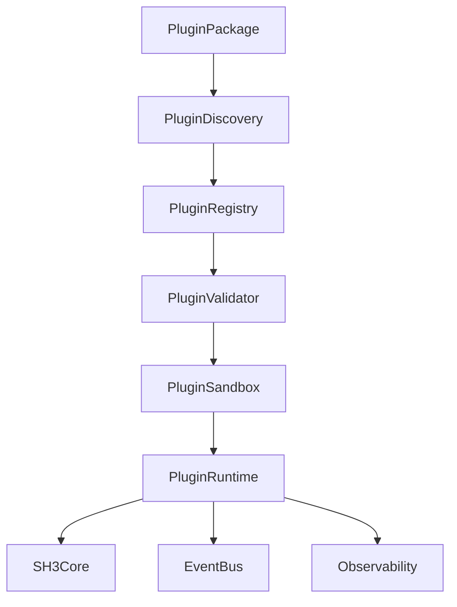

# RFC-0177

**Title:** Plugin Architecture

**Document ID:** RFC-0177

**Version:** 1.0

**Status:** Accepted

**Category:** System Architecture

**Layer:** Extension / Module / Runtime

**Target:**

```text
architecture/plugin/
```

---

# Abstract

This RFC defines the SH-3 Plugin Architecture (PA).

The Plugin Architecture establishes the extensibility framework responsible for allowing external, optional, and dynamically integrated capabilities to extend SH-3 functionality without modifying core system components.

The Plugin Architecture provides:

- plugin discovery
- plugin registration
- extension points
- capability injection
- sandbox execution
- lifecycle management
- third-party integration
- controlled extensibility

The Plugin Architecture creates the extension model:

```text
Plugin

↓

Discovery

↓

Validation

↓

Registration

↓

Execution

↓

Observation
```

Every plugin operation SHALL be:

- isolated
- permission controlled
- versioned
- validated
- observable
- replaceable

This document is normative.

---

# Motivation

SH-3 requires continuous evolution.

Core modification for every capability increase creates:

```text
Core Change

↓

System Risk

↓

Deployment Complexity
```

Plugin architecture enables:

```text
New Capability

↓

Plugin

↓

Validation

↓

Integration
```

without changing the core kernel.

---

# Goals

The architecture SHALL provide:

- external capability extension
- safe integration
- plugin lifecycle control
- capability isolation
- runtime extensibility

---

# Non-Goals

The architecture SHALL NOT:

- allow unrestricted code execution
- bypass security controls
- replace core architecture
- modify protected system components

---

# Architecture



---

# Design Principles

## Core Stability

Plugins SHALL extend without modifying core components.

---

## Controlled Extension

Every plugin SHALL pass validation.

---

## Capability Based

Plugins SHALL expose explicit capabilities.

---

## Isolation First

Plugin failures SHALL not compromise the system.

---

## Lifecycle Managed

Plugins SHALL have controlled states.

---

# Components

| Component | Responsibility |
|---|---|
| PluginManager | Plugin orchestration |
| PluginRegistry | Plugin catalog |
| PluginDiscovery | Plugin detection |
| PluginValidator | Plugin verification |
| PluginSandbox | Isolation |
| PluginRuntime | Execution |
| ExtensionManager | Extension points |
| PluginMonitor | Monitoring |

---

# Plugin Model

Every plugin SHALL contain:

```text
plugin_id

name

version

author

capabilities

dependencies

permissions

entrypoint

metadata
```

---

# Plugin Types

SH-3 SHALL support:

```text
Tool Plugin

Knowledge Plugin

Reasoning Plugin

Agent Plugin

Storage Plugin

Integration Plugin

Optimization Plugin
```

---

# Plugin Discovery

PluginDiscovery SHALL support:

```text
Package Scan

Registry Lookup

Configuration Declaration

Remote Repository
```

---

# Plugin Registration

PluginRegistry SHALL maintain:

```text
Plugin Identity

Version

Capabilities

Status

Compatibility
```

---

# Plugin Validation

PluginValidator SHALL verify:

```text
Metadata

Signature

Dependencies

Interface

Permissions

Security Rules
```

---

# Extension Points

SH-3 SHALL provide controlled extension points:

```text
Runtime Extension

Tool Extension

Knowledge Extension

Reasoning Extension

Agent Extension

Storage Extension
```

---

# Capability Model

Every plugin capability SHALL define:

```text
capability_id

description

input_schema

output_schema

permission

risk_level
```

---

# Plugin Sandbox

PluginSandbox SHALL provide:

- execution isolation
- resource limits
- permission boundaries
- failure containment

---

# Resource Control

Plugin execution SHALL be limited by:

```text
CPU

Memory

Storage

Network

Execution Time
```

---

# Plugin Lifecycle

Every plugin SHALL follow:

```text
Discovered

↓

Registered

↓

Validated

↓

Installed

↓

Activated

↓

Updated

↓

Disabled

↓

Removed
```

---

# Plugin Update

Plugin update SHALL follow:

```text
New Version

↓

Compatibility Check

↓

Security Validation

↓

Activation

↓

Rollback Point Creation
```

---

# Third Party Integration

External plugins SHALL require:

```text
Identity

Signature

Permission

Compatibility Check
```

Integration:

```text
RFC-0169 Security Architecture
```

---

# Module Integration

Plugins SHALL be implemented as specialized modules.

Integration:

```text
RFC-0176 Module Architecture
```

---

# Dependency Integration

Plugin dependencies SHALL be resolved through:

```text
Dependency Graph

↓

Compatibility Check

↓

Activation
```

Integration:

```text
RFC-0175 Dependency Management Architecture
```

---

# Configuration Integration

Plugin configuration SHALL be managed through:

```text
Plugin Configuration

↓

Schema Validation

↓

Runtime Loading
```

Integration:

```text
RFC-0174 Configuration Architecture
```

---

# Policy Integration

Plugin operations SHALL follow:

```text
Plugin Policy

+

Capability Policy

+

Security Policy
```

Integration:

```text
RFC-0168 Policy Architecture
```

---

# Agent Integration

Agents SHALL access plugins through:

```text
Capability Discovery

↓

Policy Validation

↓

Plugin Invocation
```

Integration:

```text
RFC-0164 Agent Architecture
```

---

# Cognition Integration

Cognition plugins MAY extend:

```text
Knowledge

Reasoning

Planning

Learning
```

Integration:

```text
RFC-0165 Knowledge Architecture

RFC-0166 Reasoning Architecture

RFC-0167 Planning Architecture
```

---

# Event Integration

Plugin events:

```text
PluginDiscovered

PluginRegistered

PluginValidated

PluginActivated

PluginUpdated

PluginDisabled

PluginRemoved
```

Events SHALL follow:

```text
RFC-0152 Event Bus Architecture
```

---

# State Integration

Plugin State SHALL maintain:

```text
PluginRegistryState

LifecycleState

CapabilityState

HealthState
```

Integration:

```text
RFC-0157 State Management Architecture
```

---

# Persistence

Plugin persistence SHALL store:

- plugin metadata
- versions
- permissions
- installation history
- execution history

---

# Observability Integration

Plugin monitoring SHALL expose:

```text
Plugin Status

Execution Count

Failure Count

Resource Usage

Performance
```

Integration:

```text
RFC-0171 Observability Architecture
```

---

# Testing Requirements

Plugin Architecture SHALL support:

- installation tests
- compatibility tests
- sandbox tests
- permission tests
- lifecycle tests

Integration:

```text
RFC-0172 Testing Architecture
```

---

# Thread Model

Plugin operations SHALL support concurrent:

- discovery
- validation
- loading
- execution
- monitoring

Reference implementation SHALL be:

- deterministic
- thread-safe
- isolated
- event-driven

---

# Performance Metrics

The architecture exposes:

```text
plugin_load_latency

execution_latency

failure_rate

resource_usage
```

---

# Performance Objectives

The architecture should optimize for:

- safe extensibility
- low integration cost
- independent evolution
- runtime flexibility

---

# Future Work

Potential enhancements:

- AI generated plugins
- autonomous plugin selection
- plugin marketplace
- distributed plugin federation
- self-evolving extension ecosystem

---

# References

- RFC-0176 Module Architecture
- RFC-0175 Dependency Management Architecture
- RFC-0169 Security Architecture
- RFC-0168 Policy Architecture
- RFC-0164 Agent Architecture

---

# End of RFC-0177