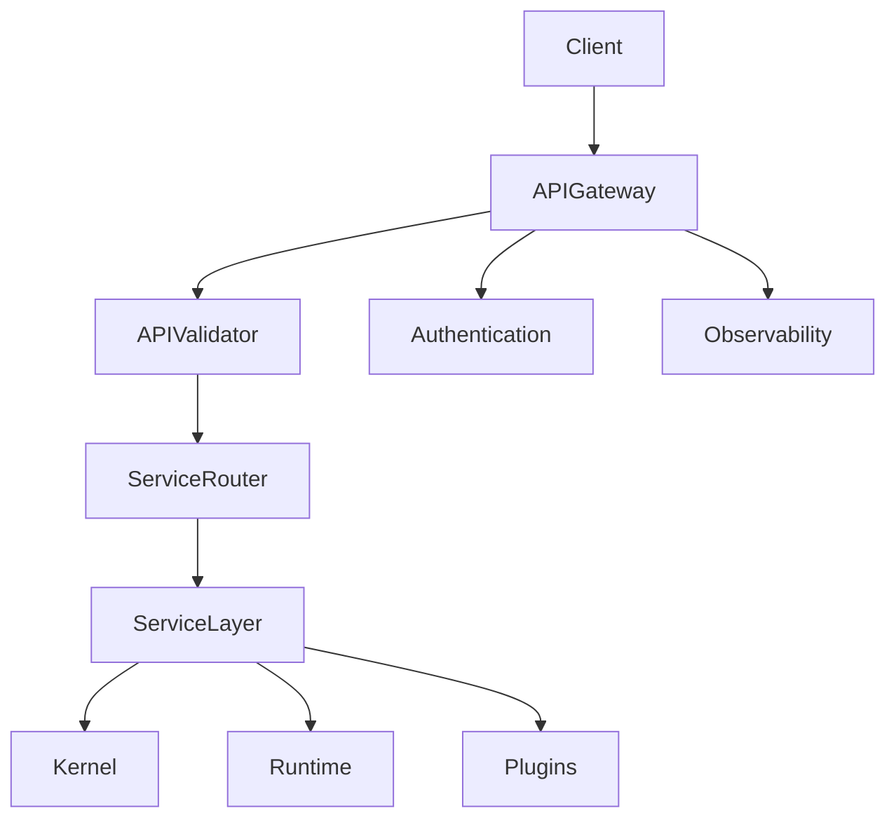

# RFC-0178

**Title:** API Architecture

**Document ID:** RFC-0178

**Version:** 1.0

**Status:** Accepted

**Category:** System Architecture

**Layer:** Interface / Integration / Communication

**Target:**

```text
architecture/api/
```

---

# Abstract

This RFC defines the SH-3 API Architecture (AA).

The API Architecture establishes the communication framework responsible for exposing, consuming, validating, securing, and managing interfaces between SH-3 components, external systems, agents, plugins, and operational services.

The API Architecture provides:

- internal API communication
- external API exposure
- service interfaces
- API gateway control
- schema management
- version management
- authentication
- authorization
- rate control
- communication observability

The API communication model:

```text
Requester

↓

API Interface

↓

Validation

↓

Service

↓

Response
```

Every API operation SHALL be:

- typed
- validated
- versioned
- secure
- observable
- deterministic

This document is normative.

---

# Motivation

SH-3 is a distributed layered AI Operating System Framework.

Components include:

```text
Kernel

Runtime

Cognition

Agents

Plugins

Deployment

External Systems
```

Independent components require stable communication contracts.

Without API control:

```text
Component Change

↓

Communication Failure

↓

System Instability
```

With API Architecture:

```text
Interface Contract

↓

Validation

↓

Safe Communication
```

---

# Goals

The architecture SHALL provide:

- stable interfaces
- component communication
- external integration
- API lifecycle management
- secure access control
- compatibility management

---

# Non-Goals

The architecture SHALL NOT:

- replace Event Bus Architecture
- replace Module Architecture
- bypass Security Architecture
- expose internal state directly

---

# Architecture



---

# Design Principles

## Contract First

Every API SHALL define an explicit contract.

---

## Strong Typing

Input and output schemas SHALL be typed.

---

## Version Stability

API changes SHALL maintain compatibility.

---

## Security By Default

Every external API SHALL require validation.

---

## Observable Communication

Every request SHALL be traceable.

---

# Components

| Component | Responsibility |
|---|---|
| APIManager | API lifecycle |
| APIGateway | Request routing |
| APIRegistry | Interface catalog |
| APIValidator | Schema validation |
| ServiceRouter | Service dispatch |
| AuthenticationManager | Identity validation |
| RateController | Traffic control |
| APIMonitor | Communication monitoring |

---

# API Model

Every API SHALL contain:

```text
api_id

name

version

endpoint

method

input_schema

output_schema

permissions

metadata
```

---

# API Types

SH-3 SHALL support:

```text
Internal API

Service API

Plugin API

Agent API

External API

Management API
```

---

# Internal API

Internal APIs provide communication between:

```text
Kernel

↓

Runtime

↓

Services

↓

Modules
```

---

# Service API

Service APIs expose:

```text
Memory

Learning

Planning

Reasoning

Optimization
```

---

# Plugin API

Plugin APIs provide:

```text
Plugin

↓

Capability

↓

Core System
```

Integration:

```text
RFC-0177 Plugin Architecture
```

---

# Agent API

Agent APIs provide:

```text
Agent

↓

Tool

↓

Capability
```

Integration:

```text
RFC-0164 Agent Architecture
```

---

# External API

External APIs provide:

```text
User Systems

↓

SH-3

↓

Response
```

---

# API Gateway

APIGateway SHALL provide:

- routing
- validation
- authentication
- rate control
- logging
- tracing

---

# Request Lifecycle

Every request SHALL follow:

```text
Received

↓

Authenticated

↓

Authorized

↓

Validated

↓

Processed

↓

Response

↓

Recorded
```

---

# Schema Management

API schemas SHALL define:

```text
Input Type

Output Type

Required Fields

Constraints

Version
```

---

# Version Management

API versions SHALL support:

```text
Major Version

Minor Version

Patch Version
```

Example:

```text
/api/v1/resource

/api/v2/resource
```

---

# Compatibility

APIValidator SHALL check:

```text
Schema Compatibility

Version Compatibility

Permission Compatibility
```

---

# Authentication

AuthenticationManager SHALL support:

```text
Identity Verification

Token Validation

Session Management
```

Integration:

```text
RFC-0169 Security Architecture
```

---

# Authorization

Access SHALL be controlled by:

```text
Identity

Role

Capability

Policy
```

Integration:

```text
RFC-0168 Policy Architecture
```

---

# Rate Control

RateController SHALL manage:

```text
Request Frequency

Resource Usage

Priority

Quota
```

---

# Error Model

API errors SHALL contain:

```text
error_id

code

message

source

timestamp

trace_id
```

---

# Communication Model

SH-3 SHALL support:

```text
Synchronous API

Asynchronous API

Event API

Streaming API
```

---

# Event Integration

APIs SHALL integrate with Event Bus:

```text
APIRequestReceived

APIValidationFailed

APIExecutionCompleted

APIErrorOccurred
```

Integration:

```text
RFC-0152 Event Bus Architecture
```

---

# State Integration

API State SHALL maintain:

```text
APIRegistryState

RequestState

SessionState

VersionState
```

Integration:

```text
RFC-0157 State Management Architecture
```

---

# Module Integration

APIs SHALL map to modules through:

```text
API

↓

Module Interface

↓

Execution
```

Integration:

```text
RFC-0176 Module Architecture
```

---

# Plugin Integration

Plugin APIs SHALL expose:

```text
Capabilities

Extensions

Tools
```

Integration:

```text
RFC-0177 Plugin Architecture
```

---

# Configuration Integration

API settings SHALL be controlled by:

```text
API Configuration

Security Configuration

Environment Configuration
```

Integration:

```text
RFC-0174 Configuration Architecture
```

---

# Deployment Integration

API deployment SHALL support:

```text
Version Release

Environment Promotion

Rollback
```

Integration:

```text
RFC-0170 Deployment Architecture
```

---

# CI/CD Integration

API validation SHALL occur during:

```text
Build

↓

Test

↓

Release
```

Integration:

```text
RFC-0173 CI/CD Architecture
```

---

# Observability Integration

API telemetry SHALL include:

```text
Request Count

Latency

Error Rate

Usage

Trace Data
```

Integration:

```text
RFC-0171 Observability Architecture
```

---

# Testing Requirements

API Architecture SHALL support:

- schema tests
- contract tests
- compatibility tests
- security tests
- performance tests

Integration:

```text
RFC-0172 Testing Architecture
```

---

# Thread Model

API operations SHALL support concurrent:

- requests
- validation
- routing
- execution
- monitoring

Reference implementation SHALL be:

- deterministic
- thread-safe
- asynchronous
- event-driven

---

# Performance Metrics

The architecture exposes:

```text
request_latency

throughput

error_rate

availability

compatibility_rate
```

---

# Performance Objectives

The architecture should optimize for:

- stable communication
- low latency
- secure integration
- scalable operation

---

# Future Work

Potential enhancements:

- autonomous API generation
- AI optimized routing
- semantic API discovery
- self-adaptive interfaces
- distributed API federation

---

# References

- RFC-0177 Plugin Architecture
- RFC-0176 Module Architecture
- RFC-0175 Dependency Management Architecture
- RFC-0169 Security Architecture
- RFC-0152 Event Bus Architecture

---

# End of RFC-0178