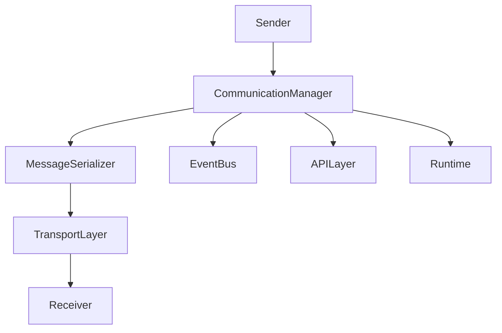

# RFC-0179

**Title:** Communication Architecture

**Document ID:** RFC-0179

**Version:** 1.0

**Status:** Accepted

**Category:** System Architecture

**Layer:** Infrastructure / Runtime / Integration

**Target:**

```text
architecture/communication/
```

---

# Abstract

This RFC defines the SH-3 Communication Architecture (CA).

The Communication Architecture establishes the unified communication framework responsible for message exchange, service communication, event propagation, remote interaction, data serialization, and reliable information transfer across the SH-3 AI Operating System Framework.

The Communication Architecture provides:

- internal communication
- external communication
- message transport
- RPC communication
- event communication
- serialization
- protocol abstraction
- reliability control
- communication monitoring

The communication model:

```text
Component

↓

Message

↓

Transport

↓

Receiver

↓

Processing
```

Every communication operation SHALL be:

- typed
- reliable
- observable
- secure
- versioned
- deterministic

This document is normative.

---

# Motivation

SH-3 is composed of independent replaceable components.

The architecture contains:

```text
Kernel

Runtime

Services

Agents

Plugins

External Systems
```

These components require a stable communication foundation.

Without communication abstraction:

```text
Component Coupling

↓

Maintenance Difficulty

↓

System Failure Risk
```

With communication architecture:

```text
Interface

↓

Message

↓

Transport

↓

Response
```

---

# Goals

The architecture SHALL provide:

- unified communication model
- component decoupling
- reliable message exchange
- protocol independence
- distributed operation support
- communication observability

---

# Non-Goals

The architecture SHALL NOT:

- replace Event Bus Architecture
- replace API Architecture
- manage business logic
- bypass security controls

---

# Architecture



---

# Design Principles

## Communication Abstraction

Components SHALL communicate through defined interfaces.

---

## Transport Independence

The system SHALL not depend on one transport mechanism.

---

## Message First

Communication SHALL use explicit message contracts.

---

## Reliability By Design

Communication failures SHALL be detectable and recoverable.

---

## Observable Communication

Every message SHALL be traceable.

---

# Components

| Component | Responsibility |
|---|---|
| CommunicationManager | Communication orchestration |
| MessageBroker | Message routing |
| Serializer | Data conversion |
| TransportManager | Transport control |
| ProtocolManager | Protocol handling |
| ReliabilityManager | Failure handling |
| CommunicationMonitor | Observation |

---

# Communication Model

Every communication message SHALL contain:

```text
message_id

source

destination

type

version

payload

timestamp

metadata
```

---

# Communication Types

SH-3 SHALL support:

```text
Event Communication

Request/Response

RPC Communication

Streaming Communication

Message Queue Communication
```

---

# Event Communication

Used for:

```text
State Change

System Event

Lifecycle Event

Learning Event
```

Integration:

```text
RFC-0152 Event Bus Architecture
```

---

# Request/Response Communication

Used for:

```text
Service Request

Capability Execution

Data Retrieval
```

Flow:

```text
Request

↓

Processing

↓

Response
```

---

# RPC Communication

RPC SHALL support:

```text
Remote Service Call

Typed Interface

Response Validation
```

Used by:

```text
Kernel

Services

Agents
```

---

# Streaming Communication

Streaming SHALL support:

```text
Continuous Data

Telemetry

Realtime Processing

Agent Interaction
```

---

# Message Serialization

Serializer SHALL provide:

- encoding
- decoding
- schema validation
- compatibility checking

Supported formats:

```text
JSON

MessagePack

Binary Format
```

---

# Schema Management

Communication schemas SHALL define:

```text
Message Type

Version

Fields

Validation Rules
```

---

# Protocol Management

ProtocolManager SHALL abstract:

```text
Transport Protocol

Communication Rules

Compatibility
```

---

# Transport Layer

Supported transports:

```text
In Process

Local IPC

Network

Distributed Transport
```

---

# Reliability Management

ReliabilityManager SHALL provide:

```text
Retry

Timeout

Acknowledgement

Failure Detection

Recovery
```

---

# Delivery Guarantees

SH-3 SHALL support:

```text
At Most Once

At Least Once

Exactly Once
```

where applicable.

---

# Communication Failure Handling

Failure flow:

```text
Failure

↓

Detection

↓

Retry

↓

Fallback

↓

Recovery
```

Integration:

```text
RFC-0161 Self Healing Architecture
```

---

# Security Integration

Communication SHALL enforce:

```text
Authentication

Authorization

Encryption

Integrity Validation
```

Integration:

```text
RFC-0169 Security Architecture
```

---

# Policy Integration

Communication actions SHALL follow:

```text
Communication Policy

+

Security Policy

+

Resource Policy
```

Integration:

```text
RFC-0168 Policy Architecture
```

---

# API Integration

API communication SHALL use:

```text
API Contract

↓

Communication Layer

↓

Service
```

Integration:

```text
RFC-0178 API Architecture
```

---

# Module Integration

Modules SHALL communicate through:

```text
Module Interface

+

Message Contract
```

Integration:

```text
RFC-0176 Module Architecture
```

---

# Plugin Integration

Plugins SHALL communicate through:

```text
Plugin API

+

Communication Interface
```

Integration:

```text
RFC-0177 Plugin Architecture
```

---

# Runtime Integration

Runtime SHALL provide:

```text
Execution Context

Message Scheduling

Resource Control
```

Integration:

```text
RFC-0156 Runtime Architecture
```

---

# Event Integration

Communication events:

```text
MessageSent

MessageReceived

MessageFailed

CommunicationRecovered

ProtocolChanged
```

Events SHALL follow:

```text
RFC-0152 Event Bus Architecture
```

---

# State Integration

Communication State SHALL maintain:

```text
ConnectionState

MessageState

ProtocolState

FailureState
```

Integration:

```text
RFC-0157 State Management Architecture
```

---

# Persistence

Communication persistence SHALL store:

- message history
- failed messages
- protocol versions
- communication metadata

---

# Observability Integration

Communication telemetry SHALL include:

```text
Message Count

Latency

Failure Rate

Throughput

Transport Status
```

Integration:

```text
RFC-0171 Observability Architecture
```

---

# Testing Requirements

Communication Architecture SHALL support:

- serialization tests
- protocol tests
- reliability tests
- failure tests
- compatibility tests

Integration:

```text
RFC-0172 Testing Architecture
```

---

# Thread Model

Communication SHALL support concurrent:

- message sending
- message receiving
- serialization
- routing
- monitoring

Reference implementation SHALL be:

- deterministic
- thread-safe
- asynchronous
- event-driven

---

# Performance Metrics

The architecture exposes:

```text
message_latency

throughput

failure_rate

retry_count

delivery_success_rate
```

---

# Performance Objectives

The architecture should optimize for:

- reliable transfer
- low latency
- scalability
- component independence

---

# Future Work

Potential enhancements:

- intelligent routing
- adaptive communication optimization
- distributed SH-3 federation
- semantic message negotiation
- autonomous protocol evolution

---

# References

- RFC-0178 API Architecture
- RFC-0177 Plugin Architecture
- RFC-0176 Module Architecture
- RFC-0171 Observability Architecture
- RFC-0152 Event Bus Architecture

---

# End of RFC-0179