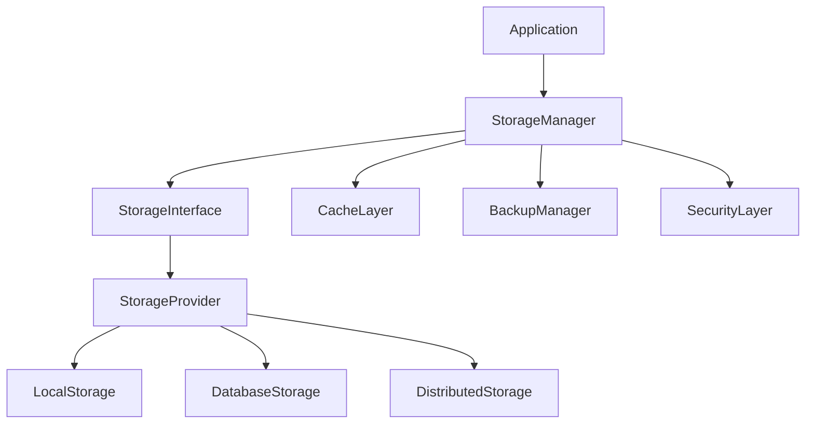

# RFC-0180

**Title:** Storage Architecture

**Document ID:** RFC-0180

**Version:** 1.0

**Status:** Accepted

**Category:** System Architecture

**Layer:** Infrastructure / Persistence / Data Management

**Target:**

```text
architecture/storage/
```

---

# Abstract

This RFC defines the SH-3 Storage Architecture (SA).

The Storage Architecture establishes the unified data persistence framework responsible for storing, retrieving, indexing, managing, protecting, and recovering data across the SH-3 AI Operating System Framework.

The Storage Architecture provides:

- storage abstraction
- persistent storage
- state storage
- memory storage
- cache management
- data lifecycle management
- backup and recovery
- storage security
- storage observability

The storage model:

```text
Data

↓

Storage Interface

↓

Storage Provider

↓

Persistence

↓

Recovery
```

Every storage operation SHALL be:

- typed
- consistent
- observable
- secure
- deterministic
- recoverable

This document is normative.

---

# Motivation

SH-3 is an autonomous AI Operating System Framework.

The system manages:

```text
Runtime State

Knowledge

Memory

Learning Data

Configuration

Events

Artifacts

Models
```

Reliable storage is required for:

```text
Execution

↓

Persistence

↓

Learning

↓

Recovery
```

Without storage abstraction:

```text
Component Dependency

↓

Migration Difficulty

↓

System Limitation
```

With Storage Architecture:

```text
Storage Contract

↓

Provider Selection

↓

Data Persistence
```

---

# Goals

The architecture SHALL provide:

- unified storage interface
- provider independence
- persistent state management
- scalable data handling
- recovery capability
- secure storage operations

---

# Non-Goals

The architecture SHALL NOT:

- define business data models
- replace Memory Architecture
- replace Database Technology
- bypass security controls

---

# Architecture



---

# Design Principles

## Storage Independence

Components SHALL not depend on a specific storage engine.

---

## Data Ownership

Every stored object SHALL have a defined owner.

---

## Persistence First

Important system state SHALL be recoverable.

---

## Consistency Before Speed

Data integrity SHALL be prioritized.

---

## Observable Storage

Storage operations SHALL be measurable.

---

# Components

| Component | Responsibility |
|---|---|
| StorageManager | Storage orchestration |
| StorageInterface | Abstract contract |
| StorageRegistry | Provider management |
| StorageProvider | Backend implementation |
| CacheManager | Temporary storage |
| BackupManager | Backup control |
| RecoveryManager | Restoration |
| StorageMonitor | Observation |

---

# Storage Model

Every stored object SHALL contain:

```text
object_id

type

version

owner

created_at

updated_at

metadata

payload
```

---

# Storage Types

SH-3 SHALL support:

```text
Configuration Storage

State Storage

Memory Storage

Event Storage

Artifact Storage

Model Storage

Cache Storage
```

---

# Storage Interface

All providers SHALL implement:

```text
create()

read()

update()

delete()

query()

exists()
```

---

# Storage Provider

Supported providers:

```text
Local File Storage

Database Storage

Key Value Storage

Object Storage

Distributed Storage
```

---

# State Storage

State Storage SHALL manage:

```text
Runtime State

Kernel State

Module State

Agent State

Learning State
```

Integration:

```text
RFC-0157 State Management Architecture
```

---

# Memory Storage

Memory Storage SHALL support:

```text
Short Term Memory

Long Term Memory

Knowledge Memory

Experience Memory
```

Integration:

```text
RFC-0165 Knowledge Architecture
```

---

# Event Storage

Event Storage SHALL persist:

```text
Event History

Replay Data

Audit Events
```

Integration:

```text
RFC-0152 Event Bus Architecture
```

---

# Cache System

CacheManager SHALL provide:

```text
Fast Access

Temporary Data

Computed Results

Runtime Optimization
```

Cache SHALL support:

```text
Expiration

Invalidation

Capacity Control
```

---

# Data Lifecycle

Every data object SHALL follow:

```text
Created

↓

Stored

↓

Accessed

↓

Updated

↓

Archived

↓

Deleted
```

---

# Version Management

Stored data SHALL support:

```text
Version

Revision

History

Rollback
```

---

# Backup Architecture

BackupManager SHALL provide:

```text
Snapshot

Incremental Backup

Verification

Restore Point
```

---

# Recovery Architecture

RecoveryManager SHALL support:

```text
Failure Detection

↓

Backup Selection

↓

Restore

↓

Validation

↓

Resume
```

Integration:

```text
RFC-0161 Self Healing Architecture
```

---

# Data Consistency

Storage SHALL support:

```text
Atomic Operation

Transaction

Consistency Check

Integrity Validation
```

---

# Security Integration

Storage SHALL enforce:

```text
Access Control

Encryption

Integrity Protection

Audit Logging
```

Integration:

```text
RFC-0169 Security Architecture
```

---

# Configuration Integration

Storage configuration SHALL be controlled by:

```text
Storage Configuration

Environment Settings

Runtime Parameters
```

Integration:

```text
RFC-0174 Configuration Architecture
```

---

# Dependency Integration

Storage providers SHALL be managed through:

```text
Dependency Management

Module System
```

Integration:

```text
RFC-0175 Dependency Management Architecture

RFC-0176 Module Architecture
```

---

# Plugin Integration

Storage extensions MAY be implemented as plugins:

```text
Storage Plugin

↓

Storage Provider

↓

Storage Interface
```

Integration:

```text
RFC-0177 Plugin Architecture
```

---

# Communication Integration

Distributed storage communication SHALL use:

```text
Communication Layer
```

Integration:

```text
RFC-0179 Communication Architecture
```

---

# API Integration

Storage access SHALL be exposed through:

```text
Storage API

↓

Storage Manager

↓

Provider
```

Integration:

```text
RFC-0178 API Architecture
```

---

# Event Integration

Storage events:

```text
StorageCreated

StorageUpdated

StorageDeleted

BackupCompleted

RecoveryStarted

RecoveryCompleted
```

Events SHALL follow:

```text
RFC-0152 Event Bus Architecture
```

---

# State Integration

Storage State SHALL maintain:

```text
ProviderState

CapacityState

HealthState

BackupState
```

---

# Persistence

This architecture defines the persistence foundation itself.

Stored information includes:

- system state
- configuration
- memory
- artifacts
- events
- metadata

---

# Observability Integration

Storage telemetry SHALL include:

```text
Read Latency

Write Latency

Storage Usage

Failure Rate

Recovery Status
```

Integration:

```text
RFC-0171 Observability Architecture
```

---

# Testing Requirements

Storage Architecture SHALL support:

- provider tests
- consistency tests
- recovery tests
- backup tests
- performance tests

Integration:

```text
RFC-0172 Testing Architecture
```

---

# Thread Model

Storage operations SHALL support concurrent:

- reads
- writes
- transactions
- backups
- recovery operations

Reference implementation SHALL be:

- deterministic
- thread-safe
- atomic
- event-driven

---

# Performance Metrics

The architecture exposes:

```text
read_latency

write_latency

storage_capacity

recovery_time

failure_rate
```

---

# Performance Objectives

The architecture should optimize for:

- reliability
- scalability
- recovery speed
- data integrity

---

# Future Work

Potential enhancements:

- AI optimized storage allocation
- autonomous data lifecycle management
- distributed knowledge storage
- predictive storage scaling
- self-healing storage systems

---

# References

- RFC-0179 Communication Architecture
- RFC-0178 API Architecture
- RFC-0177 Plugin Architecture
- RFC-0169 Security Architecture
- RFC-0157 State Management Architecture

---

# End of RFC-0180