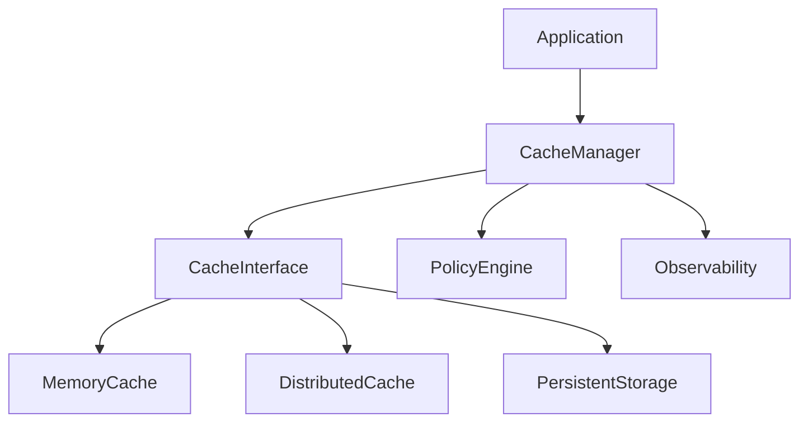

# RFC-0181

**Title:** Cache Architecture

**Document ID:** RFC-0181

**Version:** 1.0

**Status:** Accepted

**Category:** System Architecture

**Layer:** Infrastructure / Runtime / Storage Optimization

**Target:**

```text
architecture/cache/
```

---

# Abstract

This RFC defines the SH-3 Cache Architecture (CA).

The Cache Architecture establishes the caching framework responsible for accelerating data access, reducing storage latency, minimizing redundant computation, and improving overall runtime efficiency throughout the SH-3 AI Operating System Framework.

The Cache Architecture provides:

- cache abstraction
- memory cache
- distributed cache
- cache lifecycle
- cache invalidation
- cache consistency
- eviction management
- cache observability

The cache model:

```text
Request

↓

Cache Lookup

↓

Hit / Miss

↓

Storage

↓

Cache Update

↓

Response
```

Every cache operation SHALL be:

- typed
- deterministic
- observable
- configurable
- thread-safe
- recoverable

This document is normative.

---

# Motivation

Large-scale AI systems repeatedly access identical data.

Typical examples include:

```text
Configuration

Knowledge

Runtime State

Policies

Models

Metadata
```

Repeated storage access increases:

```text
Latency

↓

CPU Usage

↓

Storage Load
```

The Cache Architecture minimizes unnecessary computation while preserving correctness.

---

# Goals

The architecture SHALL provide:

- unified cache abstraction
- provider independence
- configurable cache policies
- low-latency access
- consistency guarantees
- scalable cache management

---

# Non-Goals

The architecture SHALL NOT:

- replace persistent storage
- become the source of truth
- bypass security controls
- guarantee permanent persistence

---

# Architecture



---

# Design Principles

## Cache Is An Optimization

Persistent storage SHALL remain authoritative.

---

## Transparent Access

Consumers SHALL access cache through a common interface.

---

## Configurable Policies

Caching behavior SHALL be configurable.

---

## Consistency Before Performance

Invalid data SHALL never be preferred over fresh data.

---

## Observable Behavior

Cache efficiency SHALL be measurable.

---

# Components

| Component | Responsibility |
|---|---|
| CacheManager | Cache orchestration |
| CacheInterface | Unified cache API |
| CacheProvider | Backend implementation |
| CachePolicyManager | Policy enforcement |
| CacheInvalidator | Invalidation |
| CacheMonitor | Metrics |
| CacheRegistry | Provider registry |

---

# Cache Model

Every cache entry SHALL contain:

```text
cache_key

value

version

created_at

expires_at

ttl

metadata
```

---

# Cache Types

SH-3 SHALL support:

```text
Memory Cache

Distributed Cache

Read Cache

Write Cache

Query Cache

Metadata Cache

Inference Cache
```

---

# Cache Lifecycle

Every cache entry SHALL follow:

```text
Created

↓

Stored

↓

Accessed

↓

Updated

↓

Expired

↓

Removed
```

---

# Cache Lookup

Lookup SHALL follow:

```text
Request

↓

Key Lookup

↓

Hit

↓

Return

OR

Miss

↓

Load Storage

↓

Populate Cache

↓

Return
```

---

# Cache Policies

Supported policies include:

```text
Read Through

Write Through

Write Back

Write Around

Refresh Ahead
```

---

# Eviction Policies

Cache providers SHALL support one or more:

```text
LRU

LFU

FIFO

TTL

Priority Based
```

---

# Expiration

Expiration SHALL support:

```text
Time Based

Version Based

Event Based

Manual
```

---

# Cache Consistency

Consistency strategies SHALL include:

```text
Strong Consistency

Eventual Consistency

Version Consistency
```

Selection SHALL be configurable.

---

# Cache Invalidation

Invalidation SHALL support:

```text
Key

Prefix

Tag

Namespace

Global Flush
```

---

# Distributed Cache

Distributed implementations SHALL provide:

- node discovery
- replication
- partition awareness
- failover support

---

# Runtime Integration

Runtime SHALL use cache for:

```text
Execution Context

Scheduling Metadata

Resource Metadata
```

Integration:

```text
RFC-0156 Runtime Architecture
```

---

# Storage Integration

Cache SHALL accelerate storage access without replacing storage.

Integration:

```text
RFC-0180 Storage Architecture
```

---

# Configuration Integration

Cache behavior SHALL be configurable:

```text
TTL

Capacity

Policy

Eviction

Replication
```

Integration:

```text
RFC-0174 Configuration Architecture
```

---

# Security Integration

Cache SHALL enforce:

```text
Access Control

Encryption

Integrity Validation

Secure Eviction
```

Integration:

```text
RFC-0169 Security Architecture
```

---

# Communication Integration

Distributed cache SHALL use:

```text
Communication Layer
```

Integration:

```text
RFC-0179 Communication Architecture
```

---

# API Integration

Applications SHALL access cache through:

```text
Cache API

↓

Cache Manager

↓

Provider
```

Integration:

```text
RFC-0178 API Architecture
```

---

# Event Integration

Cache events:

```text
CacheHit

CacheMiss

CacheExpired

CacheEvicted

CacheInvalidated

CacheRefreshed
```

Events SHALL follow:

```text
RFC-0152 Event Bus Architecture
```

---

# State Integration

Cache State SHALL maintain:

```text
ProviderState

CapacityState

HitRateState

HealthState
```

Integration:

```text
RFC-0157 State Management Architecture
```

---

# Persistence

Cache metadata MAY be persisted.

Persistent data SHALL remain under:

```text
RFC-0180 Storage Architecture
```

---

# Observability Integration

Cache telemetry SHALL include:

```text
Hit Rate

Miss Rate

Latency

Eviction Count

Memory Usage

Capacity
```

Integration:

```text
RFC-0171 Observability Architecture
```

---

# Testing Requirements

Cache Architecture SHALL support:

- hit/miss tests
- eviction tests
- consistency tests
- failover tests
- concurrency tests
- performance benchmarks

Integration:

```text
RFC-0172 Testing Architecture
```

---

# Thread Model

Cache SHALL support concurrent:

- reads
- writes
- invalidations
- refresh operations
- provider synchronization

Reference implementation SHALL be:

- deterministic
- thread-safe
- lock-efficient
- event-driven

---

# Performance Metrics

The architecture exposes:

```text
hit_rate

miss_rate

average_latency

eviction_rate

memory_utilization

refresh_latency
```

---

# Performance Objectives

The architecture should optimize for:

- high cache hit rate
- low latency
- predictable behavior
- scalable throughput

---

# Future Work

Potential enhancements:

- AI-driven cache policy optimization
- predictive prefetching
- adaptive TTL calculation
- semantic caching
- distributed autonomous cache balancing

---

# References

- RFC-0180 Storage Architecture
- RFC-0179 Communication Architecture
- RFC-0178 API Architecture
- RFC-0174 Configuration Architecture
- RFC-0152 Event Bus Architecture

---

# End of RFC-0181