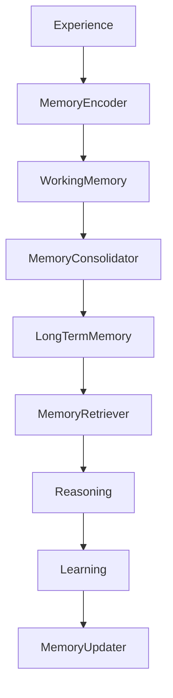

# RFC-0182

**Title:** Memory Architecture

**Document ID:** RFC-0182

**Version:** 1.0

**Status:** Accepted

**Category:** Cognitive Architecture

**Layer:** Cognition / Learning / Persistence

**Target:**

```text
architecture/memory/
```

---

# Abstract

This RFC defines the SH-3 Memory Architecture (MA).

The Memory Architecture establishes the unified memory framework responsible for acquiring, organizing, consolidating, retrieving, updating, and forgetting knowledge throughout the SH-3 AI Operating System Framework.

Memory is a persistent cognitive capability rather than a simple storage mechanism.

The Memory Architecture provides:

- working memory
- short-term memory
- long-term memory
- episodic memory
- semantic memory
- procedural memory
- vector memory
- memory consolidation
- memory retrieval
- memory decay
- knowledge integration

The memory model:

```text
Experience

↓

Encoding

↓

Memory

↓

Retrieval

↓

Reasoning

↓

Learning

↓

Updated Memory
```

Every memory operation SHALL be:

- typed
- traceable
- deterministic
- observable
- versioned
- secure

This document is normative.

---

# Motivation

An autonomous AI Operating System must preserve experience across execution cycles.

Without structured memory:

```text
Input

↓

Execution

↓

Discard
```

With Memory Architecture:

```text
Experience

↓

Memory

↓

Knowledge

↓

Reasoning

↓

Learning
```

Memory enables cumulative intelligence.

---

# Goals

The architecture SHALL provide:

- persistent cognitive memory
- structured knowledge representation
- efficient retrieval
- adaptive consolidation
- controlled forgetting
- scalable memory organization

---

# Non-Goals

The architecture SHALL NOT:

- replace Storage Architecture
- replace Knowledge Architecture
- bypass Security Architecture
- store unvalidated system configuration

---

# Architecture



---

# Design Principles

## Memory Is Knowledge

Memory SHALL represent meaningful knowledge rather than raw data.

---

## Retrieval First

Stored information SHALL remain discoverable.

---

## Controlled Growth

Memory SHALL support consolidation and forgetting.

---

## Multiple Memory Systems

Different cognitive purposes SHALL use different memory types.

---

## Continuous Learning

Every validated experience MAY improve memory.

---

# Components

| Component | Responsibility |
|---|---|
| MemoryManager | Memory orchestration |
| MemoryEncoder | Experience encoding |
| MemoryRetriever | Memory search |
| MemoryConsolidator | Long-term consolidation |
| MemoryIndexer | Index construction |
| ForgettingManager | Controlled decay |
| MemoryMonitor | Observability |

---

# Memory Model

Every memory object SHALL contain:

```text
memory_id

memory_type

importance

confidence

embedding

source

timestamp

version

metadata

content
```

---

# Memory Types

SH-3 SHALL support:

```text
Working Memory

Short-Term Memory

Long-Term Memory

Episodic Memory

Semantic Memory

Procedural Memory

Vector Memory
```

---

# Working Memory

Working Memory SHALL contain:

```text
Current Goal

Current Context

Active Reasoning

Temporary Variables
```

Characteristics:

- volatile
- low latency
- execution scoped

---

# Short-Term Memory

Short-Term Memory SHALL store:

```text
Recent Events

Recent Conversations

Recent Decisions

Recent Plans
```

---

# Long-Term Memory

Long-Term Memory SHALL contain:

```text
Learned Knowledge

Persistent Facts

Behavior History

Strategies
```

Characteristics:

- durable
- searchable
- versioned

---

# Episodic Memory

Stores experiences as chronological events.

Example:

```text
Observation

↓

Decision

↓

Outcome
```

Supports:

- replay
- reflection
- causal analysis

---

# Semantic Memory

Stores structured knowledge:

```text
Facts

Concepts

Relationships

Rules

Ontologies
```

Integration:

```text
RFC-0165 Knowledge Architecture
```

---

# Procedural Memory

Stores executable knowledge:

```text
Skills

Procedures

Workflows

Policies

Execution Patterns
```

---

# Vector Memory

Vector Memory SHALL support:

```text
Embedding Storage

Similarity Search

Semantic Retrieval

Context Expansion
```

---

# Memory Encoding

Encoding SHALL include:

```text
Normalization

Validation

Importance Estimation

Embedding Generation

Indexing
```

---

# Memory Consolidation

Consolidation SHALL follow:

```text
Working Memory

↓

Short-Term Memory

↓

Long-Term Memory

↓

Knowledge Refinement
```

---

# Memory Retrieval

Retrieval SHALL support:

```text
Identifier Lookup

Semantic Search

Vector Similarity

Keyword Search

Hybrid Search
```

---

# Memory Ranking

Results SHALL consider:

```text
Similarity

Importance

Confidence

Recency

Usage Frequency
```

---

# Memory Updating

Updates SHALL preserve:

```text
History

Version

Source

Audit Trail
```

---

# Forgetting

Forgetting SHALL support:

```text
TTL

Importance Threshold

Manual Removal

Policy-Based Cleanup
```

Deletion SHALL preserve audit metadata where required.

---

# Knowledge Integration

Memory SHALL continuously synchronize with:

```text
Knowledge Graph

↓

Reasoning Engine

↓

Learning System
```

---

# Learning Integration

Learning SHALL update memory through:

```text
Observation

↓

Validation

↓

Memory Update

↓

Consolidation
```

Integration:

```text
RFC-0162 Learning Architecture
```

---

# Reasoning Integration

Reasoning SHALL consume:

```text
Working Memory

Semantic Memory

Vector Memory

Procedural Memory
```

Integration:

```text
RFC-0166 Reasoning Architecture
```

---

# Storage Integration

Persistent memory SHALL use:

```text
Storage Manager
```

Integration:

```text
RFC-0180 Storage Architecture
```

---

# Cache Integration

Frequently accessed memories MAY be cached.

Integration:

```text
RFC-0181 Cache Architecture
```

---

# Security Integration

Memory SHALL enforce:

```text
Access Control

Encryption

Integrity Validation

Audit Logging
```

Integration:

```text
RFC-0169 Security Architecture
```

---

# Event Integration

Memory events:

```text
MemoryCreated

MemoryRetrieved

MemoryUpdated

MemoryConsolidated

MemoryForgotten
```

Events SHALL follow:

```text
RFC-0152 Event Bus Architecture
```

---

# State Integration

Memory State SHALL maintain:

```text
WorkingMemoryState

LongTermMemoryState

IndexState

RetrievalState
```

Integration:

```text
RFC-0157 State Management Architecture
```

---

# Observability Integration

Memory telemetry SHALL include:

```text
Retrieval Latency

Encoding Latency

Memory Size

Hit Rate

Consolidation Rate

Forgetting Rate
```

Integration:

```text
RFC-0171 Observability Architecture
```

---

# Testing Requirements

Memory Architecture SHALL support:

- retrieval tests
- consolidation tests
- vector search tests
- ranking tests
- forgetting tests
- concurrency tests

Integration:

```text
RFC-0172 Testing Architecture
```

---

# Thread Model

Memory SHALL support concurrent:

- retrieval
- encoding
- consolidation
- indexing
- updates

Reference implementation SHALL be:

- deterministic
- thread-safe
- event-driven
- eventually consistent where configured

---

# Performance Metrics

The architecture exposes:

```text
retrieval_latency

encoding_latency

consolidation_latency

memory_growth_rate

retrieval_accuracy

cache_hit_rate
```

---

# Performance Objectives

The architecture should optimize for:

- high retrieval accuracy
- low retrieval latency
- scalable memory growth
- continuous knowledge refinement

---

# Future Work

Potential enhancements:

- autonomous memory compression
- hierarchical episodic abstraction
- lifelong learning optimization
- distributed memory federation
- adaptive forgetting based on utility

---

# References

- RFC-0181 Cache Architecture
- RFC-0180 Storage Architecture
- RFC-0166 Reasoning Architecture
- RFC-0165 Knowledge Architecture
- RFC-0162 Learning Architecture

---

# End of RFC-0182