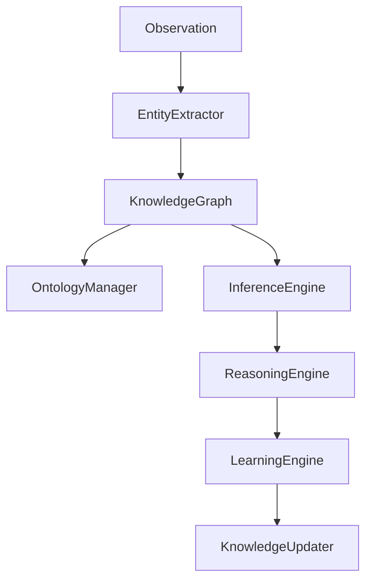

# RFC-0183

**Title:** Knowledge Graph Architecture

**Document ID:** RFC-0183

**Version:** 1.0

**Status:** Accepted

**Category:** Cognitive Architecture

**Layer:** Cognition / Knowledge / Reasoning

**Target:**

```text
architecture/knowledge_graph/
```

---

# Abstract

This RFC defines the SH-3 Knowledge Graph Architecture (KGA).

The Knowledge Graph Architecture establishes the semantic knowledge representation framework responsible for organizing entities, concepts, relationships, ontologies, facts, and inferred knowledge across the SH-3 AI Operating System Framework.

The architecture transforms isolated memories into a connected semantic network capable of supporting reasoning, planning, learning, retrieval, and autonomous decision-making.

The Knowledge Graph Architecture provides:

- entity management
- relationship modeling
- ontology management
- fact representation
- semantic search
- graph traversal
- knowledge inference
- graph evolution
- graph validation

The knowledge model:

```text
Observation

↓

Entity Extraction

↓

Knowledge Graph

↓

Reasoning

↓

Learning

↓

Knowledge Update
```

Every graph operation SHALL be:

- typed
- deterministic
- observable
- versioned
- traceable
- secure

This document is normative.

---

# Motivation

Large AI systems accumulate millions of isolated facts.

Without semantic organization:

```text
Facts

↓

Storage

↓

Limited Intelligence
```

With a Knowledge Graph:

```text
Facts

↓

Relationships

↓

Concepts

↓

Reasoning

↓

Intelligence
```

Knowledge emerges from connected information rather than isolated records.

---

# Goals

The architecture SHALL provide:

- semantic knowledge representation
- graph-based reasoning
- efficient relationship traversal
- ontology support
- continuous knowledge evolution
- scalable graph management

---

# Non-Goals

The architecture SHALL NOT:

- replace Memory Architecture
- replace Storage Architecture
- bypass validation
- store arbitrary unverified information

---

# Architecture



---

# Design Principles

## Knowledge Is Connected

Knowledge SHALL be represented as connected structures.

---

## Explicit Semantics

Entities and relationships SHALL possess defined meanings.

---

## Graph Evolution

The graph SHALL continuously evolve through learning.

---

## Explainable Knowledge

Every inferred fact SHALL be traceable.

---

## Consistency First

Conflicting knowledge SHALL be detected and managed.

---

# Components

| Component | Responsibility |
|---|---|
| KnowledgeGraphManager | Graph orchestration |
| EntityManager | Entity lifecycle |
| RelationshipManager | Relationship management |
| OntologyManager | Ontology maintenance |
| InferenceEngine | Knowledge inference |
| GraphIndexer | Graph indexing |
| GraphValidator | Consistency validation |
| KnowledgeMonitor | Observability |

---

# Graph Model

Every graph SHALL contain:

```text
Nodes

Edges

Properties

Labels

Metadata

Version
```

---

# Entity Model

Every entity SHALL contain:

```text
entity_id

entity_type

name

aliases

attributes

confidence

source

metadata
```

---

# Relationship Model

Every relationship SHALL contain:

```text
relationship_id

source_entity

target_entity

relationship_type

weight

confidence

timestamp
```

---

# Knowledge Types

SH-3 SHALL support:

```text
Fact

Concept

Rule

Ontology

Observation

Hypothesis

Inference
```

---

# Ontology

Ontology SHALL define:

```text
Classes

Hierarchy

Properties

Constraints

Inheritance
```

---

# Entity Extraction

Extraction SHALL perform:

```text
Normalization

Classification

Deduplication

Validation

Registration
```

---

# Graph Construction

Graph construction SHALL follow:

```text
Observation

↓

Entity Detection

↓

Relationship Discovery

↓

Validation

↓

Graph Update
```

---

# Knowledge Inference

Inference SHALL support:

```text
Rule-Based Inference

Graph Traversal

Relationship Expansion

Similarity Inference

Transitive Inference
```

---

# Graph Traversal

Traversal SHALL support:

```text
Breadth First Search

Depth First Search

Shortest Path

Semantic Expansion

Neighborhood Search
```

---

# Knowledge Validation

Validation SHALL detect:

```text
Conflicts

Duplicates

Broken Relationships

Ontology Violations

Confidence Threshold Failures
```

---

# Knowledge Evolution

Knowledge SHALL evolve through:

```text
Learning

↓

Inference

↓

Validation

↓

Graph Update
```

---

# Memory Integration

Knowledge Graph SHALL synchronize with:

```text
Semantic Memory

Vector Memory

Long-Term Memory
```

Integration:

```text
RFC-0182 Memory Architecture
```

---

# Reasoning Integration

Reasoning SHALL consume:

```text
Knowledge Graph

↓

Inference

↓

Decision
```

Integration:

```text
RFC-0166 Reasoning Architecture
```

---

# Learning Integration

Learning SHALL improve:

```text
Ontology

Relationships

Confidence

Knowledge Quality
```

Integration:

```text
RFC-0162 Learning Architecture
```

---

# Storage Integration

Persistent graph storage SHALL use:

```text
Storage Manager
```

Integration:

```text
RFC-0180 Storage Architecture
```

---

# Cache Integration

Frequently traversed graph regions MAY be cached.

Integration:

```text
RFC-0181 Cache Architecture
```

---

# Security Integration

Knowledge SHALL enforce:

```text
Access Control

Integrity Protection

Audit Logging

Version History
```

Integration:

```text
RFC-0169 Security Architecture
```

---

# Event Integration

Knowledge events:

```text
EntityCreated

RelationshipCreated

KnowledgeUpdated

OntologyChanged

InferenceGenerated
```

Events SHALL follow:

```text
RFC-0152 Event Bus Architecture
```

---

# State Integration

Knowledge State SHALL maintain:

```text
GraphState

OntologyState

InferenceState

ValidationState
```

Integration:

```text
RFC-0157 State Management Architecture
```

---

# Observability Integration

Knowledge telemetry SHALL include:

```text
Entity Count

Relationship Count

Inference Count

Traversal Latency

Validation Errors

Graph Density
```

Integration:

```text
RFC-0171 Observability Architecture
```

---

# Testing Requirements

Knowledge Graph Architecture SHALL support:

- graph integrity tests
- ontology validation tests
- inference tests
- traversal tests
- consistency tests
- scalability benchmarks

Integration:

```text
RFC-0172 Testing Architecture
```

---

# Thread Model

Knowledge Graph SHALL support concurrent:

- entity insertion
- relationship updates
- graph traversal
- inference
- indexing

Reference implementation SHALL be:

- deterministic
- thread-safe
- event-driven
- version-aware

---

# Performance Metrics

The architecture exposes:

```text
graph_size

entity_count

relationship_count

traversal_latency

inference_latency

graph_consistency_score
```

---

# Performance Objectives

The architecture should optimize for:

- semantic accuracy
- efficient traversal
- scalable growth
- explainable inference

---

# Future Work

Potential enhancements:

- distributed knowledge graphs
- probabilistic knowledge representation
- temporal knowledge graphs
- autonomous ontology evolution
- multi-agent shared knowledge graphs

---

# References

- RFC-0182 Memory Architecture
- RFC-0181 Cache Architecture
- RFC-0180 Storage Architecture
- RFC-0166 Reasoning Architecture
- RFC-0165 Knowledge Architecture

---

# End of RFC-0183