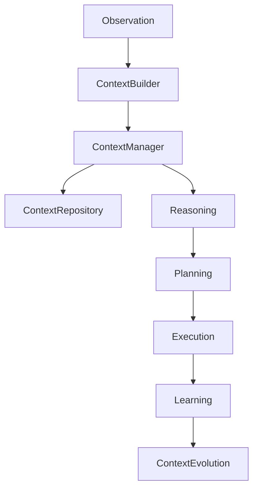

# RFC-0184

**Title:** Context Architecture

**Document ID:** RFC-0184

**Version:** 1.0

**Status:** Accepted

**Category:** Cognitive Architecture

**Layer:** Cognition / Runtime / Reasoning

**Target:**

```text
architecture/context/
```

---

# Abstract

This RFC defines the SH-3 Context Architecture (CTA).

The Context Architecture establishes the unified context management framework responsible for acquiring, constructing, maintaining, evolving, and distributing contextual information throughout the SH-3 AI Operating System Framework.

Context represents the active operational knowledge required for reasoning, planning, execution, learning, and autonomous decision-making.

The Context Architecture provides:

- context acquisition
- context construction
- context fusion
- context propagation
- context prioritization
- context persistence
- context evolution
- context isolation
- context expiration

The context model:

```text
Observation

↓

Memory Retrieval

↓

Knowledge Integration

↓

Context Construction

↓

Reasoning

↓

Planning

↓

Execution
```

Every context operation SHALL be:

- typed
- deterministic
- observable
- versioned
- traceable
- secure

This document is normative.

---

# Motivation

Knowledge alone is insufficient.

An autonomous AI system must determine:

- what is relevant
- what is current
- what should influence decisions

Without context:

```text
Knowledge

↓

Reasoning

↓

Poor Decisions
```

With context:

```text
Knowledge

↓

Relevant Context

↓

Reasoning

↓

Better Decisions
```

---

# Goals

The architecture SHALL provide:

- dynamic context construction
- relevance management
- contextual reasoning
- efficient context propagation
- context reuse
- scalable context lifecycle

---

# Non-Goals

The architecture SHALL NOT:

- replace Memory Architecture
- replace Knowledge Graph
- replace Planning
- bypass security policies

---

# Architecture



---

# Design Principles

## Context Is Dynamic

Context SHALL continuously evolve.

---

## Context Is Relevant

Only relevant information SHALL influence decisions.

---

## Context Is Scoped

Every context SHALL have explicit boundaries.

---

## Context Is Explainable

Every context SHALL be reproducible.

---

## Context Is Shareable

Contexts MAY be propagated between components.

---

# Components

| Component | Responsibility |
|---|---|
| ContextManager | Context orchestration |
| ContextBuilder | Context construction |
| ContextRepository | Active context storage |
| ContextResolver | Context lookup |
| ContextMerger | Context fusion |
| ContextValidator | Context verification |
| ContextMonitor | Observability |

---

# Context Model

Every context SHALL contain:

```text
context_id

scope

priority

confidence

source

created_at

expires_at

version

metadata

payload
```

---

# Context Types

SH-3 SHALL support:

```text
Execution Context

Conversation Context

Reasoning Context

Planning Context

Learning Context

Runtime Context

Agent Context

User Context

Environment Context
```

---

# Context Sources

Context MAY originate from:

```text
Memory

Knowledge Graph

Runtime State

Configuration

Events

External APIs

User Input

Sensor Data
```

---

# Context Construction

ContextBuilder SHALL perform:

```text
Collection

↓

Filtering

↓

Normalization

↓

Ranking

↓

Fusion

↓

Validation
```

---

# Context Fusion

Multiple contexts SHALL support:

```text
Merge

Overlay

Priority Resolution

Conflict Detection

Confidence Aggregation
```

---

# Context Selection

Selection SHALL consider:

```text
Relevance

Priority

Confidence

Recency

Policy

Execution Scope
```

---

# Context Lifecycle

Every context SHALL follow:

```text
Created

↓

Validated

↓

Activated

↓

Updated

↓

Shared

↓

Archived

↓

Expired
```

---

# Context Expiration

Expiration SHALL support:

```text
TTL

Task Completion

Manual Removal

Policy Rule

Event Trigger
```

---

# Context Isolation

Each execution SHALL maintain:

```text
Execution Context

Task Context

Agent Context

Security Context
```

Isolation SHALL prevent unintended information leakage.

---

# Context Repository

The repository SHALL support:

```text
Lookup

Versioning

Indexing

Snapshots

History
```

---

# Memory Integration

Context SHALL retrieve information from:

```text
Working Memory

Semantic Memory

Vector Memory

Long-Term Memory
```

Integration:

```text
RFC-0182 Memory Architecture
```

---

# Knowledge Graph Integration

Context SHALL enrich reasoning through:

```text
Entities

Relationships

Ontology

Inference
```

Integration:

```text
RFC-0183 Knowledge Graph Architecture
```

---

# Reasoning Integration

Reasoning SHALL consume:

```text
Current Context

↓

Inference

↓

Decision
```

Integration:

```text
RFC-0166 Reasoning Architecture
```

---

# Planning Integration

Planning SHALL consume:

```text
Context

↓

Goals

↓

Execution Plan
```

Integration:

```text
RFC-0167 Planning Architecture
```

---

# Learning Integration

Learning SHALL improve:

```text
Context Ranking

Fusion Rules

Priority Models

Relevance Estimation
```

Integration:

```text
RFC-0162 Learning Architecture
```

---

# Runtime Integration

Runtime SHALL maintain:

```text
Execution Context

Thread Context

Resource Context
```

Integration:

```text
RFC-0156 Runtime Architecture
```

---

# Storage Integration

Persistent contexts SHALL use:

```text
Storage Manager
```

Integration:

```text
RFC-0180 Storage Architecture
```

---

# Cache Integration

Active contexts MAY be cached.

Integration:

```text
RFC-0181 Cache Architecture
```

---

# Security Integration

Context SHALL enforce:

```text
Access Control

Context Isolation

Integrity Protection

Audit Logging
```

Integration:

```text
RFC-0169 Security Architecture
```

---

# Event Integration

Context events:

```text
ContextCreated

ContextActivated

ContextMerged

ContextExpired

ContextUpdated
```

Events SHALL follow:

```text
RFC-0152 Event Bus Architecture
```

---

# State Integration

Context State SHALL maintain:

```text
ActiveContextState

RepositoryState

ScopeState

LifecycleState
```

Integration:

```text
RFC-0157 State Management Architecture
```

---

# Observability Integration

Context telemetry SHALL include:

```text
Active Context Count

Construction Latency

Merge Count

Reuse Rate

Expiration Rate

Context Accuracy
```

Integration:

```text
RFC-0171 Observability Architecture
```

---

# Testing Requirements

Context Architecture SHALL support:

- context construction tests
- merge tests
- relevance ranking tests
- lifecycle tests
- isolation tests
- concurrency tests

Integration:

```text
RFC-0172 Testing Architecture
```

---

# Thread Model

Context operations SHALL support concurrent:

- construction
- lookup
- merge
- propagation
- expiration

Reference implementation SHALL be:

- deterministic
- thread-safe
- event-driven
- version-aware

---

# Performance Metrics

The architecture exposes:

```text
context_build_latency

context_lookup_latency

context_merge_latency

context_reuse_rate

active_context_count

context_accuracy_score
```

---

# Performance Objectives

The architecture should optimize for:

- relevant context selection
- low construction latency
- scalable context management
- accurate decision support

---

# Future Work

Potential enhancements:

- hierarchical context graphs
- multimodal context integration
- distributed context federation
- predictive context preloading
- adaptive context compression

---

# References

- RFC-0183 Knowledge Graph Architecture
- RFC-0182 Memory Architecture
- RFC-0181 Cache Architecture
- RFC-0167 Planning Architecture
- RFC-0166 Reasoning Architecture

---

# End of RFC-0184