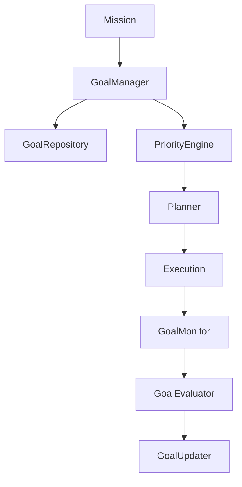

# RFC-0185

**Title:** Goal Management Architecture

**Document ID:** RFC-0185

**Version:** 1.0

**Status:** Accepted

**Category:** Cognitive Architecture

**Layer:** Cognition / Planning / Executive Control

**Target:**

```text
architecture/goals/
```

---

# Abstract

This RFC defines the SH-3 Goal Management Architecture (GMA).

The Goal Management Architecture establishes the executive framework responsible for generating, organizing, prioritizing, monitoring, adapting, and completing goals throughout the SH-3 AI Operating System Framework.

Goals represent the intentional direction of autonomous behavior and provide the bridge between reasoning and execution.

The Goal Management Architecture provides:

- goal creation
- goal decomposition
- goal prioritization
- dependency management
- goal scheduling
- goal monitoring
- adaptive replanning
- goal completion
- goal archival

The goal model:

```text
Mission

↓

Goal

↓

Objective

↓

Task

↓

Action

↓

Execution

↓

Evaluation
```

Every goal operation SHALL be:

- typed
- deterministic
- observable
- traceable
- versioned
- policy-compliant

This document is normative.

---

# Motivation

An autonomous system must transform knowledge into intentional action.

Without goal management:

```text
Reasoning

↓

Action

↓

Uncoordinated Behavior
```

With Goal Management:

```text
Reasoning

↓

Goal

↓

Planning

↓

Execution

↓

Evaluation
```

Goals provide continuity across multiple execution cycles.

---

# Goals

The architecture SHALL provide:

- explicit goal representation
- hierarchical goal decomposition
- adaptive prioritization
- dependency resolution
- lifecycle management
- execution monitoring

---

# Non-Goals

The architecture SHALL NOT:

- replace Planning Architecture
- replace Policy Architecture
- perform low-level task execution
- bypass safety constraints

---

# Architecture



---

# Design Principles

## Goal Driven Execution

Execution SHALL always be associated with one or more goals.

---

## Hierarchical Organization

Goals SHALL support decomposition.

---

## Dynamic Adaptation

Goals MAY evolve during execution.

---

## Explainable Decisions

Every goal SHALL maintain a traceable rationale.

---

## Policy Compliance

Goals SHALL respect system policies.

---

# Components

| Component | Responsibility |
|---|---|
| GoalManager | Goal orchestration |
| GoalRepository | Persistent goal storage |
| GoalBuilder | Goal creation |
| GoalDecomposer | Hierarchical decomposition |
| PriorityEngine | Priority calculation |
| GoalMonitor | Progress monitoring |
| GoalEvaluator | Outcome evaluation |
| GoalScheduler | Execution scheduling |

---

# Goal Model

Every goal SHALL contain:

```text
goal_id

parent_goal

goal_type

priority

status

deadline

confidence

owner

dependencies

constraints

metadata
```

---

# Goal Types

SH-3 SHALL support:

```text
Mission Goal

Strategic Goal

Operational Goal

Execution Goal

Learning Goal

Maintenance Goal

Recovery Goal

Optimization Goal
```

---

# Goal Hierarchy

Goals SHALL support:

```text
Mission

↓

Strategic Goal

↓

Operational Goal

↓

Task Goal

↓

Executable Action
```

---

# Goal Creation

Goals MAY originate from:

```text
User Requests

Reasoning

Learning

Policies

Schedules

Events

Recovery

Optimization
```

---

# Goal Prioritization

Priority SHALL consider:

```text
Importance

Urgency

Dependencies

Risk

Expected Value

Resource Cost

Policy Weight
```

---

# Goal Dependencies

Goals MAY define:

```text
Predecessor

Successor

Blocking Goal

Supporting Goal

Mutually Exclusive Goal
```

---

# Goal Lifecycle

Every goal SHALL follow:

```text
Created

↓

Validated

↓

Scheduled

↓

Executing

↓

Paused

↓

Completed

↓

Evaluated

↓

Archived
```

---

# Goal Scheduling

Scheduler SHALL consider:

```text
Priority

Dependencies

Available Resources

Policies

Execution Context
```

---

# Goal Monitoring

Monitoring SHALL track:

```text
Progress

Completion Rate

Execution Status

Resource Usage

Constraint Violations
```

---

# Goal Evaluation

Evaluation SHALL include:

```text
Outcome

Success Rate

Efficiency

Quality

Policy Compliance

Learning Opportunities
```

---

# Adaptive Goals

Goals MAY be:

```text
Reprioritized

Merged

Split

Suspended

Cancelled

Regenerated
```

---

# Context Integration

Goal selection SHALL consume:

```text
Execution Context

Reasoning Context

Environment Context
```

Integration:

```text
RFC-0184 Context Architecture
```

---

# Knowledge Integration

Goals MAY reference:

```text
Knowledge Graph

Semantic Memory

Procedural Memory
```

Integration:

```text
RFC-0183 Knowledge Graph Architecture
```

---

# Memory Integration

Goal history SHALL be stored within:

```text
Working Memory

Long-Term Memory

Episodic Memory
```

Integration:

```text
RFC-0182 Memory Architecture
```

---

# Planning Integration

Planner SHALL transform:

```text
Goal

↓

Execution Plan

↓

Tasks

↓

Actions
```

Integration:

```text
RFC-0167 Planning Architecture
```

---

# Reasoning Integration

Reasoning SHALL:

```text
Analyze

↓

Generate Goals

↓

Evaluate Goals
```

Integration:

```text
RFC-0166 Reasoning Architecture
```

---

# Learning Integration

Learning SHALL improve:

```text
Goal Ranking

Priority Estimation

Completion Prediction

Planning Quality
```

Integration:

```text
RFC-0162 Learning Architecture
```

---

# Storage Integration

Goals SHALL be persisted using:

```text
Storage Manager
```

Integration:

```text
RFC-0180 Storage Architecture
```

---

# Cache Integration

Frequently accessed goals MAY be cached.

Integration:

```text
RFC-0181 Cache Architecture
```

---

# Security Integration

Goal management SHALL enforce:

```text
Authorization

Integrity Validation

Audit Logging

Policy Enforcement
```

Integration:

```text
RFC-0169 Security Architecture
```

---

# Event Integration

Goal events:

```text
GoalCreated

GoalUpdated

GoalStarted

GoalPaused

GoalCompleted

GoalCancelled

GoalEvaluated
```

Events SHALL follow:

```text
RFC-0152 Event Bus Architecture
```

---

# State Integration

Goal State SHALL maintain:

```text
GoalRepositoryState

SchedulerState

ExecutionState

EvaluationState
```

Integration:

```text
RFC-0157 State Management Architecture
```

---

# Observability Integration

Goal telemetry SHALL include:

```text
Active Goal Count

Completion Rate

Average Completion Time

Priority Distribution

Blocked Goal Count

Goal Success Rate
```

Integration:

```text
RFC-0171 Observability Architecture
```

---

# Testing Requirements

Goal Management Architecture SHALL support:

- lifecycle tests
- dependency resolution tests
- prioritization tests
- scheduling tests
- adaptation tests
- concurrency tests

Integration:

```text
RFC-0172 Testing Architecture
```

---

# Thread Model

Goal management SHALL support concurrent:

- creation
- scheduling
- monitoring
- evaluation
- reprioritization

Reference implementation SHALL be:

- deterministic
- thread-safe
- event-driven
- version-aware

---

# Performance Metrics

The architecture exposes:

```text
goal_creation_latency

goal_scheduling_latency

goal_completion_rate

goal_success_rate

goal_dependency_depth

goal_adaptation_count
```

---

# Performance Objectives

The architecture should optimize for:

- efficient goal execution
- adaptive prioritization
- scalable coordination
- explainable autonomous behavior

---

# Future Work

Potential enhancements:

- multi-agent collaborative goals
- predictive goal generation
- self-optimizing priorities
- hierarchical mission planning
- autonomous strategic objective synthesis

---

# References

- RFC-0184 Context Architecture
- RFC-0183 Knowledge Graph Architecture
- RFC-0182 Memory Architecture
- RFC-0167 Planning Architecture
- RFC-0166 Reasoning Architecture

---

# End of RFC-0185