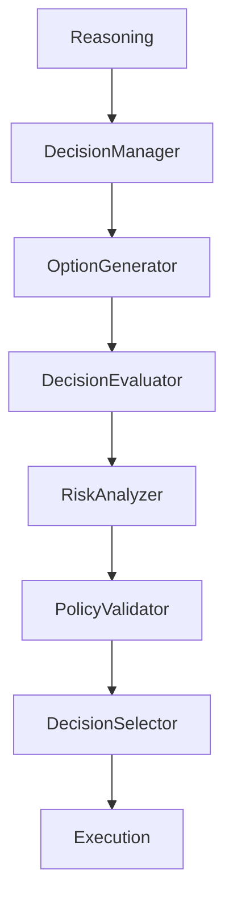

# RFC-0186

**Title:** Decision Architecture

**Document ID:** RFC-0186

**Version:** 1.0

**Status:** Accepted

**Category:** Cognitive Architecture

**Layer:** Cognition / Executive Control / Decision Making

**Target:**

```text
architecture/decision/
```

---

# Abstract

This RFC defines the SH-3 Decision Architecture (DA).

The Decision Architecture establishes the executive decision-making framework responsible for selecting, validating, authorizing, and committing actions throughout the SH-3 AI Operating System Framework.

Decision making integrates reasoning, context, goals, policies, knowledge, resource constraints, and risk analysis into a deterministic execution decision.

The Decision Architecture provides:

- decision construction
- option generation
- decision evaluation
- risk assessment
- policy validation
- action selection
- decision explanation
- decision learning
- decision auditing

The decision model:

```text
Context

↓

Reasoning

↓

Candidate Actions

↓

Evaluation

↓

Decision

↓

Execution
```

Every decision SHALL be:

- typed
- deterministic
- explainable
- observable
- auditable
- policy-compliant

This document is normative.

---

# Motivation

Reasoning produces alternatives.

Execution requires commitment.

Without structured decision making:

```text
Reasoning

↓

Execution

↓

Unpredictable Behavior
```

With Decision Architecture:

```text
Reasoning

↓

Evaluation

↓

Decision

↓

Execution
```

Decision Architecture transforms intelligence into controlled behavior.

---

# Goals

The architecture SHALL provide:

- deterministic action selection
- explainable decision making
- policy-compliant execution
- risk-aware evaluation
- continuous decision improvement
- auditable decision history

---

# Non-Goals

The architecture SHALL NOT:

- replace Planning Architecture
- replace Goal Management
- replace Policy Architecture
- execute actions directly

---

# Architecture



---

# Design Principles

## Decision Before Action

Execution SHALL require an approved decision.

---

## Explainability

Every decision SHALL include its rationale.

---

## Risk Awareness

Risk SHALL influence action selection.

---

## Policy Compliance

Every decision SHALL satisfy active policies.

---

## Continuous Improvement

Decision quality SHALL improve through learning.

---

# Components

| Component | Responsibility |
|---|---|
| DecisionManager | Decision orchestration |
| OptionGenerator | Candidate generation |
| DecisionEvaluator | Multi-factor evaluation |
| RiskAnalyzer | Risk estimation |
| PolicyValidator | Policy verification |
| DecisionSelector | Final selection |
| DecisionRepository | Decision history |
| DecisionMonitor | Observability |

---

# Decision Model

Every decision SHALL contain:

```text
decision_id

goal_id

context_id

candidate_actions

selected_action

confidence

risk_score

policy_result

reason

timestamp

metadata
```

---

# Decision Sources

Decision inputs MAY originate from:

```text
Reasoning

Context

Goals

Policies

Knowledge Graph

Memory

Runtime State

External Events
```

---

# Candidate Generation

The OptionGenerator SHALL produce:

```text
Primary Action

Alternative Actions

Fallback Actions

Recovery Actions
```

---

# Decision Evaluation

Evaluation SHALL consider:

```text
Expected Value

Goal Alignment

Execution Cost

Resource Availability

Confidence

Risk

Policy Compliance
```

---

# Risk Assessment

RiskAnalyzer SHALL evaluate:

```text
Operational Risk

Security Risk

Resource Risk

Failure Probability

Recovery Cost
```

---

# Decision Selection

Selection SHALL maximize:

```text
Goal Achievement

Policy Compliance

Expected Utility

Safety

Reliability
```

---

# Decision Lifecycle

Every decision SHALL follow:

```text
Created

↓

Evaluated

↓

Validated

↓

Approved

↓

Executed

↓

Observed

↓

Archived
```

---

# Decision Explanation

Every decision SHALL preserve:

```text
Input Context

Evaluation Criteria

Alternative Actions

Selection Reason

Policy Results

Risk Summary
```

---

# Context Integration

Decision SHALL consume:

```text
Execution Context

Reasoning Context

Environment Context
```

Integration:

```text
RFC-0184 Context Architecture
```

---

# Goal Integration

Decision SHALL align with:

```text
Mission

Goals

Execution Priorities
```

Integration:

```text
RFC-0185 Goal Management Architecture
```

---

# Knowledge Integration

Decision MAY reference:

```text
Knowledge Graph

Semantic Memory

Procedural Memory
```

Integration:

```text
RFC-0183 Knowledge Graph Architecture
```

---

# Memory Integration

Decision history SHALL update:

```text
Episodic Memory

Procedural Memory

Long-Term Memory
```

Integration:

```text
RFC-0182 Memory Architecture
```

---

# Planning Integration

Approved decisions SHALL initiate:

```text
Execution Plan

↓

Tasks

↓

Actions
```

Integration:

```text
RFC-0167 Planning Architecture
```

---

# Learning Integration

Learning SHALL improve:

```text
Decision Ranking

Risk Models

Confidence Estimation

Outcome Prediction
```

Integration:

```text
RFC-0162 Learning Architecture
```

---

# Policy Integration

Every decision SHALL satisfy:

```text
Security Policy

Execution Policy

Resource Policy

Ethics Policy
```

Integration:

```text
RFC-0168 Policy Architecture
```

---

# Security Integration

Decision SHALL enforce:

```text
Authorization

Integrity Validation

Audit Logging

Decision Traceability
```

Integration:

```text
RFC-0169 Security Architecture
```

---

# Event Integration

Decision events:

```text
DecisionCreated

DecisionEvaluated

DecisionApproved

DecisionRejected

DecisionExecuted
```

Events SHALL follow:

```text
RFC-0152 Event Bus Architecture
```

---

# State Integration

Decision State SHALL maintain:

```text
EvaluationState

ApprovalState

ExecutionState

HistoryState
```

Integration:

```text
RFC-0157 State Management Architecture
```

---

# Observability Integration

Decision telemetry SHALL include:

```text
Decision Count

Approval Rate

Average Evaluation Time

Risk Distribution

Confidence Distribution

Decision Accuracy
```

Integration:

```text
RFC-0171 Observability Architecture
```

---

# Testing Requirements

Decision Architecture SHALL support:

- option generation tests
- evaluation tests
- policy validation tests
- risk analysis tests
- explanation tests
- concurrency tests

Integration:

```text
RFC-0172 Testing Architecture
```

---

# Thread Model

Decision processing SHALL support concurrent:

- evaluation
- policy validation
- risk analysis
- approval
- auditing

Reference implementation SHALL be:

- deterministic
- thread-safe
- event-driven
- version-aware

---

# Performance Metrics

The architecture exposes:

```text
decision_latency

approval_rate

decision_accuracy

average_risk_score

policy_violation_rate

decision_reuse_rate
```

---

# Performance Objectives

The architecture should optimize for:

- accurate decision selection
- explainable outcomes
- low evaluation latency
- safe autonomous execution

---

# Future Work

Potential enhancements:

- probabilistic decision models
- game-theoretic multi-agent decisions
- reinforcement-guided decision optimization
- adaptive risk calibration
- strategic autonomous decision synthesis

---

# References

- RFC-0185 Goal Management Architecture
- RFC-0184 Context Architecture
- RFC-0183 Knowledge Graph Architecture
- RFC-0168 Policy Architecture
- RFC-0167 Planning Architecture

---

# End of RFC-0186