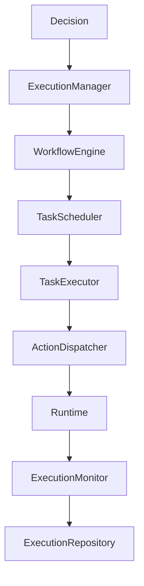

# RFC-0187

**Title:** Execution Architecture

**Document ID:** RFC-0187

**Version:** 1.0

**Status:** Accepted

**Category:** Runtime Architecture

**Layer:** Runtime / Execution / Executive Control

**Target:**

```text
architecture/execution/
```

---

# Abstract

This RFC defines the SH-3 Execution Architecture (EA).

The Execution Architecture establishes the unified execution framework responsible for transforming approved decisions into deterministic, observable, recoverable, and policy-compliant execution throughout the SH-3 AI Operating System Framework.

Execution is responsible for coordinating workflows, tasks, actions, resources, monitoring, recovery, and completion.

The Execution Architecture provides:

- execution orchestration
- workflow execution
- task scheduling
- action dispatch
- execution monitoring
- resource coordination
- failure recovery
- execution auditing
- execution optimization

The execution model:

```text
Decision

↓

Execution Plan

↓

Workflow

↓

Task

↓

Action

↓

Execution

↓

Observation

↓

Completion
```

Every execution SHALL be:

- typed
- deterministic
- observable
- recoverable
- policy-compliant
- auditable

This document is normative.

---

# Motivation

Decision making selects *what* should happen.

Execution determines *how* it happens.

Without a unified execution layer:

```text
Decision

↓

Direct Action

↓

Uncontrolled Execution
```

With Execution Architecture:

```text
Decision

↓

Execution Engine

↓

Controlled Workflow

↓

Observable Results
```

---

# Goals

The architecture SHALL provide:

- deterministic execution
- workflow orchestration
- concurrent task management
- execution monitoring
- automatic recovery
- execution traceability

---

# Non-Goals

The architecture SHALL NOT:

- replace Planning Architecture
- replace Runtime Scheduler
- replace Resource Management
- generate goals or decisions

---

# Architecture



---

# Design Principles

## Execution Is Deterministic

Identical inputs SHALL produce identical execution behavior.

---

## Workflow First

Execution SHALL occur through managed workflows.

---

## Recoverability

Failures SHALL trigger recovery procedures.

---

## Observability

Every execution SHALL be measurable.

---

## Isolation

Independent executions SHALL remain isolated.

---

# Components

| Component | Responsibility |
|---|---|
| ExecutionManager | Execution orchestration |
| WorkflowEngine | Workflow lifecycle |
| TaskScheduler | Task scheduling |
| TaskExecutor | Task execution |
| ActionDispatcher | Action dispatch |
| ExecutionMonitor | Runtime monitoring |
| ExecutionRepository | Execution history |
| RecoveryCoordinator | Failure recovery |

---

# Execution Model

Every execution SHALL contain:

```text
execution_id

workflow_id

plan_id

goal_id

status

priority

owner

started_at

completed_at

metadata
```

---

# Workflow Model

A workflow SHALL contain:

```text
Workflow

↓

Stages

↓

Tasks

↓

Actions
```

Each workflow SHALL support:

- sequential execution
- parallel execution
- conditional execution
- iterative execution

---

# Task Model

Every task SHALL contain:

```text
task_id

parent_workflow

dependencies

priority

status

assigned_executor

constraints
```

---

# Action Model

An action SHALL represent the smallest executable unit.

Examples:

```text
API Call

File Operation

Tool Invocation

Model Inference

Memory Update

State Transition
```

---

# Execution Lifecycle

Every execution SHALL follow:

```text
Created

↓

Scheduled

↓

Started

↓

Executing

↓

Monitoring

↓

Completed

↓

Verified

↓

Archived
```

---

# Scheduling

Execution scheduling SHALL consider:

```text
Priority

Dependencies

Resources

Policies

Deadlines
```

---

# Parallel Execution

The architecture SHALL support:

```text
Independent Tasks

Worker Pools

Task Groups

Barrier Synchronization
```

---

# Failure Handling

Failures SHALL trigger:

```text
Detection

↓

Classification

↓

Recovery

↓

Retry

↓

Escalation
```

---

# Recovery

Recovery SHALL support:

```text
Retry

Rollback

Compensation

Alternative Workflow

Safe Termination
```

Integration:

```text
RFC-0161 Self-Healing Architecture
```

---

# Resource Coordination

Execution SHALL coordinate:

```text
CPU

Memory

Storage

Network

GPU

External Services
```

---

# Decision Integration

Execution SHALL consume:

```text
Approved Decision
```

Integration:

```text
RFC-0186 Decision Architecture
```

---

# Goal Integration

Execution SHALL report progress to:

```text
Goal Manager
```

Integration:

```text
RFC-0185 Goal Management Architecture
```

---

# Context Integration

Execution SHALL maintain:

```text
Execution Context

Resource Context

Security Context
```

Integration:

```text
RFC-0184 Context Architecture
```

---

# Planning Integration

Execution SHALL consume:

```text
Execution Plan

↓

Workflow

↓

Tasks
```

Integration:

```text
RFC-0167 Planning Architecture
```

---

# Runtime Integration

Execution SHALL cooperate with:

```text
Runtime Scheduler

Thread Pool

Event Bus

State Manager
```

Integration:

```text
RFC-0156 Runtime Architecture
```

---

# Storage Integration

Execution history SHALL be persisted.

Integration:

```text
RFC-0180 Storage Architecture
```

---

# Security Integration

Execution SHALL enforce:

```text
Authorization

Integrity

Sandboxing

Audit Logging
```

Integration:

```text
RFC-0169 Security Architecture
```

---

# Event Integration

Execution events:

```text
ExecutionCreated

ExecutionStarted

TaskCompleted

ExecutionPaused

ExecutionFailed

ExecutionRecovered

ExecutionCompleted
```

Events SHALL follow:

```text
RFC-0152 Event Bus Architecture
```

---

# State Integration

Execution State SHALL maintain:

```text
ExecutionState

WorkflowState

TaskState

RecoveryState
```

Integration:

```text
RFC-0157 State Management Architecture
```

---

# Observability Integration

Execution telemetry SHALL include:

```text
Execution Count

Execution Latency

Task Throughput

Failure Rate

Recovery Rate

Resource Utilization
```

Integration:

```text
RFC-0171 Observability Architecture
```

---

# Testing Requirements

Execution Architecture SHALL support:

- workflow tests
- scheduling tests
- concurrency tests
- recovery tests
- performance tests
- stress tests

Integration:

```text
RFC-0172 Testing Architecture
```

---

# Thread Model

Execution SHALL support concurrent:

- workflows
- tasks
- actions
- monitoring
- recovery

Reference implementation SHALL be:

- deterministic
- thread-safe
- lock-efficient
- event-driven

---

# Performance Metrics

The architecture exposes:

```text
execution_latency

workflow_completion_rate

task_success_rate

resource_utilization

failure_rate

recovery_time
```

---

# Performance Objectives

The architecture should optimize for:

- predictable execution
- high throughput
- low latency
- reliable recovery
- efficient resource utilization

---

# Future Work

Potential enhancements:

- adaptive workflow optimization
- distributed execution engine
- autonomous workload balancing
- predictive execution scheduling
- self-optimizing execution pipelines

---

# References

- RFC-0186 Decision Architecture
- RFC-0185 Goal Management Architecture
- RFC-0167 Planning Architecture
- RFC-0161 Self-Healing Architecture
- RFC-0156 Runtime Architecture

---

# End of RFC-0187