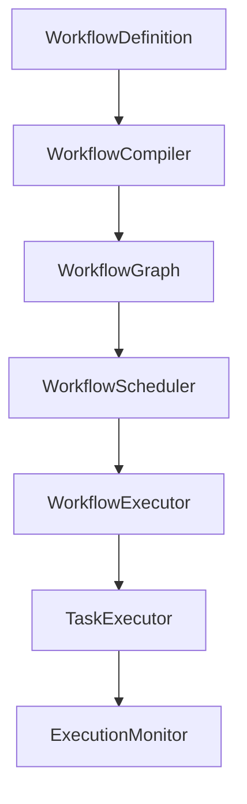

# RFC-0188

**Title:** Workflow Architecture

**Document ID:** RFC-0188

**Version:** 1.0

**Status:** Accepted

**Category:** Runtime Architecture

**Layer:** Runtime / Workflow / Orchestration

**Target:**

```text
architecture/workflow/
```

---

# Abstract

This RFC defines the SH-3 Workflow Architecture (WFA).

The Workflow Architecture establishes the execution orchestration framework responsible for modeling, validating, scheduling, coordinating, executing, recovering, and monitoring workflows throughout the SH-3 AI Operating System Framework.

A workflow represents a directed execution graph composed of stages, tasks, actions, conditions, synchronization points, and recovery paths.

The Workflow Architecture provides:

- workflow definition
- workflow compilation
- DAG execution
- conditional branching
- parallel execution
- synchronization
- retry handling
- compensation
- workflow recovery

The workflow model:

```text
Workflow

↓

Stage

↓

Task Group

↓

Task

↓

Action
```

Every workflow SHALL be:

- typed
- deterministic
- observable
- resumable
- recoverable
- versioned

This document is normative.

---

# Motivation

Large autonomous systems execute thousands of dependent operations.

Without workflow orchestration:

```text
Task

↓

Task

↓

Task

↓

Complex State
```

With Workflow Architecture:

```text
Workflow

↓

Execution Graph

↓

Controlled Coordination

↓

Reliable Execution
```

---

# Goals

The architecture SHALL provide:

- declarative workflow definition
- deterministic orchestration
- scalable execution graphs
- failure isolation
- workflow versioning
- execution replay

---

# Non-Goals

The architecture SHALL NOT:

- replace Execution Architecture
- replace Planning Architecture
- execute business logic
- replace Scheduling

---

# Architecture



---

# Design Principles

## Workflow As Graph

Every workflow SHALL be represented as a Directed Acyclic Graph (DAG), unless explicitly configured to support controlled iterative cycles.

---

## Declarative Definition

Workflows SHALL describe intent rather than implementation.

---

## Execution Isolation

Workflow failures SHALL remain isolated.

---

## Deterministic Scheduling

Execution order SHALL be reproducible.

---

## Recoverability

Interrupted workflows SHALL be resumable.

---

# Components

| Component | Responsibility |
|---|---|
| WorkflowManager | Workflow lifecycle |
| WorkflowCompiler | Definition validation |
| WorkflowGraph | DAG construction |
| WorkflowScheduler | Node scheduling |
| WorkflowExecutor | Workflow execution |
| BranchResolver | Conditional routing |
| SynchronizationManager | Join/barrier handling |
| CompensationManager | Recovery execution |
| WorkflowRepository | Persistence |

---

# Workflow Model

Every workflow SHALL contain:

```text
workflow_id

name

version

entry_node

exit_node

status

priority

metadata
```

---

# Workflow Node Types

Supported node types:

```text
Start

Stage

Task

Action

Condition

Decision

Parallel Split

Parallel Join

Loop

Delay

Event Wait

Compensation

End
```

---

# Workflow Edge Types

Supported transitions:

```text
Sequential

Conditional

Parallel

Failure

Retry

Compensation

Timeout
```

---

# Workflow Compilation

Compilation SHALL perform:

```text
Syntax Validation

↓

Graph Construction

↓

Cycle Detection

↓

Dependency Validation

↓

Optimization

↓

Executable Workflow
```

---

# Execution Modes

Supported modes:

```text
Sequential

Parallel

Conditional

Event Driven

Time Driven

Hybrid
```

---

# Branching

Conditional execution SHALL support:

```text
If

Else

Switch

Rule Evaluation

Policy Decision
```

---

# Parallel Execution

Workflow SHALL support:

```text
Fork

Barrier

Join

Worker Groups

Dynamic Fan-Out

Dynamic Fan-In
```

---

# Synchronization

Synchronization SHALL include:

```text
Barrier

Countdown

Join

Completion Trigger

Timeout
```

---

# Retry Policies

Supported retry strategies:

```text
Immediate Retry

Fixed Delay

Exponential Backoff

Jitter

Policy Controlled
```

---

# Compensation

Compensation SHALL support:

```text
Rollback

Reverse Action

Cleanup

Alternative Path

Manual Intervention
```

---

# Workflow Lifecycle

Every workflow SHALL follow:

```text
Defined

↓

Validated

↓

Compiled

↓

Scheduled

↓

Running

↓

Paused

↓

Recovered

↓

Completed

↓

Archived
```

---

# Execution Integration

Workflow SHALL execute through:

```text
Workflow

↓

Execution Engine

↓

Task Executor
```

Integration:

```text
RFC-0187 Execution Architecture
```

---

# Decision Integration

Decision nodes SHALL consume:

```text
Decision Manager
```

Integration:

```text
RFC-0186 Decision Architecture
```

---

# Goal Integration

Workflow SHALL report progress to:

```text
Goal Manager
```

Integration:

```text
RFC-0185 Goal Management Architecture
```

---

# Context Integration

Workflow SHALL maintain:

```text
Execution Context

Workflow Context

Stage Context
```

Integration:

```text
RFC-0184 Context Architecture
```

---

# Event Integration

Workflow events:

```text
WorkflowCreated

WorkflowCompiled

WorkflowStarted

WorkflowPaused

WorkflowResumed

WorkflowFailed

WorkflowRecovered

WorkflowCompleted
```

Events SHALL follow:

```text
RFC-0152 Event Bus Architecture
```

---

# Storage Integration

Workflow definitions and history SHALL be persisted.

Integration:

```text
RFC-0180 Storage Architecture
```

---

# Security Integration

Workflow SHALL enforce:

```text
Authorization

Integrity

Execution Policy

Audit Logging
```

Integration:

```text
RFC-0169 Security Architecture
```

---

# Observability Integration

Workflow telemetry SHALL include:

```text
Workflow Count

Execution Duration

Retry Count

Failure Count

Recovery Count

Node Latency
```

Integration:

```text
RFC-0171 Observability Architecture
```

---

# Testing Requirements

Workflow Architecture SHALL support:

- DAG validation tests
- branching tests
- synchronization tests
- retry tests
- compensation tests
- scalability tests

Integration:

```text
RFC-0172 Testing Architecture
```

---

# Thread Model

Workflow execution SHALL support concurrent:

- graph scheduling
- branch execution
- parallel stages
- synchronization
- recovery

Reference implementation SHALL be:

- deterministic
- thread-safe
- event-driven
- lock-efficient

---

# Performance Metrics

The architecture exposes:

```text
workflow_compile_latency

workflow_execution_latency

workflow_success_rate

parallel_efficiency

retry_rate

compensation_rate
```

---

# Performance Objectives

The architecture should optimize for:

- efficient orchestration
- scalable DAG execution
- low scheduling latency
- reliable recovery
- predictable execution

---

# Future Work

Potential enhancements:

- distributed workflow federation
- adaptive workflow optimization
- AI-assisted workflow synthesis
- speculative execution
- self-evolving workflows

---

# References

- RFC-0187 Execution Architecture
- RFC-0186 Decision Architecture
- RFC-0185 Goal Management Architecture
- RFC-0180 Storage Architecture
- RFC-0152 Event Bus Architecture

---

# End of RFC-0188