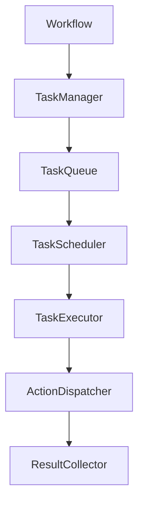

# RFC-0189

**Title:** Task Architecture

**Document ID:** RFC-0189

**Version:** 1.0

**Status:** Accepted

**Category:** Runtime Architecture

**Layer:** Runtime / Task Execution

**Target:**

```text
architecture/task/
```

---

# Abstract

This RFC defines the SH-3 Task Architecture (TA).

The Task Architecture establishes the standardized execution unit responsible for representing, scheduling, executing, monitoring, retrying, recovering, and completing individual tasks within the SH-3 AI Operating System Framework.

A task is the smallest schedulable execution unit managed by the runtime. Tasks execute one or more actions under defined execution constraints and lifecycle guarantees.

The Task Architecture provides:

- task definition
- task scheduling
- dependency management
- execution control
- retry policies
- timeout management
- cancellation
- compensation
- result management

The task model:

```text
Workflow

↓

Stage

↓

Task

↓

Action

↓

Result
```

Every task SHALL be:

- typed
- deterministic
- observable
- resumable
- recoverable
- auditable

This document is normative.

---

# Motivation

Execution engines require a uniform execution abstraction.

Without standardized tasks:

```text
Action

↓

Action

↓

Action

↓

Inconsistent Execution
```

With Task Architecture:

```text
Workflow

↓

Task

↓

Controlled Execution

↓

Verified Result
```

Tasks isolate execution complexity while providing deterministic runtime behavior.

---

# Goals

The architecture SHALL provide:

- standardized execution units
- deterministic lifecycle management
- dependency-aware scheduling
- reliable retries
- recoverable execution
- observable task state

---

# Non-Goals

The architecture SHALL NOT:

- replace Workflow Architecture
- replace Action execution
- perform planning
- manage business logic

---

# Architecture



---

# Design Principles

## Task Is Atomic

A task SHALL represent one logical execution unit.

---

## Explicit Lifecycle

Every task SHALL progress through a defined lifecycle.

---

## Dependency Awareness

Tasks SHALL respect dependency constraints.

---

## Recoverability

Interrupted tasks SHALL support retry or recovery according to policy.

---

## Traceability

Every task SHALL be fully auditable.

---

# Components

| Component | Responsibility |
|---|---|
| TaskManager | Task lifecycle orchestration |
| TaskQueue | Ready and waiting tasks |
| TaskScheduler | Scheduling decisions |
| TaskExecutor | Task execution |
| DependencyResolver | Dependency evaluation |
| RetryManager | Retry handling |
| ResultCollector | Result aggregation |
| TaskRepository | Persistent task history |

---

# Task Model

Every task SHALL contain:

```text
task_id

workflow_id

stage_id

parent_task

priority

status

dependencies

owner

deadline

retry_policy

timeout

metadata
```

---

# Task Types

Supported task types:

```text
Execution Task

IO Task

Computation Task

Tool Task

Model Task

Validation Task

Recovery Task

Maintenance Task
```

---

# Task Lifecycle

Every task SHALL follow:

```text
Created

↓

Validated

↓

Queued

↓

Scheduled

↓

Running

↓

Succeeded

↓

Verified

↓

Archived
```

Alternative transitions:

```text
Running

↓

Failed

↓

Retrying

↓

Recovered

↓

Completed
```

or

```text
Running

↓

Cancelled
```

---

# Dependency Management

Supported dependency models:

```text
Finish-To-Start

Start-To-Start

Finish-To-Finish

Conditional

Policy Controlled
```

---

# Scheduling

Scheduling SHALL consider:

```text
Priority

Dependencies

Deadlines

Resources

Execution Policies
```

---

# Retry Policies

Supported retry strategies:

```text
Immediate

Fixed Delay

Exponential Backoff

Randomized Jitter

Adaptive Retry
```

---

# Timeout Handling

Tasks SHALL support:

```text
Soft Timeout

Hard Timeout

Heartbeat Timeout

Idle Timeout
```

---

# Cancellation

Cancellation SHALL support:

```text
Immediate

Graceful

Deferred

Policy Driven
```

---

# Compensation

Compensation SHALL support:

```text
Rollback

Cleanup

Alternative Task

Recovery Workflow
```

Integration:

```text
RFC-0161 Self-Healing Architecture
```

---

# Result Model

Every completed task SHALL produce:

```text
result_id

task_id

status

duration

output

artifacts

metrics

logs

timestamp
```

---

# Execution Integration

Tasks SHALL execute through:

```text
Execution Manager

↓

Task Executor

↓

Action Dispatcher
```

Integration:

```text
RFC-0187 Execution Architecture
```

---

# Workflow Integration

Tasks SHALL belong to:

```text
Workflow

↓

Stage

↓

Task
```

Integration:

```text
RFC-0188 Workflow Architecture
```

---

# Decision Integration

Execution authorization SHALL originate from:

```text
Decision Manager
```

Integration:

```text
RFC-0186 Decision Architecture
```

---

# Event Integration

Task events:

```text
TaskCreated

TaskQueued

TaskStarted

TaskSucceeded

TaskFailed

TaskRetried

TaskCancelled

TaskCompleted
```

Events SHALL follow:

```text
RFC-0152 Event Bus Architecture
```

---

# Storage Integration

Task metadata, logs, and results SHALL be persisted.

Integration:

```text
RFC-0180 Storage Architecture
```

---

# Security Integration

Tasks SHALL enforce:

```text
Authorization

Sandboxing

Integrity

Audit Logging
```

Integration:

```text
RFC-0169 Security Architecture
```

---

# Observability Integration

Task telemetry SHALL include:

```text
Queue Length

Execution Time

Retry Count

Failure Rate

Success Rate

Average Latency
```

Integration:

```text
RFC-0171 Observability Architecture
```

---

# Testing Requirements

Task Architecture SHALL support:

- lifecycle tests
- dependency tests
- retry tests
- timeout tests
- cancellation tests
- stress tests

Integration:

```text
RFC-0172 Testing Architecture
```

---

# Thread Model

Task processing SHALL support concurrent:

- queue operations
- scheduling
- execution
- retries
- completion callbacks

Reference implementation SHALL be:

- deterministic
- thread-safe
- lock-efficient
- event-driven

---

# Performance Metrics

The architecture exposes:

```text
task_queue_depth

task_latency

task_success_rate

retry_rate

timeout_rate

average_execution_time
```

---

# Performance Objectives

The architecture should optimize for:

- predictable execution
- efficient scheduling
- high throughput
- rapid recovery
- low queue latency

---

# Future Work

Potential enhancements:

- distributed task scheduling
- predictive retry optimization
- adaptive queue prioritization
- speculative task execution
- autonomous task decomposition

---

# References

- RFC-0188 Workflow Architecture
- RFC-0187 Execution Architecture
- RFC-0161 Self-Healing Architecture
- RFC-0180 Storage Architecture
- RFC-0152 Event Bus Architecture

---

# End of RFC-0189