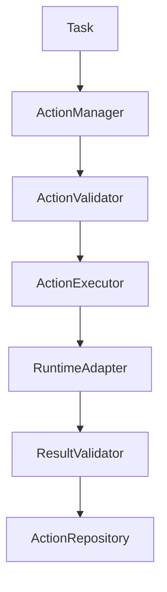

# RFC-0190

**Title:** Action Architecture

**Document ID:** RFC-0190

**Version:** 1.0

**Status:** Accepted

**Category:** Runtime Architecture

**Layer:** Runtime / Action Execution

**Target:**

```text
architecture/action/
```

---

# Abstract

This RFC defines the SH-3 Action Architecture (AA).

The Action Architecture establishes the standardized execution contract for the smallest executable unit within the SH-3 AI Operating System Framework.

An Action represents a single deterministic operation executed by the runtime. Actions consume validated inputs, execute within an isolated runtime context, and produce typed outputs with complete observability and auditability.

The Action Architecture provides:

- action definition
- input validation
- output validation
- execution contract
- timeout management
- idempotent execution
- rollback support
- compensation hooks
- execution telemetry

The action model:

```text
Task

↓

Action

↓

Execution Context

↓

Result
```

Every action SHALL be:

- typed
- deterministic
- idempotent when applicable
- observable
- auditable
- policy-compliant

This document is normative.

---

# Motivation

Tasks are composed of executable operations.

Without a standardized Action contract:

```text
Task

↓

Custom Code

↓

Inconsistent Runtime Behavior
```

With Action Architecture:

```text
Task

↓

Action Contract

↓

Validated Execution

↓

Typed Result
```

The Action layer provides a uniform execution interface for all runtime capabilities.

---

# Goals

The architecture SHALL provide:

- standardized execution contracts
- deterministic action execution
- typed inputs and outputs
- runtime isolation
- execution observability
- reusable action components

---

# Non-Goals

The architecture SHALL NOT:

- replace Task Architecture
- perform workflow scheduling
- generate execution plans
- manage high-level business logic

---

# Architecture



---

# Design Principles

## Action Is Atomic

Each action SHALL perform one logical operation.

---

## Explicit Contracts

Every action SHALL declare its interface.

---

## Isolation

Actions SHALL execute in isolated runtime contexts.

---

## Validation First

Inputs SHALL be validated before execution.

---

## Observable Execution

Every action SHALL emit telemetry and events.

---

# Components

| Component | Responsibility |
|---|---|
| ActionManager | Action orchestration |
| ActionRegistry | Action registration |
| ActionValidator | Input/output validation |
| ActionExecutor | Execution engine |
| RuntimeAdapter | Runtime abstraction |
| ResultValidator | Result verification |
| CompensationManager | Rollback hooks |
| ActionRepository | Action metadata |

---

# Action Model

Every action SHALL contain:

```text
action_id

action_type

name

version

owner

timeout

retry_policy

idempotent

security_level

metadata
```

---

# Input Contract

Every action SHALL declare:

```text
Input Schema

Required Fields

Optional Fields

Validation Rules

Constraints
```

---

# Output Contract

Every action SHALL produce:

```text
Status

Typed Output

Execution Metrics

Artifacts

Diagnostics
```

---

# Action Types

Supported action categories:

```text
Compute Action

Tool Action

API Action

File Action

Memory Action

Knowledge Action

State Action

Control Action

Recovery Action
```

---

# Execution Lifecycle

Every action SHALL follow:

```text
Created

↓

Validated

↓

Authorized

↓

Executing

↓

Completed

↓

Verified

↓

Archived
```

Alternative transitions:

```text
Executing

↓

Failed

↓

Retry

↓

Recovered
```

or

```text
Executing

↓

Cancelled
```

---

# Execution Context

Every action SHALL receive:

```text
Execution Context

Security Context

Resource Context

Task Context

Workflow Context
```

---

# Idempotency

Actions MAY declare:

```text
Strict Idempotent

Conditionally Idempotent

Non-Idempotent
```

Idempotency SHALL be enforced by the runtime when applicable.

---

# Timeout Policy

Supported timeout modes:

```text
Soft Timeout

Hard Timeout

Adaptive Timeout
```

---

# Retry Policy

Supported retry modes:

```text
Immediate

Fixed Delay

Exponential Backoff

Policy Controlled
```

---

# Rollback

Rollback SHALL support:

```text
Reverse Operation

Cleanup

Compensation Action

Recovery Workflow
```

Integration:

```text
RFC-0161 Self-Healing Architecture
```

---

# Action Composition

Actions MAY be composed into:

```text
Composite Action

Pipeline Action

Macro Action
```

Composite actions SHALL remain deterministic.

---

# Task Integration

Actions SHALL execute under:

```text
Task

↓

Action
```

Integration:

```text
RFC-0189 Task Architecture
```

---

# Workflow Integration

Actions SHALL inherit workflow execution context.

Integration:

```text
RFC-0188 Workflow Architecture
```

---

# Execution Integration

Action execution SHALL be coordinated by:

```text
Execution Manager
```

Integration:

```text
RFC-0187 Execution Architecture
```

---

# Decision Integration

Actions SHALL only execute after an approved decision.

Integration:

```text
RFC-0186 Decision Architecture
```

---

# Event Integration

Action events:

```text
ActionCreated

ActionValidated

ActionStarted

ActionCompleted

ActionFailed

ActionRetried

ActionCancelled
```

Events SHALL follow:

```text
RFC-0152 Event Bus Architecture
```

---

# Storage Integration

Action metadata and execution history SHALL be persisted.

Integration:

```text
RFC-0180 Storage Architecture
```

---

# Security Integration

Actions SHALL enforce:

```text
Authorization

Input Validation

Output Validation

Sandboxing

Audit Logging
```

Integration:

```text
RFC-0169 Security Architecture
```

---

# Observability Integration

Action telemetry SHALL include:

```text
Execution Count

Latency

Failure Rate

Retry Count

Resource Usage

Validation Errors
```

Integration:

```text
RFC-0171 Observability Architecture
```

---

# Testing Requirements

Action Architecture SHALL support:

- contract tests
- validation tests
- execution tests
- rollback tests
- timeout tests
- idempotency tests

Integration:

```text
RFC-0172 Testing Architecture
```

---

# Thread Model

Action execution SHALL support concurrent:

- validation
- execution
- rollback
- retries
- completion callbacks

Reference implementation SHALL be:

- deterministic
- thread-safe
- lock-efficient
- event-driven

---

# Performance Metrics

The architecture exposes:

```text
action_latency

action_success_rate

retry_rate

rollback_rate

validation_failure_rate

resource_consumption
```

---

# Performance Objectives

The architecture should optimize for:

- low execution latency
- predictable behavior
- safe execution
- reusable action contracts
- efficient resource utilization

---

# Future Work

Potential enhancements:

- distributed action execution
- adaptive timeout prediction
- autonomous action optimization
- action marketplaces
- AI-generated composite actions

---

# References

- RFC-0189 Task Architecture
- RFC-0188 Workflow Architecture
- RFC-0187 Execution Architecture
- RFC-0161 Self-Healing Architecture
- RFC-0152 Event Bus Architecture

---

# End of RFC-0190