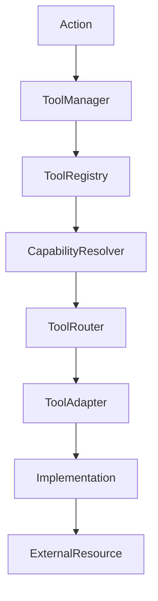

# RFC-0191

**Title:** Tool Architecture

**Document ID:** RFC-0191

**Version:** 1.0

**Status:** Accepted

**Category:** Runtime Architecture

**Layer:** Runtime / Tool System

**Target:**

```text
architecture/tools/
```

---

# Abstract

This RFC defines the SH-3 Tool Architecture (TLA).

The Tool Architecture establishes the standardized abstraction layer for integrating, registering, discovering, validating, executing, monitoring, and managing executable tools within the SH-3 AI Operating System Framework.

A Tool is an external or internal capability invoked by an Action through a unified execution contract. Tools encapsulate concrete implementations while exposing a stable, typed interface to the runtime.

The Tool Architecture provides:

- tool registration
- capability discovery
- tool versioning
- contract validation
- lifecycle management
- execution routing
- permission enforcement
- telemetry collection
- health monitoring

The tool model:

```text
Action

↓

Tool

↓

Adapter

↓

Implementation

↓

External Resource
```

Every tool SHALL be:

- typed
- versioned
- discoverable
- observable
- policy-compliant
- replaceable

This document is normative.

---

# Motivation

Runtime components interact with heterogeneous execution targets including local modules, remote APIs, databases, models, operating system services, and user-defined plugins.

Without a unified tool abstraction:

```text
Action

↓

Direct API Calls

↓

Custom Logic

↓

Tight Coupling
```

With Tool Architecture:

```text
Action

↓

Tool Contract

↓

Tool Adapter

↓

Implementation

↓

External System
```

The Tool Architecture isolates execution logic from implementation details and enables consistent lifecycle management.

---

# Goals

The architecture SHALL provide:

- unified tool abstraction
- deterministic tool invocation
- capability discovery
- implementation independence
- runtime extensibility
- execution observability

---

# Non-Goals

The architecture SHALL NOT:

- replace Action Architecture
- replace Plugin Architecture
- manage workflow execution
- implement business-specific tools

---

# Architecture



---

# Design Principles

## Tool Abstraction

Actions SHALL never depend on implementation details.

---

## Stable Contracts

Every tool SHALL expose a typed execution contract.

---

## Replaceability

Implementations SHALL be interchangeable without modifying callers.

---

## Discoverability

Tools SHALL be discoverable by declared capabilities.

---

## Least Privilege

Tool execution SHALL follow explicit permission policies.

---

# Components

| Component | Responsibility |
|---|---|
| ToolManager | Tool lifecycle orchestration |
| ToolRegistry | Tool registration |
| CapabilityResolver | Capability lookup |
| ToolRouter | Invocation routing |
| ToolAdapter | Implementation bridge |
| ToolValidator | Contract validation |
| ToolMonitor | Health monitoring |
| ToolRepository | Metadata persistence |

---

# Tool Model

Every tool SHALL contain:

```text
tool_id

name

version

capabilities

provider

implementation

permissions

health_status

metadata
```

---

# Tool Categories

SH-3 SHALL support:

```text
Internal Tool

External API Tool

LLM Tool

Database Tool

Storage Tool

Filesystem Tool

Network Tool

Operating System Tool

Plugin Tool

Diagnostic Tool
```

---

# Tool Contract

Every tool SHALL declare:

```text
Input Schema

Output Schema

Execution Constraints

Timeout

Retry Policy

Security Policy

Capability Set
```

---

# Tool Lifecycle

Every tool SHALL follow:

```text
Registered

↓

Validated

↓

Loaded

↓

Ready

↓

Executing

↓

Completed

↓

Monitored

↓

Retired
```

---

# Capability Discovery

Capability resolution SHALL support:

```text
Capability Name

Capability Version

Semantic Tags

Execution Policy

Provider
```

---

# Routing

Tool routing SHALL support:

```text
Direct Routing

Capability Routing

Policy Routing

Load-Based Routing

Fallback Routing
```

---

# Version Management

Every tool SHALL support:

```text
Semantic Versioning

Compatibility Rules

Upgrade Policy

Deprecation Policy
```

---

# Permission Model

Permissions SHALL include:

```text
Filesystem

Network

Memory

Process

Database

Secrets

Model Access
```

---

# Health Monitoring

Tool health SHALL expose:

```text
Availability

Latency

Failure Rate

Error Count

Resource Usage

Version Status
```

---

# Action Integration

Tools SHALL execute only through:

```text
Action

↓

Tool

↓

Adapter
```

Integration:

```text
RFC-0190 Action Architecture
```

---

# Task Integration

Tool invocation SHALL inherit task execution context.

Integration:

```text
RFC-0189 Task Architecture
```

---

# Execution Integration

Tool execution SHALL be coordinated by:

```text
Execution Manager
```

Integration:

```text
RFC-0187 Execution Architecture
```

---

# Plugin Integration

Plugin-provided tools SHALL satisfy the Tool contract.

Future integration:

```text
RFC-0192 Plugin Architecture
```

---

# Event Integration

Tool events:

```text
ToolRegistered

ToolLoaded

ToolInvoked

ToolSucceeded

ToolFailed

ToolUnloaded

ToolRetired
```

Events SHALL follow:

```text
RFC-0152 Event Bus Architecture
```

---

# Storage Integration

Tool metadata SHALL be persisted.

Integration:

```text
RFC-0180 Storage Architecture
```

---

# Security Integration

Tool execution SHALL enforce:

```text
Permission Validation

Capability Authorization

Sandbox Isolation

Secret Management

Audit Logging
```

Integration:

```text
RFC-0169 Security Architecture
```

---

# Observability Integration

Tool telemetry SHALL include:

```text
Invocation Count

Execution Latency

Success Rate

Failure Rate

Availability

Resource Consumption
```

Integration:

```text
RFC-0171 Observability Architecture
```

---

# Testing Requirements

Tool Architecture SHALL support:

- contract tests
- routing tests
- permission tests
- adapter tests
- compatibility tests
- stress tests

Integration:

```text
RFC-0172 Testing Architecture
```

---

# Thread Model

Tool execution SHALL support concurrent:

- registration
- discovery
- invocation
- health monitoring
- unloading

Reference implementation SHALL be:

- deterministic
- thread-safe
- lock-efficient
- event-driven

---

# Performance Metrics

The architecture exposes:

```text
tool_registration_latency

tool_lookup_latency

tool_invocation_latency

tool_success_rate

tool_health_score

tool_availability
```

---

# Performance Objectives

The architecture should optimize for:

- low invocation latency
- high availability
- safe execution
- rapid capability discovery
- implementation independence

---

# Future Work

Potential enhancements:

- distributed tool federation
- adaptive tool selection
- automatic capability negotiation
- AI-assisted tool composition
- self-healing tool replacement

---

# References

- RFC-0190 Action Architecture
- RFC-0189 Task Architecture
- RFC-0187 Execution Architecture
- RFC-0180 Storage Architecture
- RFC-0152 Event Bus Architecture

---

# End of RFC-0191