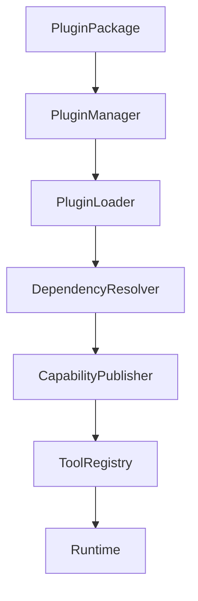

# RFC-0192

**Title:** Plugin Architecture

**Document ID:** RFC-0192

**Version:** 1.0

**Status:** Accepted

**Category:** Runtime Architecture

**Layer:** Runtime / Extension System

**Target:**

```text
architecture/plugins/
```

---

# Abstract

This RFC defines the SH-3 Plugin Architecture (PLA).

The Plugin Architecture establishes the standardized extension framework for dynamically adding, updating, isolating, validating, executing, and removing runtime capabilities within the SH-3 AI Operating System Framework.

A Plugin is a deployable package that contributes one or more capabilities to the runtime while remaining isolated from the core system through stable contracts and lifecycle management.

The Plugin Architecture provides:

- plugin discovery
- plugin registration
- dependency resolution
- lifecycle management
- capability publication
- sandbox isolation
- compatibility validation
- hot loading
- hot unloading

The plugin model:

```text
Plugin

↓

Capabilities

↓

Tools

↓

Actions

↓

Runtime
```

Every plugin SHALL be:

- versioned
- isolated
- discoverable
- observable
- replaceable
- policy-compliant

This document is normative.

---

# Motivation

An AI Operating System must evolve without modifying the core runtime.

Without plugins:

```text
New Feature

↓

Modify Core

↓

Rebuild Runtime
```

With Plugin Architecture:

```text
Plugin

↓

Registration

↓

Capability Publication

↓

Immediate Availability
```

The Plugin Architecture enables safe extensibility while preserving runtime stability.

---

# Goals

The architecture SHALL provide:

- dynamic extensibility
- implementation isolation
- dependency validation
- capability publication
- runtime safety
- deterministic lifecycle management

---

# Non-Goals

The architecture SHALL NOT:

- replace Tool Architecture
- replace Package Management
- manage workflow execution
- bypass security policies

---

# Architecture



---

# Design Principles

## Extension Without Modification

Core runtime SHALL remain unchanged when adding plugins.

---

## Capability-Based Integration

Plugins SHALL expose capabilities rather than implementation details.

---

## Isolation

Plugins SHALL execute within controlled runtime boundaries.

---

## Compatibility

Plugins SHALL satisfy declared compatibility constraints.

---

## Secure Execution

Plugin permissions SHALL be explicitly granted.

---

# Components

| Component | Responsibility |
|---|---|
| PluginManager | Lifecycle orchestration |
| PluginLoader | Loading and unloading |
| DependencyResolver | Dependency validation |
| CapabilityPublisher | Capability registration |
| CompatibilityValidator | Version checking |
| SandboxManager | Execution isolation |
| PluginRepository | Metadata storage |
| PluginMonitor | Health monitoring |

---

# Plugin Model

Every plugin SHALL contain:

```text
plugin_id

name

version

author

capabilities

dependencies

permissions

entry_point

metadata
```

---

# Plugin Package

A plugin package SHALL include:

```text
Manifest

Executable Modules

Configuration

Resources

Documentation

Signatures
```

---

# Manifest Schema

The manifest SHALL define:

```text
Plugin Name

Plugin Version

Runtime Compatibility

Capabilities

Permissions

Dependencies

Entry Point

Checksum
```

---

# Lifecycle

Every plugin SHALL follow:

```text
Discovered

↓

Validated

↓

Loaded

↓

Initialized

↓

Activated

↓

Running

↓

Suspended

↓

Stopped

↓

Unloaded
```

---

# Capability Publication

Plugins MAY publish:

```text
Tools

Actions

Services

Policies

Models

Providers

Hooks
```

Published capabilities SHALL be registered with the appropriate subsystem.

---

# Dependency Resolution

Dependency validation SHALL include:

```text
Plugin Dependencies

Version Constraints

Capability Availability

Conflict Detection
```

---

# Compatibility Rules

Compatibility SHALL verify:

```text
Runtime Version

RFC Version

API Version

Capability Version
```

---

# Hot Loading

The architecture SHALL support:

```text
Load

Reload

Update

Unload
```

without restarting the runtime whenever compatibility and policy checks succeed.

---

# Isolation

Plugin execution SHALL provide:

```text
Separate Namespace

Controlled Permissions

Resource Quotas

Failure Isolation

Sandbox Execution
```

---

# Security Model

Plugins SHALL request permissions for:

```text
Filesystem

Network

Database

Memory

Processes

Secrets

External APIs
```

Permission approval SHALL be governed by system policy.

---

# Tool Integration

Plugins MAY contribute Tool implementations.

Integration:

```text
RFC-0191 Tool Architecture
```

---

# Action Integration

Plugin tools SHALL satisfy the Action execution contract.

Integration:

```text
RFC-0190 Action Architecture
```

---

# Execution Integration

Plugins SHALL execute under the Runtime Execution Architecture.

Integration:

```text
RFC-0187 Execution Architecture
```

---

# Event Integration

Plugin events:

```text
PluginDiscovered

PluginValidated

PluginLoaded

PluginActivated

PluginSuspended

PluginUpdated

PluginUnloaded

PluginFailed
```

Events SHALL follow:

```text
RFC-0152 Event Bus Architecture
```

---

# Storage Integration

Plugin metadata SHALL be persisted.

Integration:

```text
RFC-0180 Storage Architecture
```

---

# Security Integration

Plugin execution SHALL enforce:

```text
Signature Verification

Permission Validation

Sandbox Enforcement

Integrity Checking

Audit Logging
```

Integration:

```text
RFC-0169 Security Architecture
```

---

# Observability Integration

Plugin telemetry SHALL include:

```text
Loaded Plugins

Plugin Startup Time

Invocation Count

Failure Rate

Memory Usage

Health Status
```

Integration:

```text
RFC-0171 Observability Architecture
```

---

# Testing Requirements

Plugin Architecture SHALL support:

- manifest validation tests
- compatibility tests
- dependency tests
- sandbox tests
- hot reload tests
- stress tests

Integration:

```text
RFC-0172 Testing Architecture
```

---

# Thread Model

Plugin management SHALL support concurrent:

- loading
- unloading
- capability publication
- dependency resolution
- health monitoring

Reference implementation SHALL be:

- deterministic
- thread-safe
- event-driven
- lock-efficient

---

# Performance Metrics

The architecture exposes:

```text
plugin_load_latency

plugin_activation_time

plugin_failure_rate

plugin_memory_usage

plugin_health_score

capability_registration_latency
```

---

# Performance Objectives

The architecture should optimize for:

- fast plugin loading
- reliable hot updates
- strong isolation
- low runtime overhead
- scalable extensibility

---

# Future Work

Potential enhancements:

- distributed plugin repositories
- signed plugin marketplace
- automatic dependency upgrades
- AI-assisted plugin generation
- live plugin migration

---

# References

- RFC-0191 Tool Architecture
- RFC-0190 Action Architecture
- RFC-0187 Execution Architecture
- RFC-0180 Storage Architecture
- RFC-0152 Event Bus Architecture

---

# End of RFC-0192