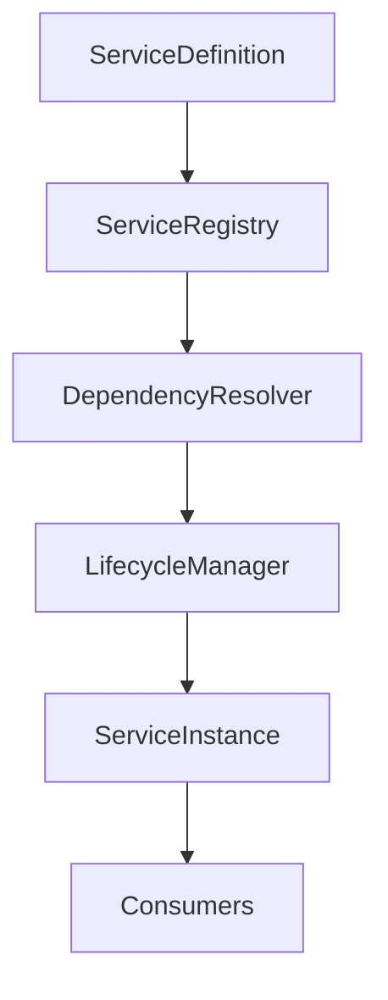

# RFC-0193

**Title:** Service Architecture

**Document ID:** RFC-0193

**Version:** 1.0

**Status:** Accepted

**Category:** Runtime Architecture

**Layer:** Runtime / Service Layer

**Target:**

```text
architecture/services/
```

---

# Abstract

This RFC defines the SH-3 Service Architecture (SVA).

The Service Architecture establishes the standardized model for long-lived runtime services within the SH-3 AI Operating System Framework. A Service encapsulates reusable capabilities, maintains controlled lifecycle state, exposes stable interfaces, and coordinates one or more tools, plugins, or internal modules.

Unlike Actions, which are short-lived execution units, Services are persistent runtime components responsible for providing capabilities across multiple execution cycles.

The Service Architecture provides:

- service registration
- service discovery
- lifecycle management
- dependency management
- service orchestration
- health monitoring
- configuration management
- state management
- graceful shutdown

The service model:

```text
Service

↓

Interface

↓

Implementation

↓

Resources

↓

Capabilities
```

Every service SHALL be:

- typed
- versioned
- discoverable
- observable
- configurable
- policy-compliant

This document is normative.

---

# Motivation

Many runtime capabilities must remain active beyond the execution of a single Action.

Without Services:

```text
Action

↓

Initialize Resource

↓

Execute

↓

Destroy Resource
```

With Services:

```text
Service

↓

Initialized Once

↓

Shared Usage

↓

Managed Lifecycle
```

Services improve efficiency, reuse, consistency, and operational stability.

---

# Goals

The architecture SHALL provide:

- persistent runtime capabilities
- reusable service interfaces
- lifecycle control
- dependency-aware initialization
- runtime health management
- scalable service composition

---

# Non-Goals

The architecture SHALL NOT:

- replace Tool Architecture
- replace Plugin Architecture
- replace Workflow execution
- manage deployment infrastructure

---

# Architecture



---

# Design Principles

## Long-Lived Components

Services SHALL persist independently of Action execution.

---

## Stable Interfaces

Consumers SHALL depend only on published service contracts.

---

## Dependency Injection

Service dependencies SHALL be explicitly declared.

---

## Lifecycle Ownership

The runtime SHALL own service lifecycle management.

---

## Observable Operations

All services SHALL expose health and telemetry.

---

# Components

| Component | Responsibility |
|---|---|
| ServiceManager | Service orchestration |
| ServiceRegistry | Registration and lookup |
| LifecycleManager | Startup and shutdown |
| DependencyResolver | Dependency graph resolution |
| ServiceFactory | Instance creation |
| ConfigurationProvider | Configuration injection |
| HealthMonitor | Health evaluation |
| ServiceRepository | Metadata persistence |

---

# Service Model

Every service SHALL contain:

```text
service_id

name

version

interfaces

dependencies

configuration

health_status

state

metadata
```

---

# Service Categories

Supported categories:

```text
Infrastructure Service

Runtime Service

Storage Service

Memory Service

Knowledge Service

Planning Service

Execution Service

Security Service

Monitoring Service

Plugin Service
```

---

# Service Interface

Every service SHALL define:

```text
Public API

Input Types

Output Types

Events

Configuration Schema

Health Contract
```

---

# Lifecycle

Every service SHALL follow:

```text
Registered

↓

Configured

↓

Initialized

↓

Started

↓

Running

↓

Paused

↓

Stopping

↓

Stopped

↓

Disposed
```

---

# Dependency Management

Dependencies SHALL support:

```text
Required Services

Optional Services

Version Constraints

Capability Requirements

Circular Dependency Detection
```

---

# Configuration

Configuration SHALL support:

```text
Default Values

Runtime Overrides

Environment Settings

Dynamic Reload

Validation Rules
```

---

# Health Management

Every service SHALL expose:

```text
Availability

Readiness

Liveness

Performance

Error Status
```

Health states:

```text
Healthy

Degraded

Recovering

Unavailable
```

---

# State Management

Services MAY maintain:

```text
Transient State

Persistent State

Cached State

Replicated State
```

State SHALL follow the Runtime State Management Architecture.

Integration:

```text
RFC-0157 State Management Architecture
```

---

# Service Discovery

Discovery SHALL support:

```text
Name

Capability

Version

Tags

Metadata
```

---

# Service Composition

Services MAY depend on:

```text
Other Services

Tools

Plugins

Providers

Adapters
```

Composition SHALL remain acyclic.

---

# Tool Integration

Services MAY expose or consume tools.

Integration:

```text
RFC-0191 Tool Architecture
```

---

# Plugin Integration

Plugins MAY provide service implementations.

Integration:

```text
RFC-0192 Plugin Architecture
```

---

# Execution Integration

Services SHALL execute within the Runtime Execution Architecture.

Integration:

```text
RFC-0187 Execution Architecture
```

---

# Event Integration

Service events:

```text
ServiceRegistered

ServiceConfigured

ServiceStarted

ServiceHealthy

ServiceDegraded

ServiceStopped

ServiceDisposed
```

Events SHALL follow:

```text
RFC-0152 Event Bus Architecture
```

---

# Storage Integration

Service metadata and persistent state SHALL be stored through:

```text
RFC-0180 Storage Architecture
```

---

# Security Integration

Services SHALL enforce:

```text
Authentication

Authorization

Configuration Validation

Secret Management

Audit Logging
```

Integration:

```text
RFC-0169 Security Architecture
```

---

# Observability Integration

Service telemetry SHALL include:

```text
Startup Time

Request Count

Latency

Error Rate

Availability

Resource Usage
```

Integration:

```text
RFC-0171 Observability Architecture
```

---

# Testing Requirements

Service Architecture SHALL support:

- lifecycle tests
- dependency tests
- health tests
- configuration tests
- concurrency tests
- resilience tests

Integration:

```text
RFC-0172 Testing Architecture
```

---

# Thread Model

Service management SHALL support concurrent:

- registration
- startup
- shutdown
- configuration reload
- health evaluation

Reference implementation SHALL be:

- deterministic
- thread-safe
- event-driven
- lock-efficient

---

# Performance Metrics

The architecture exposes:

```text
service_startup_latency

service_availability

service_error_rate

dependency_resolution_time

configuration_reload_latency

health_check_latency
```

---

# Performance Objectives

The architecture should optimize for:

- rapid initialization
- high availability
- efficient dependency resolution
- predictable lifecycle management
- low operational overhead

---

# Future Work

Potential enhancements:

- distributed service discovery
- service mesh integration
- automatic scaling
- autonomous service optimization
- self-healing service orchestration

---

# References

- RFC-0192 Plugin Architecture
- RFC-0191 Tool Architecture
- RFC-0187 Execution Architecture
- RFC-0180 Storage Architecture
- RFC-0157 State Management Architecture

---

# End of RFC-0193