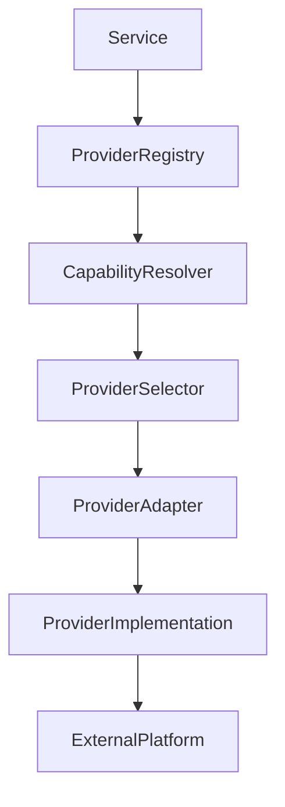

# RFC-0194

**Title:** Provider Architecture

**Document ID:** RFC-0194

**Version:** 1.0

**Status:** Accepted

**Category:** Runtime Architecture

**Layer:** Runtime / Provider Layer

**Target:**

```text
architecture/providers/
```

---

# Abstract

This RFC defines the SH-3 Provider Architecture (PRA).

The Provider Architecture establishes the standardized abstraction layer between SH-3 Services and concrete implementations such as LLMs, vector databases, storage engines, search engines, cloud platforms, operating system services, and external APIs.

A Provider implements one or more service contracts while remaining interchangeable through capability-based interfaces.

The Provider Architecture provides:

- provider abstraction
- provider registration
- capability negotiation
- provider discovery
- implementation selection
- provider failover
- provider health monitoring
- provider version management
- provider lifecycle management

The provider model:

```text
Service

↓

Provider Interface

↓

Provider Adapter

↓

Provider Implementation

↓

External Platform
```

Every provider SHALL be:

- typed
- versioned
- replaceable
- discoverable
- observable
- policy-compliant

This document is normative.

---

# Motivation

SH-3 must support multiple interchangeable implementations for the same capability.

Examples include:

- multiple LLM vendors
- multiple vector databases
- multiple storage engines
- multiple cloud platforms
- multiple search providers

Without a Provider layer:

```text
Service

↓

Vendor SDK

↓

Vendor Lock-In
```

With Provider Architecture:

```text
Service

↓

Provider Interface

↓

Adapter

↓

Implementation
```

This separation enables portability, resiliency, and runtime flexibility.

---

# Goals

The architecture SHALL provide:

- implementation independence
- capability-based selection
- runtime provider replacement
- automatic failover
- provider health management
- version compatibility

---

# Non-Goals

The architecture SHALL NOT:

- replace Service Architecture
- replace Tool Architecture
- implement vendor SDKs
- manage deployment infrastructure

---

# Architecture



---

# Design Principles

## Interface Before Implementation

Services SHALL depend only on provider interfaces.

---

## Capability-Based Selection

Providers SHALL be selected according to declared capabilities.

---

## Replaceability

Providers SHALL be interchangeable without changing consumers.

---

## Runtime Adaptability

Provider selection MAY change dynamically according to policy and health.

---

## Observable Operations

Every provider SHALL expose operational telemetry.

---

# Components

| Component | Responsibility |
|---|---|
| ProviderManager | Lifecycle management |
| ProviderRegistry | Registration and lookup |
| CapabilityResolver | Capability matching |
| ProviderSelector | Provider selection |
| ProviderAdapter | Vendor abstraction |
| ProviderMonitor | Health monitoring |
| CompatibilityValidator | Version validation |
| ProviderRepository | Metadata persistence |

---

# Provider Model

Every provider SHALL contain:

```text
provider_id

name

version

provider_type

capabilities

priority

health_status

metadata
```

---

# Provider Categories

Supported provider types:

```text
LLM Provider

Embedding Provider

Vector Database Provider

Storage Provider

Search Provider

Database Provider

Filesystem Provider

Network Provider

Cloud Provider

Identity Provider

Monitoring Provider
```

---

# Provider Interface

Every provider SHALL define:

```text
Capabilities

Supported Operations

Input Schema

Output Schema

Performance Profile

Compatibility Matrix
```

---

# Lifecycle

Every provider SHALL follow:

```text
Registered

↓

Validated

↓

Initialized

↓

Ready

↓

Selected

↓

Executing

↓

Monitoring

↓

Retired
```

---

# Provider Selection

Selection SHALL consider:

```text
Capabilities

Priority

Health

Policy

Latency

Cost

Availability
```

Selection strategies MAY include:

```text
Highest Priority

Lowest Latency

Round Robin

Weighted Distribution

Policy Driven

Cost Optimized
```

---

# Capability Negotiation

Capability resolution SHALL evaluate:

```text
Required Features

Optional Features

Version Compatibility

Security Requirements

Performance Requirements
```

---

# Failover

Provider failover SHALL support:

```text
Automatic Retry

Priority Fallback

Capability Re-Evaluation

Load Redistribution

Graceful Recovery
```

---

# Version Management

Providers SHALL support:

```text
Semantic Versioning

Backward Compatibility

Deprecation Policy

Migration Strategy
```

---

# Health Monitoring

Health SHALL include:

```text
Availability

Latency

Error Rate

Resource Usage

Success Rate

Connection Status
```

Health states:

```text
Healthy

Degraded

Recovering

Unavailable
```

---

# Service Integration

Services SHALL consume provider interfaces rather than provider implementations.

Integration:

```text
RFC-0193 Service Architecture
```

---

# Tool Integration

Tools MAY delegate execution to providers.

Integration:

```text
RFC-0191 Tool Architecture
```

---

# Plugin Integration

Plugins MAY register new providers.

Integration:

```text
RFC-0192 Plugin Architecture
```

---

# Event Integration

Provider events:

```text
ProviderRegistered

ProviderInitialized

ProviderSelected

ProviderUnavailable

ProviderRecovered

ProviderRetired
```

Events SHALL follow:

```text
RFC-0152 Event Bus Architecture
```

---

# Storage Integration

Provider metadata SHALL be persisted.

Integration:

```text
RFC-0180 Storage Architecture
```

---

# Security Integration

Providers SHALL enforce:

```text
Credential Management

Authentication

Authorization

Secure Transport

Audit Logging
```

Integration:

```text
RFC-0169 Security Architecture
```

---

# Observability Integration

Provider telemetry SHALL include:

```text
Invocation Count

Average Latency

Success Rate

Failure Rate

Health Score

Failover Count
```

Integration:

```text
RFC-0171 Observability Architecture
```

---

# Testing Requirements

Provider Architecture SHALL support:

- compatibility tests
- failover tests
- capability matching tests
- health monitoring tests
- selection strategy tests
- concurrency tests

Integration:

```text
RFC-0172 Testing Architecture
```

---

# Thread Model

Provider management SHALL support concurrent:

- registration
- capability resolution
- selection
- monitoring
- failover

Reference implementation SHALL be:

- deterministic
- thread-safe
- event-driven
- lock-efficient

---

# Performance Metrics

The architecture exposes:

```text
provider_selection_latency

provider_health_score

provider_failover_time

provider_success_rate

provider_utilization

provider_availability
```

---

# Performance Objectives

The architecture should optimize for:

- rapid provider selection
- low execution latency
- seamless failover
- implementation portability
- high runtime availability

---

# Future Work

Potential enhancements:

- AI-assisted provider selection
- predictive failover
- multi-provider consensus execution
- distributed provider federation
- autonomous provider optimization

---

# References

- RFC-0193 Service Architecture
- RFC-0192 Plugin Architecture
- RFC-0191 Tool Architecture
- RFC-0180 Storage Architecture
- RFC-0171 Observability Architecture

---

# End of RFC-0194