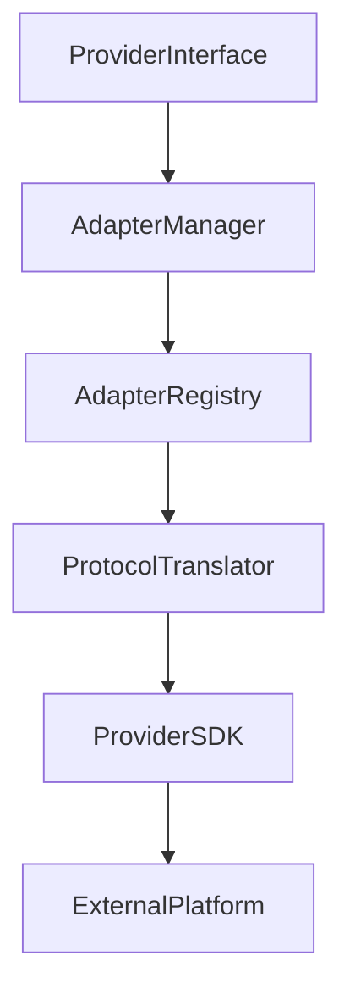

# RFC-0195

**Title:** Adapter Architecture

**Document ID:** RFC-0195

**Version:** 1.0

**Status:** Accepted

**Category:** Runtime Architecture

**Layer:** Runtime / Adapter Layer

**Target:**

```text
architecture/adapters/
```

---

# Abstract

This RFC defines the SH-3 Adapter Architecture (ADA).

The Adapter Architecture establishes the standardized translation layer between Provider Interfaces and concrete provider implementations within the SH-3 AI Operating System Framework.

An Adapter translates typed SH-3 contracts into provider-specific protocols, SDK calls, network requests, operating system APIs, or other implementation-specific interactions while preserving deterministic behavior and standardized error semantics.

The Adapter Architecture provides:

- interface translation
- protocol conversion
- request normalization
- response normalization
- exception translation
- provider isolation
- compatibility adaptation
- connection management
- execution instrumentation

The adapter model:

```text
Service

↓

Provider Interface

↓

Adapter

↓

Provider SDK

↓

External Platform
```

Every adapter SHALL be:

- typed
- deterministic
- replaceable
- stateless when practical
- observable
- testable

This document is normative.

---

# Motivation

Providers expose heterogeneous interfaces.

Without adapters:

```text
Service

↓

Vendor SDK

↓

Vendor-Specific Logic

↓

Application
```

With Adapter Architecture:

```text
Service

↓

Provider Interface

↓

Adapter

↓

Implementation
```

Adapters isolate implementation-specific behavior and preserve runtime consistency.

---

# Goals

The architecture SHALL provide:

- protocol abstraction
- provider isolation
- request normalization
- response normalization
- deterministic translation
- standardized error handling

---

# Non-Goals

The architecture SHALL NOT:

- replace Provider Architecture
- replace Service Architecture
- implement business logic
- manage provider selection

---

# Architecture



---

# Design Principles

## Translation Only

Adapters SHALL translate interfaces without changing business semantics.

---

## Statelessness

Adapters SHOULD remain stateless whenever feasible.

---

## Deterministic Mapping

Equivalent requests SHALL produce equivalent translated operations.

---

## Explicit Contracts

Input and output mappings SHALL be formally defined.

---

## Failure Isolation

Provider-specific failures SHALL be translated into standardized runtime errors.

---

# Components

| Component | Responsibility |
|---|---|
| AdapterManager | Adapter lifecycle |
| AdapterRegistry | Adapter registration |
| ProtocolTranslator | Protocol conversion |
| RequestNormalizer | Input normalization |
| ResponseNormalizer | Output normalization |
| ErrorTranslator | Exception mapping |
| ConnectionManager | Connection lifecycle |
| AdapterRepository | Metadata persistence |

---

# Adapter Model

Every adapter SHALL contain:

```text
adapter_id

name

version

provider_type

supported_protocols

supported_versions

configuration

metadata
```

---

# Adapter Categories

Supported adapter types:

```text
REST Adapter

gRPC Adapter

WebSocket Adapter

SDK Adapter

Filesystem Adapter

Database Adapter

Message Queue Adapter

CLI Adapter

LLM Adapter

Operating System Adapter
```

---

# Translation Pipeline

Every invocation SHALL follow:

```text
Typed Request

↓

Normalization

↓

Protocol Translation

↓

Provider Invocation

↓

Response Translation

↓

Normalization

↓

Typed Response
```

---

# Request Normalization

Normalization SHALL validate:

```text
Schema

Data Types

Constraints

Encoding

Defaults
```

---

# Response Normalization

Responses SHALL normalize:

```text
Output Types

Metadata

Status Codes

Metrics

Diagnostics
```

---

# Error Translation

Provider-specific failures SHALL map to standardized runtime errors:

```text
Timeout

Authentication Failure

Authorization Failure

Unavailable

Conflict

Validation Error

Internal Error
```

---

# Connection Management

Adapters MAY manage:

```text
Persistent Connections

Connection Pools

Session State

Retries

Circuit Breakers
```

---

# Compatibility

Adapters SHALL declare:

```text
Supported Provider Versions

Supported API Versions

Protocol Versions

Compatibility Rules
```

---

# Provider Integration

Adapters SHALL implement Provider Interfaces.

Integration:

```text
RFC-0194 Provider Architecture
```

---

# Service Integration

Services SHALL communicate exclusively through Provider Interfaces.

Integration:

```text
RFC-0193 Service Architecture
```

---

# Tool Integration

Tool implementations MAY delegate provider communication to adapters.

Integration:

```text
RFC-0191 Tool Architecture
```

---

# Event Integration

Adapter events:

```text
AdapterRegistered

AdapterLoaded

RequestTranslated

ProviderInvoked

ResponseTranslated

AdapterFailed

AdapterUnloaded
```

Events SHALL follow:

```text
RFC-0152 Event Bus Architecture
```

---

# Storage Integration

Adapter metadata SHALL be persisted.

Integration:

```text
RFC-0180 Storage Architecture
```

---

# Security Integration

Adapters SHALL enforce:

```text
Credential Protection

Transport Security

Request Validation

Response Validation

Audit Logging
```

Integration:

```text
RFC-0169 Security Architecture
```

---

# Observability Integration

Adapter telemetry SHALL include:

```text
Translation Latency

Invocation Count

Protocol Errors

Connection Pool Usage

Retry Count

Error Distribution
```

Integration:

```text
RFC-0171 Observability Architecture
```

---

# Testing Requirements

Adapter Architecture SHALL support:

- protocol translation tests
- compatibility tests
- normalization tests
- error mapping tests
- performance tests
- concurrency tests

Integration:

```text
RFC-0172 Testing Architecture
```

---

# Thread Model

Adapter execution SHALL support concurrent:

- request translation
- connection reuse
- response normalization
- retry handling
- metrics collection

Reference implementation SHALL be:

- deterministic
- thread-safe
- lock-efficient
- event-driven

---

# Performance Metrics

The architecture exposes:

```text
translation_latency

adapter_success_rate

connection_reuse_rate

protocol_error_rate

normalization_latency

adapter_availability
```

---

# Performance Objectives

The architecture should optimize for:

- minimal translation overhead
- efficient connection reuse
- standardized interoperability
- predictable latency
- implementation independence

---

# Future Work

Potential enhancements:

- adaptive protocol optimization
- automatic adapter generation
- multi-protocol negotiation
- AI-assisted schema translation
- distributed adapter federation

---

# References

- RFC-0194 Provider Architecture
- RFC-0193 Service Architecture
- RFC-0191 Tool Architecture
- RFC-0180 Storage Architecture
- RFC-0171 Observability Architecture

---

# End of RFC-0195