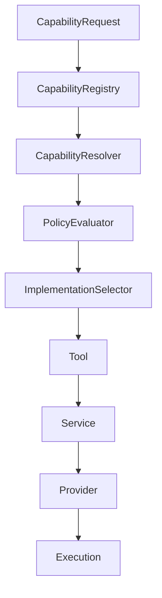

# RFC-0196

**Title:** Capability Architecture

**Document ID:** RFC-0196

**Version:** 1.0

**Status:** Accepted

**Category:** Cross Layer Architecture

**Layer:** Cross-Cutting / Capability Model

**Target:**

```text
architecture/capabilities/
```

---

# Abstract

This RFC defines the SH-3 Capability Architecture (CPA).

The Capability Architecture establishes the canonical abstraction used to describe, discover, negotiate, authorize, compose, and invoke functionality across the SH-3 AI Operating System Framework.

A Capability represents *what the system can do*, independent of *how the functionality is implemented*. Concrete implementations MAY be provided by Services, Tools, Providers, Plugins, or future extension mechanisms.

The Capability Architecture provides:

- capability definition
- capability registration
- capability discovery
- capability negotiation
- capability composition
- capability authorization
- capability versioning
- capability lifecycle
- capability observability

Every capability SHALL be:

- typed
- uniquely identifiable
- discoverable
- composable
- versioned
- policy-controlled
- implementation-independent

This document is normative.

---

# Motivation

Multiple runtime components expose similar functionality through different implementations.

Without a unified capability model:

```text
Action

↓

Tool

↓

Provider A
```

or

```text
Action

↓

Service

↓

Provider B
```

Capability resolution becomes implementation-specific.

With Capability Architecture:

```text
Capability Request

↓

Capability Resolution

↓

Implementation Selection

↓

Execution
```

Consumers depend only on capabilities, not implementations.

---

# Goals

The architecture SHALL provide:

- implementation-independent functionality
- unified capability discovery
- dynamic capability resolution
- composable capabilities
- runtime extensibility
- deterministic capability selection

---

# Non-Goals

The architecture SHALL NOT:

- replace Services
- replace Tools
- replace Providers
- execute business logic

---

# Architecture



---

# Design Principles

## Capability First

Consumers SHALL depend on capabilities rather than concrete implementations.

---

## Implementation Independence

Capability contracts SHALL remain stable regardless of implementation changes.

---

## Composability

Capabilities MAY be combined to form higher-level capabilities.

---

## Discoverability

Capabilities SHALL be queryable at runtime.

---

## Policy Enforcement

Capability usage SHALL be governed by authorization and policy evaluation.

---

# Components

| Component | Responsibility |
|---|---|
| CapabilityManager | Lifecycle management |
| CapabilityRegistry | Registration and lookup |
| CapabilityResolver | Resolution engine |
| CapabilityComposer | Composition |
| PolicyEvaluator | Authorization |
| CompatibilityValidator | Version compatibility |
| CapabilityRepository | Persistence |
| CapabilityMonitor | Observability |

---

# Capability Model

Every capability SHALL contain:

```text
capability_id

name

namespace

version

description

category

required_permissions

provided_interfaces

metadata
```

---

# Capability Categories

Supported capability categories include:

```text
Reasoning

Planning

Execution

Memory

Knowledge

Storage

Network

Filesystem

Model

Security

Monitoring

Learning

Optimization
```

---

# Capability Lifecycle

Every capability SHALL follow:

```text
Defined

↓

Registered

↓

Validated

↓

Published

↓

Available

↓

Invoked

↓

Observed

↓

Deprecated

↓

Retired
```

---

# Capability Discovery

Discovery SHALL support queries by:

```text
Identifier

Namespace

Category

Tags

Version

Provider

Interface
```

---

# Capability Resolution

Resolution SHALL evaluate:

```text
Capability Match

Policy

Compatibility

Priority

Health

Availability
```

---

# Capability Composition

Capabilities MAY be composed as:

```text
Composite Capability

Pipeline Capability

Hierarchical Capability

Delegated Capability
```

Composite capabilities SHALL expose a single logical contract.

---

# Versioning

Capabilities SHALL support:

```text
Semantic Versioning

Backward Compatibility

Deprecation

Migration
```

---

# Authorization

Capability invocation SHALL require:

```text
Permission Validation

Policy Evaluation

Execution Context

Security Context
```

---

# Service Integration

Services MAY publish one or more capabilities.

Integration:

```text
RFC-0193 Service Architecture
```

---

# Tool Integration

Tools SHALL advertise supported capabilities.

Integration:

```text
RFC-0191 Tool Architecture
```

---

# Provider Integration

Providers SHALL implement capability contracts.

Integration:

```text
RFC-0194 Provider Architecture
```

---

# Plugin Integration

Plugins MAY contribute new capabilities.

Integration:

```text
RFC-0192 Plugin Architecture
```

---

# Action Integration

Actions SHALL request capabilities rather than specific implementations.

Integration:

```text
RFC-0190 Action Architecture
```

---

# Event Integration

Capability events:

```text
CapabilityRegistered

CapabilityPublished

CapabilityResolved

CapabilityInvoked

CapabilityDeprecated

CapabilityRetired
```

Events SHALL follow:

```text
RFC-0152 Event Bus Architecture
```

---

# Storage Integration

Capability metadata SHALL be persisted.

Integration:

```text
RFC-0180 Storage Architecture
```

---

# Security Integration

Capability execution SHALL enforce:

```text
Authorization

Permission Validation

Policy Enforcement

Audit Logging
```

Integration:

```text
RFC-0169 Security Architecture
```

---

# Observability Integration

Capability telemetry SHALL include:

```text
Invocation Count

Resolution Latency

Selection Accuracy

Failure Rate

Availability

Usage Distribution
```

Integration:

```text
RFC-0171 Observability Architecture
```

---

# Testing Requirements

Capability Architecture SHALL support:

- registry tests
- discovery tests
- resolution tests
- composition tests
- authorization tests
- compatibility tests

Integration:

```text
RFC-0172 Testing Architecture
```

---

# Thread Model

Capability management SHALL support concurrent:

- registration
- discovery
- resolution
- publication
- retirement

Reference implementation SHALL be:

- deterministic
- thread-safe
- lock-efficient
- event-driven

---

# Performance Metrics

The architecture exposes:

```text
capability_resolution_latency

capability_lookup_latency

capability_success_rate

capability_usage_rate

capability_availability

composition_latency
```

---

# Performance Objectives

The architecture should optimize for:

- fast capability resolution
- minimal lookup overhead
- implementation independence
- scalable discovery
- deterministic behavior

---

# Future Work

Potential enhancements:

- semantic capability reasoning
- ontology-driven capability discovery
- AI-assisted capability composition
- distributed capability federation
- autonomous capability optimization

---

# References

- RFC-0195 Adapter Architecture
- RFC-0194 Provider Architecture
- RFC-0193 Service Architecture
- RFC-0192 Plugin Architecture
- RFC-0191 Tool Architecture

---

# End of RFC-0196